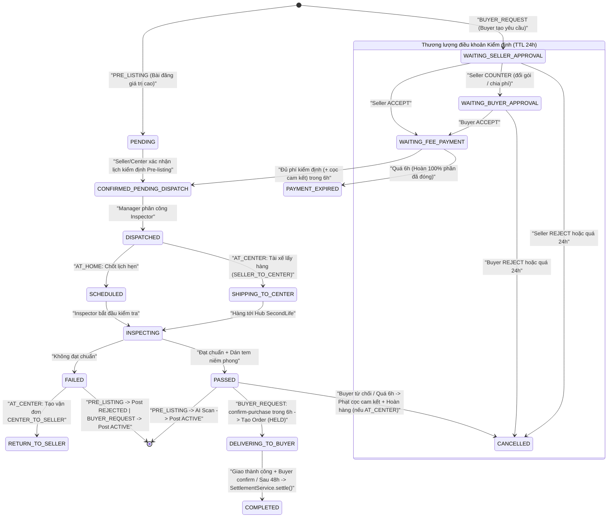
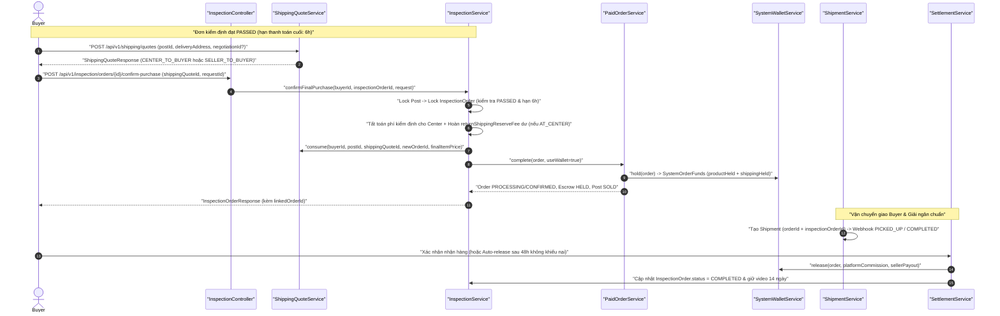

# KẾ HOẠCH TRIỂN KHAI CHI TIẾT (IMPLEMENTATION PLAN)
## KHẮC PHỤC & HỢP NHẤT LUỒNG KIỂM ĐỊNH SẢN PHẨM VÀ MUA HÀNG KÈM KIỂM ĐỊNH — SECONDLIFE BACKEND

- **Ngày lập**: 30/10/2026
- **Phạm vi**: Backend (`BE_SecondLife/secondLife` — package gốc `com.secondlife.secondlife`)
- **Tài liệu ràng buộc kiến trúc**:
  - [BACKEND_CODING_STANDARDS.md](file:///p:/FPT/Capstone/BE_SecondLife/secondLife/docs/BACKEND_CODING_STANDARDS.md)
  - [BACKEND_MODULE_BOUNDARIES.md](file:///p:/FPT/Capstone/BE_SecondLife/secondLife/docs/BACKEND_MODULE_BOUNDARIES.md)
- **Trạng thái**: Chờ duyệt trước khi triển khai code & migration `V66`

---

## 1. Mục tiêu & Nguyên tắc Kiến trúc Bắt buộc

Kế hoạch này giải quyết triệt để **7 lỗ hổng nghiệp vụ và kỹ thuật** đã phát hiện khi rà soát luồng Kiểm định (`Inspection`) và Mua hàng kèm Kiểm định (`Inspection + Order + Shipping + Escrow`), đảm bảo khép kín dòng tiền và trạng thái từ lúc yêu cầu kiểm định đến khi tất toán cho Người bán (`Seller`), Trung tâm kiểm định (`Inspection Center`) và Ví hệ thống (`SystemWallet`).

> [!IMPORTANT]
> Mọi thay đổi trong kế hoạch này tuân thủ nghiêm ngặt quy chuẩn dự án và phải vượt qua bộ test kiến trúc tự động `ModuleBoundariesTest` và `PackageArchitectureTest`.

### 1.1. Ràng buộc cấu trúc & phụ thuộc module
1. **Giữ nguyên cấu trúc phẳng theo layer** tại `com.secondlife.secondlife`: `controller/`, `dto/request/`, `dto/response/`, `entity/`, `repository/`, `mapper/`, `service/`, `service/impl/`, `scheduler/`, `enums/`. Tuyệt đối không tạo package con theo tính năng.
2. **DTO & Mapper**:
   - Toàn bộ DTO mới trong `dto/request/` và `dto/response/` bắt buộc là `record`.
   - Mapper dùng `@Component` class ủy quyền cho `interface Delegate` cấu hình `@Mapper(config = MapStructConfiguration.class)`, không query DB trong Mapper.
3. **Ranh giới Service (`ModuleBoundariesTest`)**:
   - Class `@Service` trong `service/impl/` **chỉ được inject interface trong `service/`**, tuyệt đối không inject trực tiếp `*ServiceImpl` khác.
   - Không thêm repository trái phép vào 6 seam đại diện đang bị khóa kiểm tra (`AuthServiceImpl`, `ListingAccessServiceImpl`, `OrderConfirmationServiceImpl`, `InspectionOrderChecklistServiceImpl`, `ShippingCatalogServiceImpl`, `WalletQueryServiceImpl`).
4. **Thứ tự khóa bi quan (Pessimistic Lock Ordering) chống Deadlock**:
   - Mọi transaction khóa nhiều bản ghi bắt buộc tuân thủ thứ tự bất biến:
     `Post` -> `Order` (nếu đã tồn tại) -> `InspectionOrder` -> `SystemWallet ('MAIN')` -> `UserWallet` (theo thứ tự UUID tăng dần nếu khóa >1 ví) -> `SellerReputation`.
   - Không giữ DB transaction / row lock khi gọi HTTP ra ngoài (Lalamove, Gemini AI, Cloudinary) — tách pha đọc/chuẩn bị và pha ghi bằng `TransactionTemplate` giống [ShipmentServiceImpl.java](file:///p:/FPT/Capstone/BE_SecondLife/secondLife/src/main/java/com/secondlife/secondlife/service/impl/ShipmentServiceImpl.java).
5. **Tương thích ngược (Backward Compatibility)**:
   - Không đổi URL, tên trường JSON hiện có hoặc kiểu trả về của các API mà FE Web và 3 app Flutter (`Buyer`, `Seller`, `Inspector`) đang gọi; các trường mở rộng trong request đều có fallback an toàn nếu client cũ chưa truyền.

---

## 2. Ma trận Tổng hợp 7 Vấn đề & Giải pháp Đích

| Mã WP | Mức độ | Vấn đề hiện tại trong Backend | Giải pháp kiến trúc đích |
| :---: | :---: | :--- | :--- |
| **WP-1** | **P0 (Bug 500)** | [`InspectionOrderRepository.findByPostId`](file:///p:/FPT/Capstone/BE_SecondLife/secondLife/src/main/java/com/secondlife/secondlife/repository/InspectionOrderRepository.java#L43) trả `Optional<InspectionOrder>` gây lỗi `IncorrectResultSizeDataAccessException` (HTTP 500) ngay khi 1 bài đăng có từ 2 đơn kiểm định trở lên (VD: đơn 1 hủy/hết hạn, đơn 2 tạo mới). | Thay bằng query trả danh sách/đơn active mới nhất + thêm **Partial Unique Index** ở PostgreSQL (`V66`) chặn tuyệt đối tạo 2 đơn kiểm định đang active trên cùng 1 `post_id`. |
| **WP-2** | **P1 (Bug Logic)** | Luồng kiểm định bài đăng giá trị cao (`> 5.000.000 VND`) lệch trạng thái: [`ListingPublicationServiceImpl`](file:///p:/FPT/Capstone/BE_SecondLife/secondLife/src/main/java/com/secondlife/secondlife/service/impl/ListingPublicationServiceImpl.java#L66) gán `PENDING_INSPECTION`, nhưng [`InspectionServiceImpl.submitResult`](file:///p:/FPT/Capstone/BE_SecondLife/secondLife/src/main/java/com/secondlife/secondlife/service/impl/InspectionServiceImpl.java#L900) lại kiểm tra `PENDING_APPROVAL`; tệ hơn, khi `FAILED` (dòng 866) lại gán `post.status = "ACTIVE"` làm hàng giả/lỗi tự động lên sàn mà không tốn credit! | Phân tách tường minh `inspection_scope` (`PRE_LISTING` vs `BUYER_REQUEST`). Với `PRE_LISTING`: `PASSED` -> tách pha AI scan ngoài lock rồi gọi `publication.activate(post)` (trừ credit); `FAILED` -> `post.status = "REJECTED"` kèm lý do từ biên bản KTV. |
| **WP-3** | **P0 (Deadlock luồng)** | Khi Seller chọn `COUNTER`, đơn chuyển sang `WAITING_BUYER_APPROVAL` nhưng **không có API cho Buyer phản hồi**, bỏ qua `counterOrderType`, và không có Scheduler hết hạn -> `Post` bị kẹt vĩnh viễn ở `RESERVED`. | Xử lý đầy đủ `counterOrderType` + `counterFeePayer`, bổ sung API `POST /api/v1/inspection/requests/{orderId}/buyer-respond` (`ACCEPT` / `REJECT`) và bổ sung `approval_deadline` (mặc định 24h) quét tự động bởi Scheduler. |
| **WP-4** | **P1 (Đứt luồng)** | Thương lượng giá (`Negotiation` `ACCEPTED` -> `post.status = "RESERVED"`) bị chặn hoàn toàn khỏi `requestInspection` (vì chỉ nhận `post.status == "ACTIVE"`) và `submitResult` dòng 897 ghi đè `finalItemPrice = post.getPrice()`. | Bổ sung `negotiationId` tùy chọn vào `InspectionBuyRequest` và cột `negotiation_id` vào `inspection_orders`; khóa cứng `finalItemPrice = negotiation.offeredPrice`, đóng băng hạn `Negotiation` trong thời gian kiểm định. |
| **WP-5** | **P0 (Lỗ hổng Tài chính)** | [`confirmFinalPurchase`](file:///p:/FPT/Capstone/BE_SecondLife/secondLife/src/main/java/com/secondlife/secondlife/service/impl/InspectionServiceImpl.java#L498-L563) trừ thẳng ví Buyer (`finalShippingFee` luôn `null`/`0`), không tạo `Order`, không giữ tiền ở `SystemWallet`, không chụp `OrderCommissionSnapshot`, khiến **Seller không bao giờ nhận được tiền bán hàng**, mất cơ chế khiếu nại 48h & tự động giải ngân. | Hợp nhất `confirmFinalPurchase` với pipeline chuẩn: cho phép lấy `ShippingQuote` cho bài đăng `RESERVED` đã `PASSED`, tạo bản ghi `Order` liên kết `inspectionOrder.setOrder(order)`, chụp hoa hồng, giữ tiền vào `SystemWallet` qua `PaidOrderService`, đồng bộ `SettlementService.settle()` để tất toán cho Seller và chuyển `InspectionOrder` -> `COMPLETED`. |
| **WP-6** | **P1 (Đứt vận đơn)** | 1) `ShipmentServiceImpl.prepareForOrder` tạo chặng `CENTER_TO_BUYER` với `inspectionId = null` nên webhook Lalamove không bao giờ cập nhật `InspectionOrder` hay ghi log tem niêm phong.<br>2) Khi `AT_CENTER` bị `FAILED` hoặc Buyer từ chối mua sau `PASSED`, hàng nằm tại Trung tâm nhưng không tạo được vận đơn hoàn trả `CENTER_TO_SELLER`. | 1) Gắn `inspection.getId()` vào `Shipment` cho cả `CENTER_TO_BUYER` và `SELLER_TO_BUYER` (đơn có kiểm định); sửa điều kiện log tem niêm phong theo chặng.<br>2) Mở rộng `prepareForInspection` hỗ trợ chặng hoàn trả `CENTER_TO_SELLER` dùng quỹ `returnShippingReserveFee`. |
| **WP-7** | **P1 (Lệch kế toán)** | Phí kiểm định thu xong không được hạch toán trả cho Trung tâm/KTV; khi Buyer từ chối mua sau `PASSED`, hệ thống chuyển **100% `buyerFeeShare` cho Seller**, làm mất trắng phí kiểm định đã thực hiện và mất quỹ ship hoàn trả `CENTER_TO_SELLER`. | Thiết kế bảng đối soát bất biến `inspection_fee_settlements`, tách bạch **Chi phí dịch vụ đã tiêu hao** (trả Center/Carrier), **Quỹ hoàn hàng `returnShippingReserveFee`** (hoàn lại khi mua thành công / giữ lại để ship trả khi hủy/fail), và **Tiền cọc cam kết mua `buyerCommitmentDeposit`** (bồi thường cho Seller nếu Buyer bỏ cọc sau `PASSED`). |

---

## 3. Kiến trúc Luồng Đích (Target End-to-End Architecture)

### 3.1. Sơ đồ trạng thái hợp nhất (`InspectionOrder` + `Post` + `Order`)



### 3.2. Sơ đồ tuần tự: Chốt mua sau `PASSED` hợp nhất với `Order` & `SystemWallet` (WP-5 & WP-6)



---

## 4. Thiết kế Database Migration (`V66`)

Tạo file migration mới:
`src/main/resources/db/migration/V66__unify_inspection_order_checkout_and_lifecycle.sql`

> [!WARNING]
> Tuyệt đối không sửa các file migration `V1`..`V65` đã chạy. Không ghi vào bảng `system_wallet_transactions` cho phí kiểm định vì bảng này có khóa ngoại cứng `order_id REFERENCES orders(id)` và trigger bất biến `trg_system_wallet_transaction_immutable` tại [V39__system_wallet_order_escrow.sql](file:///p:/FPT/Capstone/BE_SecondLife/secondLife/src/main/resources/db/migration/V39__system_wallet_order_escrow.sql#L16-L77).

### Nội dung SQL chi tiết cho `V66`:

```sql
-- 1. Mở rộng bảng inspection_orders phục vụ phân loại nguồn gốc, thương lượng giá, timeout phản hồi và cọc cam kết
ALTER TABLE inspection_orders
    ADD COLUMN inspection_scope VARCHAR(30) NOT NULL DEFAULT 'BUYER_REQUEST',
    ADD COLUMN negotiation_id UUID REFERENCES negotiations(id),
    ADD COLUMN approval_deadline TIMESTAMPTZ,
    ADD COLUMN buyer_delivery_address_json TEXT,
    ADD COLUMN buyer_commitment_deposit NUMERIC(18, 2) NOT NULL DEFAULT 0,
    ADD COLUMN fee_settled_at TIMESTAMPTZ;

-- Backfill dữ liệu lịch sử: các đơn kiểm định bài đăng giá trị cao không có buyer_id là PRE_LISTING
UPDATE inspection_orders
SET inspection_scope = 'PRE_LISTING',
    seller_id = COALESCE(seller_id, (SELECT p.user_id FROM posts p WHERE p.id = inspection_orders.post_id))
WHERE buyer_id IS NULL;

ALTER TABLE inspection_orders
    ADD CONSTRAINT ck_inspection_orders_scope
        CHECK (inspection_scope IN ('PRE_LISTING', 'BUYER_REQUEST')),
    ADD CONSTRAINT ck_inspection_orders_commitment_deposit
        CHECK (buyer_commitment_deposit >= 0);

-- 2. Partial Unique Index: Chặn tuyệt đối race-condition tạo >= 2 đơn kiểm định đang hoạt động trên cùng 1 bài đăng
CREATE UNIQUE INDEX uq_inspection_orders_one_active_per_post
    ON inspection_orders (post_id)
    WHERE status NOT IN ('CANCELLED', 'FAILED', 'PAYMENT_EXPIRED', 'COMPLETED');

-- 3. Index tăng tốc cho Scheduler quét hết hạn phản hồi 2 chiều và tra cứu theo bài đăng
CREATE INDEX idx_inspection_orders_post_created
    ON inspection_orders (post_id, created_at DESC);

CREATE INDEX idx_inspection_orders_approval_deadline
    ON inspection_orders (status, approval_deadline)
    WHERE status IN ('WAITING_SELLER_APPROVAL', 'WAITING_BUYER_APPROVAL')
      AND approval_deadline IS NOT NULL;

-- 4. Bảng sổ cái đối soát tất toán phí kiểm định (Idempotent & Conservation of Money)
CREATE TABLE inspection_fee_settlements (
    id UUID PRIMARY KEY DEFAULT gen_random_uuid(),
    inspection_order_id UUID NOT NULL UNIQUE REFERENCES inspection_orders(id),
    outcome VARCHAR(40) NOT NULL CHECK (outcome IN (
        'PAYMENT_EXPIRED',
        'CANCELLED_BEFORE_INSPECTION',
        'FAILED_INSPECTION',
        'PASSED_PURCHASED',
        'PASSED_BUYER_DEFAULTED'
    )),
    total_collected NUMERIC(18, 2) NOT NULL CHECK (total_collected >= 0),
    center_recipient_user_id UUID REFERENCES users(id),
    center_payout_amount NUMERIC(18, 2) NOT NULL DEFAULT 0 CHECK (center_payout_amount >= 0),
    outbound_shipping_allocated NUMERIC(18, 2) NOT NULL DEFAULT 0 CHECK (outbound_shipping_allocated >= 0),
    return_reserve_allocated NUMERIC(18, 2) NOT NULL DEFAULT 0 CHECK (return_reserve_allocated >= 0),
    buyer_refund_amount NUMERIC(18, 2) NOT NULL DEFAULT 0 CHECK (buyer_refund_amount >= 0),
    seller_refund_amount NUMERIC(18, 2) NOT NULL DEFAULT 0 CHECK (seller_refund_amount >= 0),
    seller_compensation_amount NUMERIC(18, 2) NOT NULL DEFAULT 0 CHECK (seller_compensation_amount >= 0),
    platform_retained_amount NUMERIC(18, 2) NOT NULL DEFAULT 0 CHECK (platform_retained_amount >= 0),
    settled_at TIMESTAMPTZ NOT NULL DEFAULT now(),
    CONSTRAINT ck_inspection_fee_conservation CHECK (
        total_collected = center_payout_amount
                        + outbound_shipping_allocated
                        + return_reserve_allocated
                        + buyer_refund_amount
                        + seller_refund_amount
                        + seller_compensation_amount
                        + platform_retained_amount
    )
);
```

---

## 5. Thiết kế Chi tiết Từng Gói Công việc (7 Work Packages)

### WP-1 (P0): Triệt tiêu lỗi `IncorrectResultSizeDataAccessException` trên `InspectionOrderRepository`

- **Hiện trạng**: [`InspectionOrderRepository.findByPostId(UUID postId)`](file:///p:/FPT/Capstone/BE_SecondLife/secondLife/src/main/java/com/secondlife/secondlife/repository/InspectionOrderRepository.java#L43) ném lỗi HTTP 500 tại 3 nơi gọi: [`InspectionServiceImpl.java`](file:///p:/FPT/Capstone/BE_SecondLife/secondLife/src/main/java/com/secondlife/secondlife/service/impl/InspectionServiceImpl.java#L143), [`ShippingQuoteServiceImpl.java`](file:///p:/FPT/Capstone/BE_SecondLife/secondLife/src/main/java/com/secondlife/secondlife/service/impl/ShippingQuoteServiceImpl.java#L91) và [`ShipmentServiceImpl.java`](file:///p:/FPT/Capstone/BE_SecondLife/secondLife/src/main/java/com/secondlife/secondlife/service/impl/ShipmentServiceImpl.java#L164).
- **Thay đổi thực hiện**:
  1. Xóa hoặc thay thế `Optional<InspectionOrder> findByPostId(UUID postId)` trong [`InspectionOrderRepository`](file:///p:/FPT/Capstone/BE_SecondLife/secondLife/src/main/java/com/secondlife/secondlife/repository/InspectionOrderRepository.java) bằng 3 hàm truy vấn rõ ngữ nghĩa:
     - `List<InspectionOrder> findAllByPostIdOrderByCreatedAtDesc(UUID postId);`
     - `Optional<InspectionOrder> findFirstByPostIdAndStatusOrderByCreatedAtDesc(UUID postId, String status);`
     - `@Query("SELECT o FROM InspectionOrder o WHERE o.post.id = :postId AND o.status NOT IN ('CANCELLED', 'FAILED', 'PAYMENT_EXPIRED', 'COMPLETED') ORDER BY o.createdAt DESC") Optional<InspectionOrder> findActiveByPostId(@Param("postId") UUID postId);`
  2. Cập nhật các điểm gọi:
     - Trong `InspectionServiceImpl.requestInspection`: dùng `findActiveByPostId(post.getId())` để chặn tạo trùng đơn đang chạy (đồng thời được bảo vệ lớp 2 bởi unique index `uq_inspection_orders_one_active_per_post`).
     - Trong `ShippingQuoteServiceImpl.quote`: dùng `findFirstByPostIdAndStatusOrderByCreatedAtDesc(post.getId(), "PASSED")` (hoặc tìm theo `buyerId` + `PASSED`) thay vì `findByPostId`.
     - Trong `ShipmentServiceImpl.prepareForOrder`: ưu tiên lấy qua `inspectionOrders.findByOrderId(order.getId())` (vì đơn `Order` sau WP-5 đã liên kết khóa ngoại trực tiếp `inspection_orders.order_id`), fallback sang `findFirstByPostIdAndStatusOrderByCreatedAtDesc(order.getPost().getId(), "PASSED")` cho dữ liệu cũ.

---

### WP-2 (P1): Tách bạch Kiểm định Đầu vào (`PRE_LISTING`) và Kiểm định Theo Yêu cầu Mua (`BUYER_REQUEST`)

- **Hiện trạng**:
  - [`ListingPublicationServiceImpl.accept`](file:///p:/FPT/Capstone/BE_SecondLife/secondLife/src/main/java/com/secondlife/secondlife/service/impl/ListingPublicationServiceImpl.java#L62-L67) tạo `InspectionOrder` nhưng để trống `seller`, không gắn scope, và đặt `post.setStatus("PENDING_INSPECTION")`.
  - [`InspectionServiceImpl.submitResult`](file:///p:/FPT/Capstone/BE_SecondLife/secondLife/src/main/java/com/secondlife/secondlife/service/impl/InspectionServiceImpl.java#L861-L910) khi `FAILED` gán cứng `post.setStatus("ACTIVE")`; khi `PASSED` lại kiểm tra nhầm `"PENDING_APPROVAL".equals(post.getStatus())` và gọi `aiScanPost(post)` ngay bên trong `@Transactional` đang giữ row lock!
- **Thay đổi thực hiện**:
  1. Tạo enum mới `InspectionScope` (`PRE_LISTING`, `BUYER_REQUEST`) trong `enums/InspectionScope.java`.
  2. Trong [`ListingPublicationServiceImpl.accept`](file:///p:/FPT/Capstone/BE_SecondLife/secondLife/src/main/java/com/secondlife/secondlife/service/impl/ListingPublicationServiceImpl.java):
     - Gán `order.setInspectionScope(InspectionScope.PRE_LISTING)`, `order.setSeller(post.getUser())`, `order.setFeePayer(InspectionFeePayer.SELLER_PAYS)`.
  3. Trong [`InspectionServiceImpl.submitResult`](file:///p:/FPT/Capstone/BE_SecondLife/secondLife/src/main/java/com/secondlife/secondlife/service/impl/InspectionServiceImpl.java):
     - **Tách pha gọi Gemini AI ra ngoài DB lock**: Nếu đơn là `PRE_LISTING` và `request.status()` là `"PASSED"`, đọc dữ liệu `Post` ở pha 1 (không giữ lock) để chạy `aiScanPost(post)` trước, sau đó mới mở `TransactionTemplate` ở pha 2 khóa `Post` -> `InspectionOrder` để ghi kết quả.
     - **Nhánh `PRE_LISTING`**:
       - Nếu `FAILED`: chuyển `post.setStatus("REJECTED")`, `post.setRejectionReason("Không đạt kiểm định chất lượng đầu vào: " + request.note())` — **tuyệt đối không mở `ACTIVE`**.
       - Nếu `PASSED`: kiểm tra `"PENDING_INSPECTION".equals(post.getStatus())` (hỗ trợ cả `"PENDING_APPROVAL"` cho dữ liệu legacy), nếu AI scan đạt thì gọi `publication.activate(post)` (trừ `LISTING` credit và lên sàn `ACTIVE`), không đặt `finalPaymentDeadline` (vì không có Buyer).
     - **Nhánh `BUYER_REQUEST`**:
       - Nếu `FAILED`: khôi phục trạng thái bài đăng (về `"RESERVED"` nếu còn `Negotiation` hợp lệ, hoặc `"ACTIVE"` nếu không có), kích hoạt quy trình hoàn trả hàng `CENTER_TO_SELLER` (nếu `AT_CENTER`).
       - Nếu `PASSED`: giữ nguyên `finalItemPrice` đã chốt lúc tạo đơn (chỉ fallback `post.getPrice()` nếu `finalItemPrice == null` — sửa lỗi dòng 897 ghi đè giá thương lượng!), đặt `finalPaymentDeadline = now + 6h`.

---

### WP-3 (P0): Hoàn thiện Đàm phán Điều khoản 2 Chiều (`COUNTER` + `buyer-respond` + Approval Timeout)

- **Thay đổi thực hiện**:
  1. **Tạo DTO mới** `src/main/java/com/secondlife/secondlife/dto/request/InspectionBuyerRespondRequest.java` (`record`):
     - `String action` (`@NotBlank`: `"ACCEPT"` hoặc `"REJECT"`).
     - `Boolean buyerConsentZin` (bắt buộc `true` khi `"ACCEPT"` nếu gói kiểm định thay đổi).
     - `String note` (lý do từ chối tùy chọn).
  2. **Sửa `InspectionServiceImpl.respondInspection` (nhánh `COUNTER`)**:
     - Hỗ trợ đầy đủ `request.counterOrderType()` (nếu Seller muốn đổi từ `AT_HOME` sang `AT_CENTER` hoặc ngược lại): gọi lại `InspectionPricingService` để tính lại `inspectionFee`, `travelFee`, `shippingFee`, `returnShippingReserveFee` theo gói mới + tỷ lệ chia `counterFeePayer` mới.
     - Cập nhật `order.setStatus(InspectionOrderStatus.WAITING_BUYER_APPROVAL.name())` và đặt `order.setApprovalDeadline(Instant.now().plus(Duration.ofHours(approvalTtlHours)))` (cấu hình `app.inspection.approval-ttl-hours=24`).
  3. **Đặt `approvalDeadline` ngay từ lúc `requestInspection`**:
     - Khi Buyer gửi yêu cầu (`WAITING_SELLER_APPROVAL`), đặt `approvalDeadline = now + 24h`.
  4. **Thêm API mới tại [`InspectionController`](file:///p:/FPT/Capstone/BE_SecondLife/secondLife/src/main/java/com/secondlife/secondlife/controller/InspectionController.java)**:
     - `POST /api/v1/inspection/requests/{orderId}/buyer-respond`
     - Xác thực `buyerId == order.getBuyer().getId()` và `status == WAITING_BUYER_APPROVAL`.
     - Nếu `ACCEPT`: chuyển sang `WAITING_FEE_PAYMENT`, đặt `paymentDeadline = now + 6h`, xóa `approvalDeadline = null`, tự động đánh dấu `paidAt = now` cho bên nào có `feeShare == 0` (tái sử dụng helper chung với nhánh Seller `ACCEPT`).
     - Nếu `REJECT`: chuyển `status = CANCELLED`, mở khóa `Post` (về `ACTIVE` hoặc giữ `RESERVED` nếu `Negotiation` còn hạn).
  5. **Mở rộng [`InspectionEscrowExpiryScheduler`](file:///p:/FPT/Capstone/BE_SecondLife/secondLife/src/main/java/com/secondlife/secondlife/scheduler/InspectionEscrowExpiryScheduler.java)**:
     - Quét các đơn ở `WAITING_SELLER_APPROVAL` hoặc `WAITING_BUYER_APPROVAL` có `approvalDeadline < now` -> tự động chuyển `CANCELLED`, ghi chú hết hạn phản hồi, khôi phục trạng thái `Post` và bắn thông báo cho 2 bên.

---

### WP-4 (P1): Tích hợp Thương lượng Giá (`Negotiation`) vào Luồng Kiểm định

- **Thay đổi thực hiện**:
  1. Bổ sung trường tùy chọn `UUID negotiationId` vào record [`InspectionBuyRequest`](file:///p:/FPT/Capstone/BE_SecondLife/secondLife/src/main/java/com/secondlife/secondlife/dto/request/InspectionBuyRequest.java) và `UUID negotiationId` vào [`InspectionQuoteRequest`](file:///p:/FPT/Capstone/BE_SecondLife/secondLife/src/main/java/com/secondlife/secondlife/dto/request/InspectionQuoteRequest.java) (để báo giá bảo hiểm/vận chuyển dựa trên giá đã chốt nếu cần).
  2. Trong `InspectionServiceImpl.requestInspection(UUID buyerId, InspectionBuyRequest request)`:
     - Khóa `Post` trước (`postRepository.findByIdForUpdate`).
     - Cho phép tạo đơn kiểm định khi:
       - Trường hợp A: `"ACTIVE".equals(post.getStatus())` và `request.negotiationId() == null` -> `agreedPrice = post.getPrice()`.
       - Trường hợp B: `"RESERVED".equals(post.getStatus())` (hoặc `"ACTIVE"`) và `request.negotiationId() != null` -> tải `Negotiation`, kiểm tra `buyerId`, `postId`, `status == NegotiationStatus.ACCEPTED`, `expiredAt > now`. Khi hợp lệ:
         - Gán `order.setNegotiation(negotiation)` và `order.setFinalItemPrice(negotiation.getOfferedPrice())`.
         - Gia hạn tạm thời `negotiation.setExpiredAt(...)` (ví dụ cộng thêm 72 giờ trong thời gian chờ kiểm định) để `Negotiation` không bị hết hạn giữa chừng khi KTV đang kiểm tra máy.
  3. Khi đơn kiểm định kết thúc sớm (`CANCELLED`, `PAYMENT_EXPIRED`, `FAILED`):
     - Nếu có `negotiation` liên kết và `negotiation.status == ACCEPTED`: đặt lại hạn `negotiation.expiredAt = Instant.now().plus(Duration.ofHours(24))` để Buyer vẫn có quyền mua thường hoặc đặt lại kiểm định trong 24h, giữ `post.status = "RESERVED"`; nếu `negotiation` đã hủy/hết hạn thì trả `post.status = "ACTIVE"`.

---

### WP-5 (P0 — Trọng tâm): Hợp nhất `confirmFinalPurchase` với `Order`, `ShippingQuote`, `SystemWallet` & `SettlementService`

Đây là mảnh ghép quan trọng nhất để đảm bảo tiền bán hàng được giữ trong `SystemWallet`, tính hoa hồng sàn minh bạch, có bảo vệ khiếu nại 48h và giải ngân về ví Seller.

#### 5.1. Mở khóa `ShippingQuoteServiceImpl.quote` cho đơn Kiểm định `PASSED`
Tại [`ShippingQuoteServiceImpl.java`](file:///p:/FPT/Capstone/BE_SecondLife/secondLife/src/main/java/com/secondlife/secondlife/service/impl/ShippingQuoteServiceImpl.java#L72-L101):
- Hiện tại dòng 76 chặn mọi `post.status == "RESERVED"` nếu `request.negotiationId() == null`.
- **Sửa thành**: Khi `"RESERVED".equals(post.getStatus())`:
  1. Kiểm tra xem có đơn `InspectionOrder` trạng thái `"PASSED"` của chính `buyerId` trên `post.getId()` (và `finalPaymentDeadline > now`, `finalPaymentPaidAt == null`) hay không.
  2. Nếu **có** đơn kiểm định `PASSED` của chính `buyerId`:
     - Cho phép lấy báo giá ngay cả khi `negotiationId == null`!
     - Giá trị khai giá đơn hàng `price = inspection.getFinalItemPrice()` (đã bao gồm giá thương lượng nếu có).
     - Nếu `inspection.getOrderType() == AT_CENTER`: yêu cầu chặng `SELLER_TO_CENTER` đã `DELIVERED`, lấy địa chỉ Hub từ payload của vận đơn `SELLER_TO_CENTER` (hoặc địa chỉ Trung tâm cấu hình), đặt `leg = "CENTER_TO_BUYER"`.
     - Nếu `inspection.getOrderType() == AT_HOME`: lấy `origin = sellerPickup`, đặt `leg = "SELLER_TO_BUYER"`.
  3. Nếu **không** có đơn kiểm định `PASSED` của `buyerId`: giữ nguyên logic kiểm tra `negotiationId != null` như cũ.

#### 5.2. Nâng cấp `POST /api/v1/inspection/orders/{orderId}/confirm-purchase` (Tương thích ngược 100%)
1. **Tạo DTO mới** `ConfirmInspectionPurchaseRequest` (`record`):
   ```java
   public record ConfirmInspectionPurchaseRequest(
       UUID requestId,
       UUID shippingQuoteId,
       OrderPaymentMethod paymentMethod,
       @Valid ShippingAddress deliveryAddress
   ) {}
   ```
2. **Tại [`InspectionController.confirmFinalPurchase`](file:///p:/FPT/Capstone/BE_SecondLife/secondLife/src/main/java/com/secondlife/secondlife/controller/InspectionController.java#L110-L117)**:
   - Nhận `@RequestBody(required = false) @Valid ConfirmInspectionPurchaseRequest request` để **không làm gãy FE/Mobile hiện tại** nếu client vẫn gọi `POST /confirm-purchase` không truyền body.
3. **Luồng xử lý nguyên tử trong `InspectionServiceImpl.confirmFinalPurchase`**:
   - **Bước 1 (Pha chuẩn bị Quote ngoài lock nếu client cũ không gửi `shippingQuoteId`)**:
     - Nếu `request == null || request.shippingQuoteId() == null`: đọc `deliveryAddress` từ `request.deliveryAddress()`, hoặc từ `inspectionOrder.getBuyerDeliveryAddressJson()` (đã lưu lúc tạo đơn ở `V66`), gọi `shippingQuoteService.quote(buyerId, ...)` để tự động lấy `shippingQuoteId` hợp lệ trước khi vào transaction khóa.
   - **Bước 2 (Pha Transaction ghi — tuân thủ Lock Order `Post` -> `InspectionOrder` -> `Order` -> `SystemWallet` -> `UserWallet` -> `SellerReputation`)**:
     1. Khóa `Post` (`postRepository.findByIdForUpdate`) -> Khóa `InspectionOrder` (`inspectionOrderRepository.findByIdForUpdate`).
     2. **Idempotency**: Nếu `inspectionOrder.getOrder() != null` và `finalPaymentPaidAt != null`, trả về ngay `inspectionOrderMapper.toResponse(inspectionOrder)` (an toàn khi client retry mạng).
     3. Kiểm tra quyền `buyerId`, trạng thái `PASSED`, và `finalPaymentDeadline > now`.
     4. **Tất toán phí kiểm định & hoàn trả `returnShippingReserveFee` dư (WP-7)**:
        - Thực hiện hạch toán `PASSED_PURCHASED` (chi tiết tại WP-7): trả phí dịch vụ kiểm định cho Trung tâm; nếu đơn `AT_CENTER` có `returnShippingReserveFee > 0`, hoàn ngay phần dự phòng chiều về chưa dùng về ví của bên đã đóng (`BUYER_PAYS` -> hoàn ví Buyer trước khi trừ tiền mua hàng!).
     5. **Khởi tạo bản ghi `Order` chuẩn**:
        - `order.setPost(post)`, `order.setBuyer(buyer)`, `order.setSeller(seller)`, `order.setNegotiation(inspectionOrder.getNegotiation())`.
        - `order.setFinalPrice(itemPrice)`.
        - `order.setRequestId(request != null && request.requestId() != null ? request.requestId() : UUID.nameUUIDFromBytes(("INSPECTION_PURCHASE:" + inspectionOrder.getId()).getBytes(StandardCharsets.UTF_8)))`.
        - `order.setPaymentMethod(OrderPaymentMethod.WALLET)` (hoặc `BANK_TRANSFER` nếu mở rộng).
        - `order = orderRepository.saveAndFlush(order)`.
     6. **Chụp chính sách hoa hồng & tiêu thụ báo giá vận chuyển**:
        - `commissionService.capture(order, buyerId, "Inspection PASSED purchase confirmed")`.
        - `ShippingQuote quote = shippingQuoteService.consume(buyerId, post.getId(), effectiveQuoteId, order.getId(), itemPrice)`.
        - `order.setShippingQuoteId(quote.getId())`, `order.setShippingFee(quote.getFee())`, `order.setDeliveryAddress(quote.getDeliveryAddress())`.
     7. **Giữ tiền ký quỹ qua `PaidOrderService`**:
        - `paidOrderService.complete(order, true)` -> Tự động ghi `SystemOrderFunds` (`productHeld` + `shippingHeld`), trừ ví Buyer với `referenceType = ORDER`, cập nhật `post.status = "SOLD"`, và chuyển `Negotiation` (nếu có) sang `COMPLETED`.
     8. **Đồng bộ xác nhận của Seller trên `Order`**:
        - Với `AT_CENTER` (`CENTER_TO_BUYER`): hàng đã nằm tại Trung tâm kiểm định và Seller đã đồng thuận bán từ đầu -> gán luôn `order.setSellerConfirmedAt(order.getPaidAt())`, `order.setStatus(OrderStatus.CONFIRMED)` để Nhân viên Trung tâm có thể tạo vận đơn `CENTER_TO_BUYER` ngay lập tức và Seller không bị phạt timeout xác nhận đơn!
        - Với `AT_HOME` (`SELLER_TO_BUYER`): Seller đã đồng thuận kiểm định tại nhà nên cũng gán `order.setSellerConfirmedAt(order.getPaidAt())`, `order.setStatus(OrderStatus.CONFIRMED)`, đồng thời giữ nguyên `order.getHandoverDeadline()` (được thiết lập bởi `SellerReputationServiceImpl.initializePaidOrder`) để theo dõi SLA Seller bàn giao kiện hàng đã dán tem cho tài xế.
     9. **Liên kết ngược lên `InspectionOrder`**:
        - `inspectionOrder.setOrder(order)`.
        - `inspectionOrder.setFinalShippingFee(quote.getFee())`.
        - `inspectionOrder.setFinalPaymentPaidAt(Instant.now())`.
        - `inspectionOrder.setStatus(InspectionOrderStatus.DELIVERING_TO_BUYER.name())`.
     10. Bổ sung trường `UUID linkedOrderId` (map từ `order.id`) vào [`InspectionOrderResponse`](file:///p:/FPT/Capstone/BE_SecondLife/secondLife/src/main/java/com/secondlife/secondlife/dto/response/InspectionOrderResponse.java) để FE/Mobile điều hướng thẳng tới chi tiết đơn hàng `/buyer/orders/{linkedOrderId}`.

#### 5.3. Đồng bộ `SettlementServiceImpl` và `OrderDisputeServiceImpl`
- Tại [`SettlementServiceImpl.settle`](file:///p:/FPT/Capstone/BE_SecondLife/secondLife/src/main/java/com/secondlife/secondlife/service/impl/SettlementServiceImpl.java#L83-L90):
  - Khi giải ngân `Order` thành công (`OrderStatus.COMPLETED`, `EscrowStatus.RELEASED`), bên cạnh việc đặt `videoRetentionUntil = now + 14 days`, cập nhật thêm:
    - Nếu `io.getStatus()` chưa phải `"COMPLETED"`, chuyển `io.setStatus(InspectionOrderStatus.COMPLETED.name())`.
- Tại luồng khiếu nại / trả hàng (`OrderDisputeServiceImpl`):
  - Vì `Order` đã được tạo đầy đủ với `SystemOrderFunds` (`EscrowStatus.HELD`), nếu hàng giao tới Buyer bị rách tem niêm phong hoặc hư hỏng do vận chuyển, Buyer có toàn quyền mở khiếu nại trong 48h (`EscrowStatus.FROZEN`), tự động kích hoạt miễn xóa video bằng chứng (`videoCleanupStatus = "EXEMPTED"`) và hoàn tiền chuẩn qua `SystemWalletService.refund`!

---

### WP-6 (P1): Khép kín Chặng Vận chuyển (`Shipment`) & Đồng bộ Webhook Lalamove

1. **Sửa lỗi thiếu `inspectionOrderId` trên vận đơn giao cho Buyer**:
   - Tại [`ShipmentServiceImpl.prepareForOrder`](file:///p:/FPT/Capstone/BE_SecondLife/secondLife/src/main/java/com/secondlife/secondlife/service/impl/ShipmentServiceImpl.java#L162-L171):
     - Tra cứu `Optional<InspectionOrder> linkedInspection = inspections.findByOrderId(order.getId())` (hoặc fallback `findFirstByPostIdAndStatusOrderByCreatedAtDesc` với `PASSED`/`DELIVERING_TO_BUYER`).
     - Truyền `linkedInspection.map(InspectionOrder::getId).orElse(null)` vào hàm `prepare(actor, orderId, linkedInspectionId, ...)` thay vì truyền `null` cứng ở dòng 170!
2. **Chuẩn hóa thứ tự Lock & Log Tem niêm phong trong [`ShipmentServiceImpl.applyLalamoveStatus`](file:///p:/FPT/Capstone/BE_SecondLife/secondLife/src/main/java/com/secondlife/secondlife/service/impl/ShipmentServiceImpl.java#L452-L576)**:
   - **Chống Deadlock**: Khóa `Order` (`orders.findByIdForUpdate`) **trước**, sau đó mới khóa `InspectionOrder` (`inspections.findByIdForUpdate`) trong `applyLalamoveInspectionStatus` — khớp 100% với thứ tự khóa trong `SettlementServiceImpl.settle()`.
   - **Tách chuẩn `scanStage` theo chặng**:
     - `SELLER_TO_CENTER` (`PICKED_UP`): chỉ chuyển `inspection.status = "SHIPPING_TO_CENTER"` (lúc này KTV chưa dán tem nên không ghi `sealLogs`).
     - `CENTER_TO_BUYER` hoặc `SELLER_TO_BUYER` (của đơn có kiểm định):
       - Khi `PICKED_UP`: ghi `InspectionSealLog` với `scanStage = "CARRIER_HANDOVER"`.
       - Khi `COMPLETED` (giao tới tay Buyer): ghi `InspectionSealLog` với `scanStage = "DELIVERED_BUYER"`. Lưu ý: **giữ `inspection.status = "DELIVERING_TO_BUYER"` (hoặc chỉ sang `COMPLETED` khi `SettlementService.settle()` chạy, hoặc thêm trạng thái rõ ràng)** — để đồng nhất với vòng đời hiện có của FE, `Order.status` sang `DELIVERED` (chờ 48h xác nhận) và khi `SettlementService.settle()` hoàn tất sẽ chốt `InspectionOrder.status = "COMPLETED"`.
3. **Bổ sung chặng hoàn trả `CENTER_TO_SELLER` khi `AT_CENTER` thất bại hoặc Buyer hủy sau `PASSED`**:
   - Mở rộng [`ShipmentServiceImpl.prepareForInspection`](file:///p:/FPT/Capstone/BE_SecondLife/secondLife/src/main/java/com/secondlife/secondlife/service/impl/ShipmentServiceImpl.java#L179-L198):
     - Cho phép `request.leg()` nhận giá trị `"CENTER_TO_SELLER"` (do `STAFF` / `ADMIN` hoặc `INSPECTION_CENTER` khởi tạo) khi:
       - `inspection.getOrderType() == InspectionOrderType.AT_CENTER`, VÀ
       - Chặng `SELLER_TO_CENTER` trước đó đã `DELIVERED`, VÀ
       - `inspection.getStatus()` thuộc `Set.of("FAILED", "CANCELLED")` (tức máy không đạt hoặc Buyer từ chối/quá hạn 6h sau `PASSED`).
     - Điểm đi (`from`) lấy từ địa chỉ Trung tâm của chặng `SELLER_TO_CENTER` đã lưu; điểm đến (`to`) lấy từ địa chỉ gốc của Seller (`quoteService.pickup(seller)`).
     - Kiểm tra cước Lalamove thực tế so với `returnShippingReserveFee` đã thu ký quỹ.

---

### WP-7 (P1): Chuẩn hóa Kế toán Phí Kiểm định, Quỹ Hoàn hàng & Chính sách Cọc Cam kết

#### 7.1. Nguyên tắc Bảo toàn Dòng tiền (Conservation of Money)
Tạo service mới `InspectionFeeSettlementService` + `InspectionFeeSettlementServiceImpl` ghi vào bảng `inspection_fee_settlements` (có unique constraint `inspection_order_id` chống trả trùng 100%).

Cấu hình bổ sung trong `application.properties`:
```properties
# Tỷ lệ cọc cam kết mua của Buyer (0.00 = tắt mặc định để tương thích ngược, khuyến nghị 0.05 = 5% giá sản phẩm, trần 500000 VND)
app.inspection.buyer-commitment-deposit-rate=${INSPECTION_BUYER_COMMITMENT_RATE:0.00}
app.inspection.buyer-commitment-deposit-max=${INSPECTION_BUYER_COMMITMENT_MAX:500000}
# Tỷ lệ hoa hồng nền tảng giữ lại trên phí kiểm định cơ sở (ví dụ 0.10 = 10%, 90% trả về ví Trung tâm kiểm định)
app.inspection.platform-fee-share-rate=${INSPECTION_PLATFORM_FEE_RATE:0.00}
app.inspection.approval-ttl-hours=${INSPECTION_APPROVAL_TTL_HOURS:24}
```

#### 7.2. Bảng Công thức Hạch toán cho 5 Kịch bản Kết thúc

Giả sử đơn kiểm định có:
- Phí dịch vụ KTV/Trung tâm:
  $$F_{\text{service}} = \text{inspectionFee} + \text{travelFee}$$
- Phí vận chuyển chiều đi tới Trung tâm (`AT_CENTER`): $F_{\text{ship\_in}} = \text{shippingFee}$
- Phí dự phòng hoàn hàng (`AT_CENTER`): $F_{\text{ret\_res}} = \text{returnShippingReserveFee}$
- Tiền cọc cam kết mua của Buyer (nếu bật): $D_{\text{commit}} = \text{buyerCommitmentDeposit}$

| Kịch bản (`outcome`) | Trung tâm Kiểm định nhận (`center_payout`) | Quỹ Ship Chiều đi / Hoàn trả | Hoàn tiền Buyer (`buyer_refund`) | Hoàn / Bồi thường Seller |
| :--- | :--- | :--- | :--- | :--- |
| **1. `PAYMENT_EXPIRED` / `CANCELLED_BEFORE_INSPECTION`** (Chưa kiểm định) | `0 VND` | `0 VND` | Hoàn `100%` số tiền Buyer đã nộp | Hoàn `100%` số tiền Seller đã nộp |
| **2. `FAILED_INSPECTION`** (Hàng lỗi / sai mô tả) | $(1 - r_{\text{plat}}) \times F_{\text{service}}$ (cộng ví Manager của Trung tâm thực hiện) | Giữ $F_{\text{ship\_in}}$ + giữ $F_{\text{ret\_res}}$ (tài trợ chặng `CENTER_TO_SELLER`) | Hoàn `100%` cọc cam kết $D_{\text{commit}}$ (phí kiểm định đã tiêu hao cho việc phát hiện hàng lỗi) | `0 VND` (nhận lại hàng qua `CENTER_TO_SELLER`) |
| **3. `PASSED_PURCHASED`** (Đạt chuẩn & Buyer chốt mua) | $(1 - r_{\text{plat}}) \times F_{\text{service}}$ | Giữ $F_{\text{ship\_in}}$; **Giải phóng $F_{\text{ret\_res}}$** vì không cần hoàn hàng về Seller! | Hoàn `100%` $D_{\text{commit}}$ + phần $F_{\text{ret\_res}}$ theo tỷ lệ đóng phí (`100%` nếu `BUYER_PAYS`, `50%` nếu `SPLIT_50_50`) | Hoàn phần $F_{\text{ret\_res}}$ theo tỷ lệ đóng phí (`100%` nếu `SELLER_PAYS`, `50%` nếu `SPLIT_50_50`) |
| **4. `PASSED_BUYER_DEFAULTED`** (Đạt chuẩn nhưng Buyer từ chối mua / quá hạn 6h) | $(1 - r_{\text{plat}}) \times F_{\text{service}}$ (**Bắt buộc trả đủ công KTV/Trung tâm trước!**) | Giữ $F_{\text{ship\_in}}$ + giữ $F_{\text{ret\_res}}$ (để trả hàng từ Hub về lại cho Seller!) | `0 VND` (Mất phí kiểm định đã đóng + mất $D_{\text{commit}}$) | Nhận `100%` $D_{\text{commit}}$ bồi thường mất zin / lỡ cơ hội bán (`processEarning`) |

> [!TIP]
> **Ví dụ số học cụ thể (`AT_CENTER`, `SPLIT_50_50`, giá máy `10.000.000 VND`, cọc cam kết `5% = 500.000 VND`)**:
> - `inspectionFee = 250.000`, `shippingFee = 60.000`, `returnShippingReserveFee = 60.000` -> Tổng phí kiểm định = `370.000 VND` (`buyerFeeShare = 185.000`, `sellerFeeShare = 185.000`). Buyer nộp tổng `185.000 + 500.000 = 685.000 VND`; Seller nộp `185.000 VND`. Tổng thu = `870.000 VND`.
> - **Nếu `PASSED` và Buyer bấm Mua**: Trung tâm nhận `250.000`, quỹ ship chiều đi giữ `60.000`, dự phòng chiều về `60.000` không dùng được hoàn `30.000` cho Buyer + `30.000` cho Seller, cọc `500.000` hoàn ngay về ví Buyer để trừ vào đơn hàng `Order`. Tổng đối soát: `250k + 60k + 0 + 530k + 30k = 870.000 VND` (khớp tuyệt đối!).
> - **Nếu `PASSED` nhưng Buyer bùng kèo**: Trung tâm vẫn nhận đủ `250.000`, quỹ ship chiều đi `60.000`, quỹ hoàn hàng về cho Seller giữ đủ `60.000`, và Seller nhận ngay **`500.000 VND`** tiền bồi thường từ $D_{\text{commit}}$ (bù đắp hoàn toàn `185.000` Seller đã ứng và bù thiệt hại tháo máy kiểm định!). Tổng đối soát: `250k + 60k + 60k + 0 + 500k = 870.000 VND` (không tạo ra tiền ảo, không làm âm quỹ nền tảng!).

---

## 6. Ma trận File Tạo Mới & Chỉnh Sửa

Toàn bộ file tuân thủ đúng package phẳng `com.secondlife.secondlife.*`:

### 6.1. Các file tạo mới (New Files)
| Layer | Đường dẫn file | Mô tả |
| :--- | :--- | :--- |
| `migration` | `src/main/resources/db/migration/V66__unify_inspection_order_checkout_and_lifecycle.sql` | Schema mở rộng `inspection_orders`, partial unique index và bảng `inspection_fee_settlements`. |
| `enums` | `src/main/java/com/secondlife/secondlife/enums/InspectionScope.java` | Enum `PRE_LISTING`, `BUYER_REQUEST`. |
| `enums` | `src/main/java/com/secondlife/secondlife/enums/InspectionSettlementOutcome.java` | Enum 5 kết cục đối soát phí kiểm định. |
| `entity` | `src/main/java/com/secondlife/secondlife/entity/InspectionFeeSettlement.java` | JPA Entity ánh xạ bảng `inspection_fee_settlements`. |
| `repository` | `src/main/java/com/secondlife/secondlife/repository/InspectionFeeSettlementRepository.java` | `JpaRepository<InspectionFeeSettlement, UUID>` (`existsByInspectionOrderId`, `findByInspectionOrderId`). |
| `dto/request` | `src/main/java/com/secondlife/secondlife/dto/request/InspectionBuyerRespondRequest.java` | DTO `record` cho Buyer phản hồi `COUNTER` của Seller (`ACCEPT` / `REJECT`). |
| `dto/request` | `src/main/java/com/secondlife/secondlife/dto/request/ConfirmInspectionPurchaseRequest.java` | DTO `record` tùy chọn cho `confirm-purchase` (`requestId`, `shippingQuoteId`, `paymentMethod`, `deliveryAddress`). |
| `service` | `src/main/java/com/secondlife/secondlife/service/InspectionFeeSettlementService.java` | Interface hạch toán phí kiểm định, hoàn quỹ dự phòng và bồi thường cọc. |
| `service/impl` | `src/main/java/com/secondlife/secondlife/service/impl/InspectionFeeSettlementServiceImpl.java` | Cài đặt chi tiết đảm bảo idempotency và bảo toàn tổng tiền. |

### 6.2. Các file chỉnh sửa (Modified Files)
| Layer | File cần sửa | Nội dung thay đổi chính |
| :--- | :--- | :--- |
| `enums` | [InspectionOrderStatus.java](file:///p:/FPT/Capstone/BE_SecondLife/secondLife/src/main/java/com/secondlife/secondlife/enums/InspectionOrderStatus.java) | Bổ sung giá trị còn thiếu nếu cần (`PENDING`, `RETURN_IN_PROGRESS` hoặc giữ chuỗi tương thích). |
| `entity` | [InspectionOrder.java](file:///p:/FPT/Capstone/BE_SecondLife/secondLife/src/main/java/com/secondlife/secondlife/entity/InspectionOrder.java) | Thêm `inspectionScope`, `negotiation`, `approvalDeadline`, `buyerDeliveryAddressJson`, `buyerCommitmentDeposit`, `feeSettledAt`. |
| `repository` | [InspectionOrderRepository.java](file:///p:/FPT/Capstone/BE_SecondLife/secondLife/src/main/java/com/secondlife/secondlife/repository/InspectionOrderRepository.java) | Thay `findByPostId` bằng `findActiveByPostId`, `findAllByPostIdOrderByCreatedAtDesc`, `findFirstByPostIdAndStatusOrderByCreatedAtDesc`, và query `findExpiredApprovalOrders`. |
| `dto/request` | [InspectionBuyRequest.java](file:///p:/FPT/Capstone/BE_SecondLife/secondLife/src/main/java/com/secondlife/secondlife/dto/request/InspectionBuyRequest.java) | Thêm `UUID negotiationId` (tùy chọn). |
| `dto/response` | [InspectionOrderResponse.java](file:///p:/FPT/Capstone/BE_SecondLife/secondLife/src/main/java/com/secondlife/secondlife/dto/response/InspectionOrderResponse.java) | Thêm `UUID linkedOrderId`, `UUID negotiationId`, `String inspectionScope`, `Instant approvalDeadline`, `BigDecimal buyerCommitmentDeposit`. |
| `mapper` | [InspectionOrderMapper.java](file:///p:/FPT/Capstone/BE_SecondLife/secondLife/src/main/java/com/secondlife/secondlife/mapper/InspectionOrderMapper.java) | Map các trường mới (`order.id -> linkedOrderId`, `negotiation.id -> negotiationId`, ...). |
| `controller` | [InspectionController.java](file:///p:/FPT/Capstone/BE_SecondLife/secondLife/src/main/java/com/secondlife/secondlife/controller/InspectionController.java) | Thêm `POST /requests/{orderId}/buyer-respond`; mở rộng `POST /orders/{orderId}/confirm-purchase` nhận `@RequestBody(required = false)`. |
| `service` & `impl` | [InspectionService.java](file:///p:/FPT/Capstone/BE_SecondLife/secondLife/src/main/java/com/secondlife/secondlife/service/InspectionService.java), [InspectionServiceImpl.java](file:///p:/FPT/Capstone/BE_SecondLife/secondLife/src/main/java/com/secondlife/secondlife/service/impl/InspectionServiceImpl.java) | Triển khai WP-1, WP-2 (tách `PRE_LISTING`, tách AI scan khỏi lock), WP-3 (`COUNTER` + `buyerRespond`), WP-4 (`Negotiation`), WP-5 (`confirmFinalPurchase` tạo `Order` qua `PaidOrderService`), WP-7 (`rejectFinalPurchase`). |
| `service/impl` | [InspectionEscrowServiceImpl.java](file:///p:/FPT/Capstone/BE_SecondLife/secondLife/src/main/java/com/secondlife/secondlife/service/impl/InspectionEscrowServiceImpl.java) | Thu kèm `buyerCommitmentDeposit` khi Buyer đóng phí; gọi `InspectionFeeSettlementService` khi hết hạn 6h. |
| `service/impl` | [ListingPublicationServiceImpl.java](file:///p:/FPT/Capstone/BE_SecondLife/secondLife/src/main/java/com/secondlife/secondlife/service/impl/ListingPublicationServiceImpl.java) | Gắn `inspectionScope = PRE_LISTING` và `seller = post.getUser()` khi tạo đơn kiểm định bài đăng giá trị cao. |
| `service/impl` | [ShippingQuoteServiceImpl.java](file:///p:/FPT/Capstone/BE_SecondLife/secondLife/src/main/java/com/secondlife/secondlife/service/impl/ShippingQuoteServiceImpl.java) | Cho phép Buyer của đơn kiểm định `PASSED` lấy báo giá trên bài đăng `RESERVED` ngay cả khi `negotiationId == null`; sửa `findByPostId`. |
| `service/impl` | [ShipmentServiceImpl.java](file:///p:/FPT/Capstone/BE_SecondLife/secondLife/src/main/java/com/secondlife/secondlife/service/impl/ShipmentServiceImpl.java) | Truyền `inspectionOrderId` cho chặng giao tới Buyer; đổi thứ tự lock `Order -> InspectionOrder`; bổ sung chặng hoàn trả `CENTER_TO_SELLER`. |
| `service/impl` | [SettlementServiceImpl.java](file:///p:/FPT/Capstone/BE_SecondLife/secondLife/src/main/java/com/secondlife/secondlife/service/impl/SettlementServiceImpl.java) | Chuyển `InspectionOrder.status = "COMPLETED"` khi tất toán `Order` thành công. |
| `scheduler` | [InspectionEscrowExpiryScheduler.java](file:///p:/FPT/Capstone/BE_SecondLife/secondLife/src/main/java/com/secondlife/secondlife/scheduler/InspectionEscrowExpiryScheduler.java) | Quét hết hạn `approvalDeadline` (24h) và dùng `InspectionFeeSettlementService` khi quá hạn `finalPaymentDeadline` (6h). |
| `config` | [application.properties](file:///p:/FPT/Capstone/BE_SecondLife/secondLife/src/main/resources/application.properties) | Khai báo 4 biến cấu hình kiểm định mới kèm giá trị mặc định an toàn. |

---

## 7. Kế hoạch Kiểm thử & Xác minh (Verification Plan)

### 7.1. Kiểm tra Kiến trúc Tự động (Bắt buộc Chạy Đầu tiên & Cuối cùng)
```powershell
.\mvnw.cmd "-Dtest=ModuleBoundariesTest,PackageArchitectureTest,IdentityAccessServiceTest,ListingAccessServiceImplTest" test
```
- Đảm bảo 0 vi phạm inject concrete `@Service` trong `service/impl/`.
- Đảm bảo 0 vi phạm cấu trúc layer phẳng và 6 seam repository.

### 7.2. Bộ Unit Test & Integration Test Cần Viết Mới / Cập Nhật
1. **`InspectionRepositoryRepeatOrderTest`**:
   - Tạo bài đăng -> Tạo đơn kiểm định 1 (`CANCELLED`) -> Tạo đơn kiểm định 2 (`WAITING_SELLER_APPROVAL`) -> Gọi `requestInspection`, `ShippingQuoteService.quote`, `ShipmentService.prepareForOrder` xác nhận không còn `IncorrectResultSizeDataAccessException`; kiểm tra DB partial unique index chặn tạo đơn active thứ 2 song song.
2. **`PreListingInspectionLifecycleTest`**:
   - Bài đăng `> 5.000.000 VND` -> `PENDING_INSPECTION` (`PRE_LISTING`).
   - Test nhánh `FAILED` -> `post.status == "REJECTED"` (không bao giờ thành `ACTIVE`, không trừ listing credit).
   - Test nhánh `PASSED` -> AI Scan `APPROVED` -> `post.status == "ACTIVE"` và trừ đúng 1 `LISTING` credit.
3. **`InspectionDualConsentAndNegotiationTest`**:
   - Seller `COUNTER` đổi cả `orderType` (`AT_HOME` -> `AT_CENTER`) và `feePayer` -> Buyer `ACCEPT` -> `WAITING_FEE_PAYMENT`.
   - Seller `COUNTER` -> Buyer `REJECT` (hoặc quá 24h `approvalDeadline`) -> `CANCELLED`, bài đăng mở khóa đúng về `ACTIVE` hoặc giữ `RESERVED` nếu có `Negotiation` còn hạn.
   - Buyer có `Negotiation` `ACCEPTED` (`8.500.000 VND` trên bài `10.000.000 VND`) -> tạo kiểm định -> `PASSED` -> `finalItemPrice` giữ nguyên `8.500.000 VND` (không bị ghi đè về `10.000.000 VND`).
4. **`InspectionPurchaseToOrderSettlementEndToEndTest` (Critical Financial Path)**:
   - Chạy trọn vòng đời: `requestInspection` -> `payInspectionFee` -> `submitResult(PASSED)` -> `shippingQuoteService.quote` -> `confirmFinalPurchase` -> kiểm tra:
     - Bản ghi `Order` được tạo với `EscrowStatus.HELD`, `OrderStatus.CONFIRMED`.
     - `SystemWallet` tăng đúng `held_balance = finalItemPrice` và `shipping_balance = shippingQuote.fee`.
     - `OrderCommissionSnapshot` được lưu bất biến.
     - `returnShippingReserveFee` (với `AT_CENTER`) được hoàn đúng tỷ lệ cho người đóng.
     - Trung tâm kiểm định nhận đúng phí dịch vụ vào `UserWallet` (1 lần duy nhất, gọi lại idempotent).
     - Mô phỏng webhook Lalamove `CENTER_TO_BUYER` (`PICKED_UP` -> `COMPLETED`) -> ghi đủ log tem `CARRIER_HANDOVER` & `DELIVERED_BUYER` -> gọi `OrderService.confirmDelivery` -> `SettlementService.settle()` giải ngân tiền hàng sau trừ hoa hồng về ví Seller và chốt `InspectionOrder.status == "COMPLETED"`.
5. **`InspectionCenterReturnShipmentAndDefaultAccountingTest`**:
   - Đơn `AT_CENTER` bị `FAILED` hoặc Buyer bấm `reject-purchase` sau `PASSED`:
     - Kiểm tra tổng tiền trong `inspection_fee_settlements` thỏa ràng buộc bảo toàn `ck_inspection_fee_conservation`.
     - Nhân viên Trung tâm tạo thành công vận đơn hoàn trả `CENTER_TO_SELLER` đưa máy về lại địa chỉ Seller.

---

## 8. Thứ tự Triển khai Đề xuất (Step-by-Step Execution Order)

1. **Bước 1 — Schema & Domain Foundation**: Viết `V66__unify_inspection_order_checkout_and_lifecycle.sql`, thêm `InspectionScope`, `InspectionSettlementOutcome`, `InspectionFeeSettlement`, cập nhật `InspectionOrder` và sửa `InspectionOrderRepository` (**WP-1**).
2. **Bước 2 — Sổ cái Hạch toán Phí Kiểm định**: Cài đặt `InspectionFeeSettlementService` + `InspectionFeeSettlementServiceImpl` và tích hợp vào `InspectionEscrowServiceImpl` (**WP-7**).
3. **Bước 3 — Luồng Pre-listing & Đàm phán Đầu vào**: Sửa `ListingPublicationServiceImpl`, tách `PRE_LISTING` khỏi `BUYER_REQUEST` trong `submitResult` (**WP-2**), mở rộng `COUNTER` + API `buyer-respond` + Scheduler timeout (**WP-3**) và tích hợp `Negotiation` (**WP-4**).
4. **Bước 4 — Cầu nối Checkout `Order` + `ShippingQuote` + `SystemWallet`**: Mở khóa `ShippingQuoteServiceImpl.quote`, nâng cấp `confirmFinalPurchase` tạo `Order` qua `PaidOrderService`, đồng bộ `SettlementServiceImpl` (**WP-5**).
5. **Bước 5 — Vận đơn & Webhook Lalamove**: Gắn `inspectionOrderId` cho vận đơn giao Buyer, chuẩn hóa thứ tự lock & log tem niêm phong, mở chặng hoàn hàng `CENTER_TO_SELLER` (**WP-6**).
6. **Bước 6 — Kiểm thử Toàn diện**: Chạy `ModuleBoundariesTest`, `PackageArchitectureTest` và toàn bộ suite Unit/Integration test cho 7 gói công việc.

