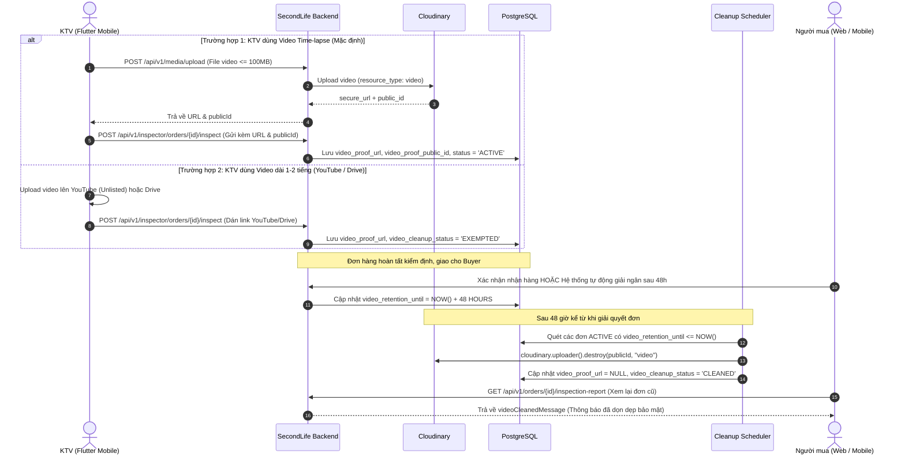

# KẾ HOẠCH TỔNG THỂ BACKEND SECONDLIFE (BE MASTER IMPLEMENTATION PLAN)
**Phiên bản**: 2.1 (Tối ưu hóa Chiến lược Video Hybrid & Hoàn thiện Mobile Clients)  
**Ngày cập nhật**: 14/10/2026  
**Trọng tâm**: 
1. **Chiến lược Video Kiểm định Hybrid (Time-lapse In-System + YouTube Unlisted/Drive)** kết hợp **Cơ chế Tự động Dọn dẹp/Xóa Video sau 48h giải quyết đơn**.
2. **Hoàn thiện trọn bộ 6 hạng mục kỹ thuật cốt lõi cho Mobile Flutter Clients** (Buyer, Seller, Inspector).

---

## MỤC LỤC
1. [Bối cảnh & Chiến lược Kiến trúc Video Kiểm định](#1-bối-cảnh--chiến-lược-kiến-trúc-video-kiểm-định)
2. [Chi tiết Kiến trúc Video Hybrid & Cơ chế Tự động Xóa sau 48h](#2-chi-tiết-kiến-trúc-video-hybrid--cơ-chế-tự-động-xóa-sau-48h)
3. [Nâng cấp Media Service Hỗ trợ Video Hệ thống](#3-nâng-cấp-media-service-hỗ-trợ-video-hệ-thống)
4. [Danh mục Toàn bộ 6 Hạng mục Backend Triển khai cho Mobile](#4-danh-mục-toàn-bộ-6-hạng-mục-backend-triển-khai-cho-mobile)
5. [Lộ trình Triển khai Chi tiết theo Giai đoạn (Roadmap)](#5-lộ-trình-triển-khai-chi-tiết-theo-giai-đoạn-roadmap)
6. [Hợp đồng API & Chuẩn Dữ liệu Giao tiếp với FE/Mobile](#6-hợp-đồng-api--chuẩn-dữ-liệu-giao-tiếp-với-femobile)

---

## 1. BỐI CẢNH & CHIẾN LƯỢC KIẾN TRÚC VIDEO KIỂM ĐỊNH

### 1.1. Thách thức Nghiệp vụ Thực tế
* Quá trình kiểm định thiết bị cũ (máy tính, điện thoại, máy tính bảng) đòi hỏi KTV phải mở vỏ máy, kiểm tra tem zin, bo mạch, màn hình, pin và các linh kiện bên trong. Thời gian thực tế có thể kéo dài từ **1 đến 2 tiếng**.
* **Thách thức kỹ thuật**:
  - Video gốc 1-2 tiếng quay bằng smartphone nặng từ **2GB đến 5GB**.
  - Gói Cloudinary Free chặn cứng dung lượng file upload tối đa **100 MB** cho mỗi video.
  - Upload file 3GB-5GB qua mạng di động sẽ gây nghẽn băng thông, timeout và nguy cơ sập RAM server Spring Boot.
  - Người mua và Hội đồng thẩm định đồ án sẽ không thể ngồi xem hết 120 phút video tháo ốc.

### 1.2. Giải pháp Kiến trúc: Mô hình Video Hybrid (Lai)
Hệ thống kết hợp hoàn hảo giữa **Chuẩn kiểm định Time-lapse khép kín** và **Lưu trữ ngoài cho video thô thời lượng dài**:

| Tiêu chí | Luồng Chính: Video Time-lapse (In-System) | Luồng Phụ: Video Gốc Dài (External Storage) |
| :--- | :--- | :--- |
| **Mục đích** | Bằng chứng tháo lắp liên tục, không tráo đổi đồ. | Xem chi tiết từng giây cho các đơn có tranh chấp nặng. |
| **Định dạng / Độ dài** | Chế độ **Time-lapse** (tua nhanh 2-3 phút) + 3-5 ảnh cận cảnh macro. | Video gốc 1-2 tiếng quay tốc độ thường. |
| **Dung lượng file** | **30 MB – 50 MB** (Upload trong 10-15s). | 2 GB – 5 GB. |
| **Hạ tầng lưu trữ** | **Cloudinary trực tiếp qua Backend**. | **YouTube (Chế độ Không công khai - Unlisted)** hoặc **Google Drive**. |
| **Vòng đời dữ liệu** | **Tự động xóa sạch sau 48h** hoàn tất đơn. | Lưu vĩnh viễn trên YouTube/Drive, không tốn tài nguyên sàn. |
| **Trình phát trên Web/App** | Thẻ `<video controls>` gốc HTML5 / Flutter `video_player`. | Nhúng `<iframe>` YouTube Player / Drive Preview (xem trực tiếp trong sàn). |

---

## 2. CHI TIẾT KIẾN TRÚC VIDEO HYBRID & CƠ CHẾ TỰ ĐỘNG XÓA SAU 48H

### 2.1. Vòng đời Video (Retention Lifecycle Flow)



### 2.2. Migration Cơ sở Dữ liệu (`V50__add_video_proof_cleanup_lifecycle.sql`)

```sql
-- Migration V50: Bổ sung quản lý vòng đời và tự động tiêu hủy video sau 48h
ALTER TABLE inspection_orders
    ADD COLUMN IF NOT EXISTS video_proof_public_id VARCHAR(255),
    ADD COLUMN IF NOT EXISTS unboxing_video_public_id VARCHAR(255),
    ADD COLUMN IF NOT EXISTS video_cleanup_status VARCHAR(30) DEFAULT 'ACTIVE', -- ACTIVE, CLEANED, EXEMPTED
    ADD COLUMN IF NOT EXISTS video_cleaned_at TIMESTAMP WITH TIME ZONE,
    ADD COLUMN IF NOT EXISTS video_retention_until TIMESTAMP WITH TIME ZONE;

CREATE INDEX IF NOT EXISTS idx_inspection_orders_video_cleanup 
    ON inspection_orders(video_cleanup_status, video_retention_until);
```

### 2.3. Quy tắc Thiết lập Hạn Dọn Dẹp (`video_retention_until`)

| Kịch bản kết thúc đơn hàng | Thời điểm kích hoạt mốc | Công thức tính `video_retention_until` |
| :--- | :--- | :--- |
| **Giao dịch thành công** (Giao hàng $\rightarrow$ Người mua bấm Xác nhận HOẶC Auto-Release sau 48h) | Ngay khi tiền được giải ngân về ví người bán (`EscrowStatus.RELEASED`) | `settlement_time + 48 hours` |
| **Kiểm định Thất bại** (`InspectionOrderStatus.FAILED`) | Ngay khi KTV nộp kết luận FAILED (máy lỗi, tráo đồ, rách seal) | `failed_time + 48 hours` |
| **Đơn bị Hủy / Trả hàng** (`CANCELLED` / `REFUNDED`) | Ngay khi tiền cọc/tiền hàng được hoàn về ví người mua | `refund_time + 48 hours` |
| **Link YouTube / Google Drive** | Khi nhận kết quả kiểm định | `video_cleanup_status = 'EXEMPTED'` *(Không xóa trên cloud thứ 3)* |

### 2.4. Scheduler Quét Tự Động (`InspectionVideoCleanupScheduler.java`)
* **Cấu hình**: `@Scheduled(cron = "${app.media.cleanup.cron:0 0 * * * *}")` (Chạy mỗi 60 phút).
* **Xử lý nghiệp vụ**:
  ```java
  @Scheduled(cron = "${app.media.cleanup.cron:0 0 * * * *}")
  public void cleanupExpiredVideos() {
      Instant now = clock.instant();
      List<InspectionOrder> expiredOrders = inspectionOrderRepository.findEligibleForVideoCleanup(now);
      for (InspectionOrder order : expiredOrders) {
          try {
              if (order.getVideoProofPublicId() != null) {
                  cloudinary.uploader().destroy(order.getVideoProofPublicId(), ObjectUtils.asMap("resource_type", "video"));
              }
              if (order.getUnboxingVideoPublicId() != null) {
                  cloudinary.uploader().destroy(order.getUnboxingVideoPublicId(), ObjectUtils.asMap("resource_type", "video"));
              }
              order.setVideoProofUrl(null);
              order.setUnboxingVideoUrl(null);
              order.setVideoCleanupStatus("CLEANED");
              order.setVideoCleanedAt(now);
              inspectionOrderRepository.save(order);
              log.info("Đã tiêu hủy video bằng chứng cho đơn kiểm định {}", order.getId());
          } catch (Exception ex) {
              log.error("Lỗi khi tiêu hủy video cho đơn {}: {}", order.getId(), ex.getMessage());
          }
      }
  }
  ```

---

## 3. NÂNG CẤP MEDIA SERVICE HỖ TRỢ VIDEO HỆ THỐNG

### 3.1. Cấu hình & Định dạng Cho phép
* **MIME types cho phép**: `image/jpeg`, `image/png`, `image/webp`, `video/mp4`, `video/quicktime` (.mov của iOS), `video/webm`.
* **Giới hạn kích thước file**:
  - Ảnh: Tối đa **10 MB**.
  - Video: Tối đa **100 MB** (Đủ cho video Time-lapse 2-4 phút ở độ phân giải 1080p).
* **Xử lý Cloudinary**:
  - Sử dụng tham số `resource_type: "auto"` hoặc `"video"`.
  - Phân mục folder: `secondlife/inspections/videos/`.
  - Trả về `secure_url`, `public_id`, `format`, `bytes`.

---

## 4. DANH MỤC TOÀN BỘ 6 HẠNG MỤC BACKEND TRIỂN KHAI CHO MOBILE

Dưới đây là bảng tổng hợp 6 hạng mục kỹ thuật cốt lõi dành cho đội ngũ Mobile Flutter:

| Hạng mục | Mức độ | Mục tiêu kỹ thuật | File/Component tác động chính |
| :--- | :---: | :--- | :--- |
| **1. Public Post Detail API** | **P0** | Mở API chi tiết sản phẩm cho Buyer không bị 403; tách endpoint valuation draft. | `PostController.java`, `SecurityConfig.java`, `ListingValuationController.java` |
| **2. KTV Start Inspection** | **P1** | Endpoint `POST /orders/{id}/start` chuyển trạng thái sang `INSPECTING` và bắn thông báo. | `InspectorController.java`, `InspectionService.java`, `InspectionServiceImpl.java` |
| **3. Media Video & Auto-Cleanup** | **P1** | Upload video trực tiếp (Time-lapse) + Tự động xóa sau 48h + Hỗ trợ link YouTube ngoài. | `MediaServiceImpl.java`, `V50...sql`, `InspectionVideoCleanupScheduler.java` |
| **4. FCM Push Notification** | **P0** | Quản lý device token + Tích hợp Firebase Admin SDK gửi multicast push notification. | `V49...sql`, `UserDeviceToken.java`, `PushNotificationChannel.java`, `NotificationController.java` |
| **5. Rút tiền Ví Thủ công** | **P2** | Yêu cầu rút tiền về ngân hàng + Admin duyệt/từ chối giải ngân ví. | `V51...sql`, `WalletWithdrawal.java`, `WalletServiceImpl.java`, `WalletController.java` |
| **6. Chuẩn hóa Tọa độ Lalamove** | **P1** | Hợp đồng tọa độ GPS (`latitude`, `longitude`, `addressLine`) kết hợp Geoapify reverse geocoding. | `SellerOnboardingController.java`, `LalamoveShippingService.java` |

---

## 5. LỘ TRÌNH TRIỂN KHAI CHI TIẾT THEO GIAI ĐOẠN (ROADMAP)

### GIAI ĐOẠN 1: Mở Khóa Điểm Nghẽn Khẩn Cấp Mobile (P0 & P1 - Ngay lập tức)
1. **Public Post Detail**:
   - Thêm `GET /api/v1/posts/{postId}` trong `PostController.java` gọi `marketplaceListingService.getDetail(postId)`.
   - Cập nhật `SecurityConfig.java`: Cấu hình `.requestMatchers(HttpMethod.GET, "/api/v1/posts/*").permitAll()`.
   - Tách biệt endpoint định giá nháp sang `GET /api/v1/posts/{postId}/draft` trong `ListingValuationController.java`.
2. **KTV Start Inspection Endpoint**:
   - Thêm phương thức `startInspection(UUID actorId, UUID orderId)` trong `InspectionServiceImpl.java`.
   - Kiểm tra KTV được phân công, trạng thái `SCHEDULED` hoặc `CONFIRMED_PENDING_DISPATCH` $\rightarrow$ Đổi sang `INSPECTING`.
   - Bắn thông báo In-app & WebSocket cho Buyer & Seller: *"Kỹ thuật viên đã bắt đầu tiến hành kiểm định sản phẩm"*.
   - Mở endpoint `POST /api/v1/inspector/orders/{orderId}/start` trong `InspectorController.java`.

### GIAI ĐOẠN 2: Nâng cấp Media Video & Cơ chế 48h Auto-Cleanup (P1)
1. **Nâng cấp MediaService**:
   - Cho phép định dạng video (`video/mp4`, `video/quicktime`, `video/webm`), dung lượng max 100MB.
   - Trả về `publicId` trong `MediaUploadResponse`.
2. **Migration V50 & Dọn dẹp Video**:
   - Tạo file `V50__add_video_proof_cleanup_lifecycle.sql`.
   - Cập nhật Entity `InspectionOrder.java` thêm các trường quản lý vòng đời.
   - Nâng cấp `submitResult` trong `InspectionServiceImpl.java` nhận diện link Cloudinary (lưu `publicId`) hoặc YouTube/Drive (`EXEMPTED`).
   - Cập nhật `SettlementService` / `OrderAutoReleaseService` để set `video_retention_until = NOW() + 48h`.
   - Xây dựng `InspectionVideoCleanupScheduler.java` tự động tiêu hủy video sau 48h.

### GIAI ĐOẠN 3: Triển khai Push Notification Hoàn Chỉnh với FCM (P0)
1. **Database & Device Token APIs**:
   - Viết migration `V49__create_user_device_tokens.sql` (bảng `user_device_tokens`: `user_id`, `fcm_token`, `device_type`, `created_at`, `last_used_at`).
   - Tạo Entity `UserDeviceToken.java` và Repository.
   - Mở 2 endpoint trong `NotificationController.java`:
     - `POST /api/v1/notifications/devices`: Lưu/cập nhật token thiết bị.
     - `DELETE /api/v1/notifications/devices/{token}`: Xóa token khi user đăng xuất.
2. **Firebase Admin SDK & Multicast Push**:
   - Thêm dependency `com.google.firebase:firebase-admin` vào `pom.xml`.
   - Cấu hình `FirebaseConfig.java` nạp service account key an toàn từ `.env` / classpath.
   - Triển khai `PushNotificationChannel.java`: Lấy danh sách token của user, gửi `MulticastMessage` bất đồng bộ qua Firebase Messaging.

### GIAI ĐOẠN 4: Hệ thống Rút Tiền Ví Thủ Công (P2)
1. **Database & Entity**:
   - Viết migration `V51__create_wallet_withdrawals.sql` (bảng `wallet_withdrawals`).
   - Tạo Entity `WalletWithdrawal.java` (`amount`, `bankCode`, `accountNumber`, `accountHolderName`, `status`: `PENDING_REVIEW`, `APPROVED`, `REJECTED`).
2. **Logic Rút tiền & Duyệt tiền**:
   - Endpoint User: `POST /api/v1/wallets/withdrawals` (khóa/trừ số dư khả dụng, đưa vào trạng thái chờ duyệt).
   - Endpoint Admin:
     - `GET /api/v1/admin/withdrawals` (danh sách yêu cầu rút tiền).
     - `POST /api/v1/admin/withdrawals/{id}/approve` (xác nhận chuyển khoản, hoàn tất trừ tiền).
     - `POST /api/v1/admin/withdrawals/{id}/reject` (từ chối, hoàn lại tiền về số dư khả dụng).

---

## 6. HỢP ĐỒNG API & CHUẨN DỮ LIỆU GIAO TIẾP VỚI FE/MOBILE

### 6.1. Chi tiết Sản phẩm Cho Buyer (`GET /api/v1/posts/{postId}`)
* **Header**: Không yêu cầu `Authorization` (Public `permitAll`).
* **Response**: `ApiResponse<MarketplaceListingDetailResponse>` chứa đầy đủ thông tin máy, giá, cấu hình, ảnh và trạng thái tin đăng.

### 6.2. Nộp Kết quả Kiểm định Hybrid (`POST /api/v1/inspector/orders/{orderId}/inspect`)
```json
{
  "status": "PASSED",
  "conditionScore": 92,
  "conditionGrade": "EXCELLENT",
  "tamperSealId": "SEAL-2026-9988",
  "barcode": "SL-BC-123456",
  "note": "Máy nguyên bản, màn hình sáng đẹp, pin 91%, không cấn móp",
  "videoProofUrl": "https://res.cloudinary.com/.../video_proof.mp4",
  "videoProofPublicId": "secondlife/inspections/videos/video_proof_123",
  "unboxingVideoUrl": "https://youtu.be/dQw4w9WgXcQ",
  "checklistResults": [
    { "itemTitle": "Màn hình cảm ứng", "isPassed": true, "note": "Cảm ứng mượt mà" },
    { "itemTitle": "Bo mạch chủ", "isPassed": true, "note": "Chưa qua sửa chữa" }
  ]
}
```

### 6.3. Phản hồi Khi Video Đã Được Dọn Dẹp Sau 48h (`GET /api/v1/orders/{id}/inspection-report`)
```json
{
  "id": "e3b0c442-98fc-1c14-9afbf4c8996fb924",
  "status": "PASSED",
  "conditionScore": 92,
  "videoProofUrl": null,
  "videoCleanupStatus": "CLEANED",
  "videoCleanedMessage": "Video bằng chứng đã được hệ thống tự động dọn dẹp an toàn sau 48h hoàn tất giao dịch theo Chính sách Bảo mật Dữ liệu.",
  "inspectionPassedAt": "2026-10-10T08:00:00Z"
}
```

### 6.4. Đăng ký Thiết bị Nhận Push Notification (`POST /api/v1/notifications/devices`)
* **Header**: `Authorization: Bearer <TOKEN>`
* **Body**:
```json
{
  "fcmToken": "c_d9j...fcm_device_token_here...",
  "deviceType": "ANDROID"
}
```

---

## 7. KẾ HOẠCH TRIỂN KHAI & KIỂM THỬ

1. Đảm bảo toàn bộ 53/53 Unit & Integration Tests hiện tại luôn PASS 100%.
2. Mỗi tính năng mới đi kèm bộ unit test tương ứng:
   - Test phân quyền Public API `GET /api/v1/posts/{id}`.
   - Test luồng `startInspection` (chuyển trạng thái `INSPECTING`).
   - Test scheduler dọn dẹp video sau 48h.
   - Test device token registration.
