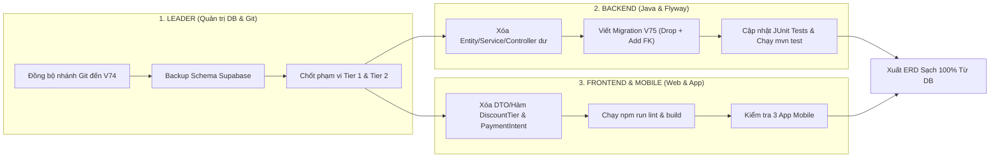

# Kế Hoạch Chi Tiết Làm Sạch Cơ Sở Dữ Liệu & Đồng Bộ Codebase (Leader – BE – FE)

> [!IMPORTANT]
> **Mục tiêu kế hoạch:**
> Dựa trên kết quả rà soát thực tế **82 bảng trên Supabase PostgreSQL** tại tài liệu [ERD_GUIDE_AND_SCHEMA_AUDIT.md](./ERD_GUIDE_AND_SCHEMA_AUDIT.md), kế hoạch này phân chia công việc cụ thể cho **3 vai trò (Leader, Backend, Frontend/Mobile)** nhằm:
> 1. Xóa bỏ triệt để các bảng mồ côi (`0 rows`, `0` tương tác) và luồng thanh toán giả lập cũ không còn dùng.
> 2. Bổ sung khóa ngoại vật lý còn thiếu để sơ đồ ERD xuất tự động từ Database hiển thị đầy đủ 100% mối quan hệ.
> 3. Đồng bộ mã nguồn Backend (Java/Flyway) và Frontend/Mobile (TypeScript/Dart) mà không làm gãy bất kỳ luồng nghiệp vụ hay bài kiểm thử (Test) nào.

---

## Tổng Quan Quy Trình Phối Hợp 3 Vai Trò



---

## Phần 1: Kế Hoạch Chi Tiết Dành Cho LEADER (Team Lead / Quản Trị DB & Nhánh Git)

### Bước L1 — Đồng bộ phiên bản Migration Flyway giữa các nhánh Git (Ưu tiên số 1)
- **Hiện trạng phát hiện khi quét DB**:
  - Trên database Supabase (`flyway_schema_history`) đã chạy tới phiên bản **`V74`** (`V70` đến `V74`), trong khi một số nhánh code chỉ có tới `V69` hoặc `V73`:
    - `V70__inspection_item_checklist_governance.sql`
    - `V71__split_ambiguous_household_items.sql`
    - `V72__snapshot_inspection_platform_rate.sql`
    - `V73__inspection_lalamove_shipping_quotes.sql`
    - `V74__inspection_return_shipping_policy.sql`
- **Hành động của Leader**:
  1. Yêu cầu thành viên vừa chạy `V74__inspection_return_shipping_policy.sql` trên local push đầy đủ file `V74` lên nhánh chung (`dev` / `feature/tuan-seller-listing-datail`).
  2. Merge thống nhất các migration từ `V1` → `V74` vào nhánh chuẩn trước khi cấp số hiệu **`V75`** cho migration dọn dẹp database.

### Bước L2 — Chốt phạm vi bảng cần xóa (Phê duyệt trước khi BE chạy Migration)

> [!CAUTION]
> **Xác nhận an toàn dữ liệu (Data Loss Check):** Tất cả 5 bảng được đề xuất xóa dưới đây đều đã được kiểm tra trực tiếp trên Supabase PostgreSQL với kết quả **`rows = 0`** (không chứa bất kỳ dữ liệu người dùng nào).

| Cấp độ | Tên bảng | Số dòng hiện tại | Quyết định của Leader | Lý do kỹ thuật |
| :--- | :--- | :-: | :--- | :--- |
| **Tier 1 (Bắt buộc xóa)** | `post_image_urls` | `0` | **DUYỆT `DROP TABLE`** | Bảng phụ thời kỳ đầu, đã thay bằng `post_images` từ `V22`. Không có Entity/Repo/FK. |
| **Tier 1 (Bắt buộc xóa)** | `fraud_flags` | `0` | **DUYỆT `DROP TABLE`** | Chỉ còn class `FraudFlag.java` mồ côi, không có Repository/Service nào gọi. |
| **Tier 1 (Bắt buộc xóa)** | `credit_discount_tiers` | `0` | **DUYỆT `DROP TABLE`** | Bảng chiết khấu bậc thang cũ (V11), đã thay bằng gói `topup_packages`. Cần `DROP COLUMN discount_tier_id` trên bảng `credit_purchases` trước khi xóa bảng. |
| **Tier 2 (Khuyến nghị xóa)** | `payment_callback_events` | `0` | **DUYỆT `DROP TABLE`** | Bảng lưu webhook giả lập (V11). Hiện hệ thống dùng `sepay_transfer_receipts` (SePay thật) và trừ tiền trực tiếp từ Ví `user_wallets`. |
| **Tier 2 (Khuyến nghị xóa)** | `payment_intents` | `0` | **DUYỆT `DROP TABLE`** | Đi kèm với `payment_callback_events` (V11). `CreditPurchaseServiceImpl` không còn lưu `PaymentIntent` nữa (`0 rows`). |
| **Giữ nguyên** | `credit_types` | `3` | **GIỮ LẠI** | Đang làm khóa ngoại (`FK`) cho `credit_balances`, `credit_ledger`, `credit_pricing_rules` (190+ dòng dữ liệu thật). |

### Bước L3 — Tạo bản sao lưu (Backup) trước khi chạy Migration `V75`
- Vào **Supabase Dashboard** → **Database** → **Backups** (hoặc chạy `pg_dump --schema-only`) để lưu snapshot cấu trúc trước khi merge PR dọn dẹp của BE.

---

## Phần 2: Kế Hoạch Chi Tiết Dành Cho BACKEND (BE Team — `BE_SecondLife`)

### Bước B1 — Xóa các Class Java dư thừa / mồ côi

1. **Xóa hoàn toàn các file mồ côi thuộc Tier 1 (`fraud_flags`)**:
   - Xóa file `src/main/java/com/secondlife/secondlife/entity/FraudFlag.java`.

2. **Xóa các file thuộc luồng Mock Payment Intent cũ (Tier 2 — sau khi Leader duyệt)**:
   - Xóa Entity:
     - `src/main/java/com/secondlife/secondlife/entity/PaymentCallbackEvent.java`
     - `src/main/java/com/secondlife/secondlife/entity/PaymentIntent.java`
   - Xóa Repository:
     - `src/main/java/com/secondlife/secondlife/repository/PaymentCallbackEventRepository.java`
     - `src/main/java/com/secondlife/secondlife/repository/PaymentIntentRepository.java`
   - Xóa Controller, Service & Integration Mock Callback:
     - `src/main/java/com/secondlife/secondlife/controller/MockPaymentCallbackController.java`
     - `src/main/java/com/secondlife/secondlife/service/CreditPaymentCallbackService.java` & `src/main/java/com/secondlife/secondlife/service/impl/CreditPaymentCallbackServiceImpl.java`
     - `src/main/java/com/secondlife/secondlife/service/PaymentCallbackInboxService.java` & `src/main/java/com/secondlife/secondlife/service/impl/PaymentCallbackInboxServiceImpl.java`
     - Package `src/main/java/com/secondlife/secondlife/integration/payment/*`

3. **Làm sạch `CreditPurchaseServiceImpl.java`, `CreditMapper.java`, `CreditPurchaseResponse.java` và `CreditPurchase.java`**:
   - Trong `CreditPurchaseServiceImpl.java`:
     - Xóa dependency `PaymentIntentRepository intentRepository` và `PaymentProvider paymentProvider`.
     - Trong `getPurchases()`: Đơn giản hóa thành `page.map(creditMapper::toPurchaseResponse)` không cần truy vấn `intentRepository.findByPurchaseIdIn(...)`.
   - Trong `CreditPurchaseResponse.java` và `CreditMapper.java`:
     - Xóa các trường `paymentIntentId`, `paymentProvider`, `providerIntentId`, `paymentStatus`.
   - Trong `CreditPurchase.java`:
     - Xóa cột `discountTierId` không còn dùng.

### Bước B2 — Tạo Flyway Migration `V75__cleanup_redundant_tables_and_add_missing_fks.sql`

Tạo file migration tại `src/main/resources/db/migration/V75__cleanup_redundant_tables_and_add_missing_fks.sql` thực hiện 2 việc:
1. **Gỡ khóa ngoại cũ và `DROP` 5 bảng dư thừa (`post_image_urls`, `fraud_flags`, `credit_discount_tiers`, `payment_callback_events`, `payment_intents`)**.
2. **Bổ sung khóa ngoại vật lý (`FOREIGN KEY`) cho `ai_price_estimates.listing_id -> posts(id)`** để khi vẽ ERD tự động, bảng `ai_price_estimates` được nối trực tiếp vào bảng `posts`:

```sql
-- ============================================================================
-- V75: Dọn dẹp các bảng dư thừa (0 rows) & Bổ sung khóa ngoại vật lý cho ERD
-- ============================================================================
SET LOCAL lock_timeout = '5s';

-- 1. Gỡ cột/khóa ngoại từ credit_purchases trỏ tới credit_discount_tiers
ALTER TABLE credit_purchases
    DROP CONSTRAINT IF EXISTS fk_v61_credit_purchases_discount_tier_id,
    DROP CONSTRAINT IF EXISTS credit_purchases_discount_tier_id_fkey,
    DROP COLUMN IF EXISTS discount_tier_id;

-- 2. Xóa các bảng dư thừa hoàn toàn (Đã kiểm chứng 0 bản ghi)
DROP TABLE IF EXISTS post_image_urls;
DROP TABLE IF EXISTS fraud_flags;
DROP TABLE IF EXISTS credit_discount_tiers;
DROP TABLE IF EXISTS payment_callback_events;
DROP TABLE IF EXISTS payment_intents;

-- 3. Bổ sung khóa ngoại vật lý cho ai_price_estimates -> posts(id)
-- (Giúp công cụ vẽ ERD tự động nối ai_price_estimates với posts)
DO $$
BEGIN
    IF NOT EXISTS (
        SELECT 1 FROM pg_constraint
        WHERE conname = 'fk_ai_price_estimates_listing_id'
    ) THEN
        DELETE FROM ai_price_estimates a
        WHERE NOT EXISTS (SELECT 1 FROM posts p WHERE p.id = a.listing_id);

        ALTER TABLE ai_price_estimates
            ADD CONSTRAINT fk_ai_price_estimates_listing_id
            FOREIGN KEY (listing_id) REFERENCES posts(id) ON DELETE CASCADE;
    END IF;
END $$;
```

### Bước B3 — Cập nhật JUnit Tests trên Backend
- Cập nhật các file test:
  - `src/test/java/com/secondlife/secondlife/integration/Day05CreditIntegrationTest.java`
  - `src/test/java/com/secondlife/secondlife/integration/Day06CreditPurchaseIntegrationTest.java`
  - `src/test/java/com/secondlife/secondlife/integration/ReadQueryIntegrationTest.java`
- Chạy lệnh kiểm chứng test suite:
  ```powershell
  cd P:\FPT\Capstone\BE_SecondLife\secondLife
  .\mvnw.cmd test
  ```

---

## Phần 3: Kế Hoạch Chi Tiết Dành Cho FRONTEND & MOBILE (FE Team)

### Bước F1 — Làm sạch Code Dư Thừa Liên Quan Đến `credit_discount_tiers` & `payment_intents` trên Web FE (`SEP490_FE_SecondLife`)

1. **Trong `src/services/adminCreditPricingService.ts`**:
   - Xóa các interface không còn bảng tương ứng trên BE:
     - `CreditDiscountTierResponseDto`
     - `SaveCreditDiscountTierRequestDto`
   - Xóa 3 hàm giả lập bậc chiết khấu bằng `localStorage` và dữ liệu hardcode `tier-1..tier-3`:
     - `getDiscountTiers()`
     - `createDiscountTier()`
     - `updateDiscountTier()`

2. **Trong `src/services/sellerCreditService.ts`**:
   - Xóa import `CreditDiscountTierResponseDto`.
   - Trong `CreditQuoteResponseDto`: Xóa `discountTierId`, `discountMinQuantity`, `discountMaxQuantity`, `discountRate`, `discountAmount`.
   - Trong `CreditPricingResponseDto`: Xóa `discountTiers`.
   - Trong `CreditPurchaseResponseDto`: Xóa 4 trường liên quan đến bảng `payment_intents` đã bỏ (`paymentIntentId`, `paymentProvider`, `providerIntentId`, `paymentStatus`).

3. **Kiểm chứng Build Web FE**:
   ```powershell
   cd P:\FPT\Capstone\FE_SecondLife\SEP490_FE_SecondLife
   npm run lint
   npm run build
   ```

### Bước F2 — Rà soát 3 Ứng dụng Mobile (`MB_SecondLife_Buyer`, `MB_SecondLife_Seller`, `MB_SecondLife_Inspector`)
- `MB_SecondLife_Buyer` và `MB_SecondLife_Inspector` không tương tác với các bảng Credit hay `fraud_flags`.
- `MB_SecondLife_Seller` chỉ sử dụng API danh sách gói nạp (`/api/v1/topup/packages`) và số dư credit (`/api/v1/seller/credits`), không phụ thuộc vào `credit_discount_tiers` hay `payment_intents`.

---

## Phần 4: Checklist Nghiệm Thu Cuối Cùng (Definition of Done)

- [ ] **Leader**: Đã đồng bộ đủ các file migration `V70`..`V74` về nhánh chính và tạo backup schema trên Supabase trước khi chạy `V75` trên môi trường chung.
- [x] **Backend**: Đã tạo migration `V75__cleanup_redundant_tables_and_add_missing_fks.sql`, xóa `FraudFlag.java` và toàn bộ các class `PaymentIntent` / `PaymentCallbackEvent` / `MockPaymentCallbackController`, thêm FK `fk_ai_price_estimates_listing_id`, và pass 100% `.\mvnw.cmd test-compile` & Unit Tests.
- [x] **Frontend & Mobile**: Đã xóa toàn bộ code/DTO thừa của `discountTiers` & `paymentIntent` trong `adminCreditPricingService.ts` và `sellerCreditService.ts`, pass 100% `npm run lint`, `npm run build` và `flutter analyze` (`0 errors`).
- [ ] **ERD**: Xuất lại sơ đồ ERD từ Database (hoặc `dbdiagram.io`) sau khi Leader áp dụng `V75` trên Supabase.


