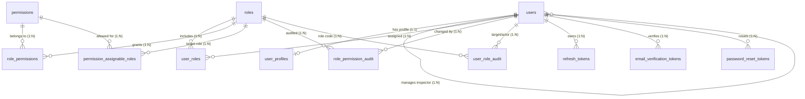
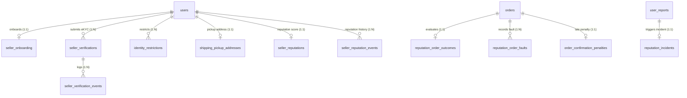
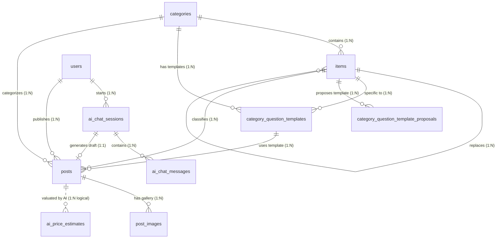
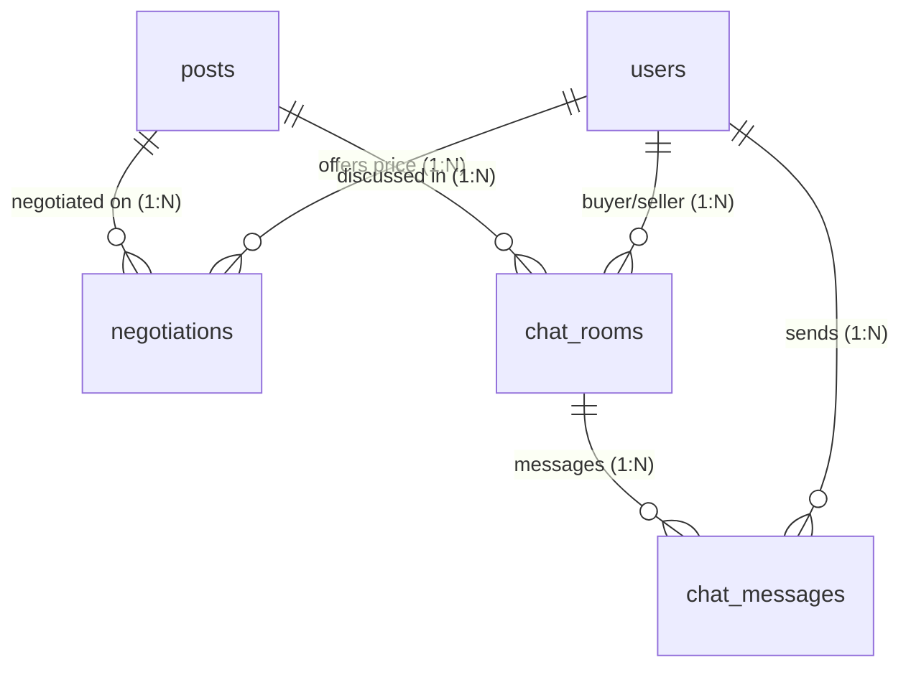
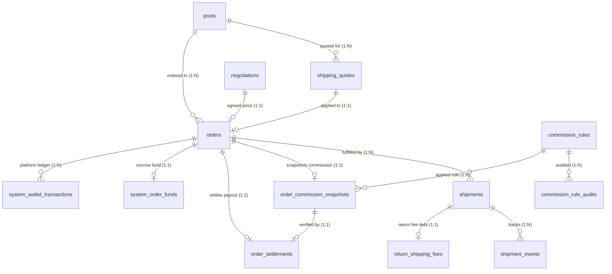
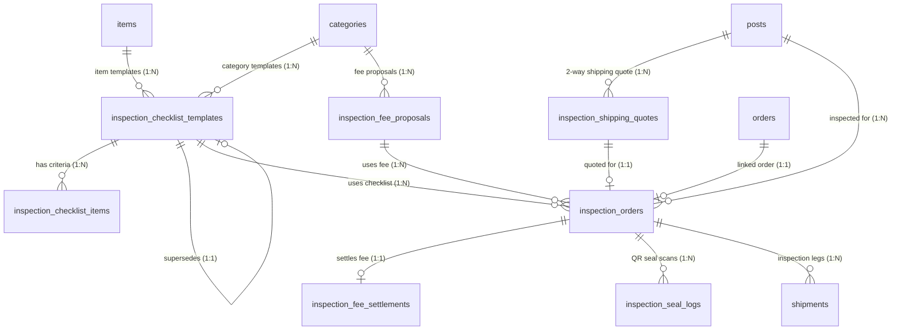
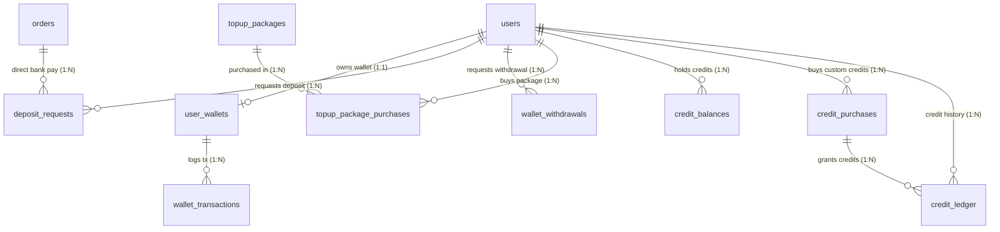
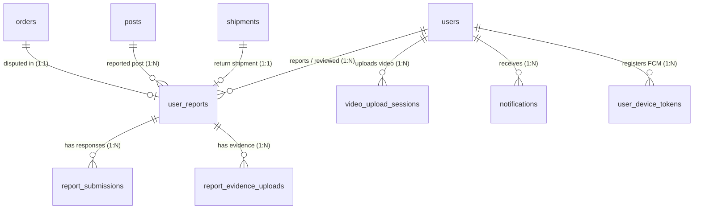
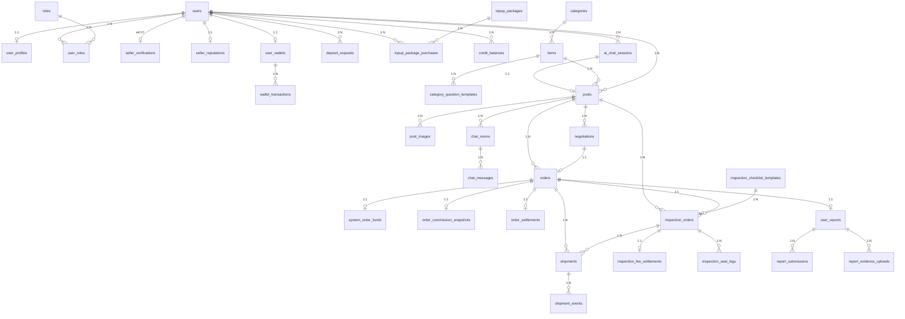

# Báo Cáo Rà Soát Cơ Sở Dữ Liệu, Phân Tích Bảng Dư Thừa & Hướng Dẫn Vẽ ERD (SecondLife)

> [!IMPORTANT]
> **Tổng quan kết quả quét hệ thống (Database Supabase PostgreSQL `public` schema + 76 Flyway Migrations + 71 JPA Entities):**
> - **Tổng số bảng vật lý trong DB**: **82 bảng** (gồm 1 bảng hệ thống `flyway_schema_history` và **81 bảng ứng dụng**).
> - **Số bảng dư thừa / ngưng sử dụng sau thay đổi nghiệp vụ**: **6 bảng** (3 bảng mồ côi hoàn toàn có thể `DROP` + 2 bảng luồng thanh toán cũ không còn ghi dữ liệu + 1 bảng lookup tĩnh chỉ giữ FK).
> - **Số bảng cấu hình / bộ nhớ đệm / sổ cái độc lập (không có FK vật lý nhưng đang hoạt động)**: **7 bảng**.
> - **Số bảng nghiệp vụ cốt lõi có quan hệ khóa ngoại (cần đưa vào ERD chính)**: **68 bảng**, chia thành **9 phân hệ nghiệp vụ (Sub-domains)**.

---

## Phần 1: Phân Tích Các Bảng Bị Dư Thừa Sau Quá Trình Thay Đổi Nghiệp Vụ

Qua đối chiếu trực tiếp giữa **82 bảng vật lý trên PostgreSQL**, **76 file migration Flyway** và **toàn bộ mã nguồn Java (`Entity`, `Repository`, `Service`, `Controller`)**, dưới đây là danh sách các bảng bị dư thừa hoặc không còn tương tác:

### 1.1. Nhóm A — Bảng Dư Thừa Hoàn Toàn (Orphan / Dead Tables — Khuyến nghị `DROP` hoặc loại khỏi ERD)

| STT | Tên Bảng (`public`) | Số bản ghi hiện tại | Nguồn gốc & Nguyên nhân dư thừa | Trạng thái trong Code Java | Khuyến nghị khi vẽ ERD |
| :-: | :--- | :-: | :--- | :--- | :--- |
| 1 | **`post_image_urls`** | `0` | Bảng phụ `@ElementCollection` tự sinh ở giai đoạn đầu để lưu mảng URL ảnh của `posts`. Từ migration `V22__add_listing_image_gallery.sql`, hệ thống đã chuyển sang bảng [`post_images`](file:///P:/FPT/Capstone/BE_SecondLife/secondLife/src/main/java/com/secondlife/secondlife/entity/PostImage.java) (lưu thứ tự ảnh, `cloudinary_public_id`, `perceptual_hash`, `image_fingerprint`). | **Không có Entity, không có Repository, 0 tham chiếu**, không có FK trong DB. | **Loại bỏ hoàn toàn khỏi ERD** (Có thể tạo migration `DROP TABLE IF EXISTS post_image_urls`). |
| 2 | **`fraud_flags`** | `0` | Bảng lưu cờ cảnh báo gian lận AI thời kỳ đầu. Hiện tại nghiệp vụ kiểm soát rủi ro và gian lận đã chuyển sang lưu trực tiếp trên [`SellerVerification`](file:///P:/FPT/Capstone/BE_SecondLife/secondLife/src/main/java/com/secondlife/secondlife/entity/SellerVerification.java) (`risk_score`, `fraud_flag`), [`IdentityRestriction`](file:///P:/FPT/Capstone/BE_SecondLife/secondLife/src/main/java/com/secondlife/secondlife/entity/IdentityRestriction.java) và hệ thống [`UserReport`](file:///P:/FPT/Capstone/BE_SecondLife/secondLife/src/main/java/com/secondlife/secondlife/entity/UserReport.java) / [`SellerReputation`](file:///P:/FPT/Capstone/BE_SecondLife/secondLife/src/main/java/com/secondlife/secondlife/entity/SellerReputation.java). | Chỉ còn class mồ côi [`FraudFlag.java`](file:///P:/FPT/Capstone/BE_SecondLife/secondLife/src/main/java/com/secondlife/secondlife/entity/FraudFlag.java), **không có Repository, 0 tham chiếu** ở bất kỳ Service/Controller nào. | **Loại bỏ khỏi ERD** và xóa class [`FraudFlag.java`](file:///P:/FPT/Capstone/BE_SecondLife/secondLife/src/main/java/com/secondlife/secondlife/entity/FraudFlag.java). |
| 3 | **`credit_discount_tiers`** | `0` | Tạo tại [`V11__create_credit_pricing_and_payment_foundation.sql`](file:///P:/FPT/Capstone/BE_SecondLife/secondLife/src/main/resources/db/migration/V11__create_credit_pricing_and_payment_foundation.sql) để tính chiết khấu theo bậc số lượng khi mua lẻ credit. Từ `V34` và `V68`, nghiệp vụ chuyển sang bán theo **Gói nạp (`topup_packages` & `topup_package_purchases`)**. | **Không có Entity, không có Repository, 0 tham chiếu trong Java**. Trong [`CreditPurchaseServiceImpl.java`](file:///P:/FPT/Capstone/BE_SecondLife/secondLife/src/main/java/com/secondlife/secondlife/service/impl/CreditPurchaseServiceImpl.java#L77-L79), chiết khấu luôn gán cứng bằng `0`. | **Loại bỏ khỏi ERD** (chỉ còn FK lịch sử `credit_purchases.discount_tier_id`). |

### 1.2. Nhóm B — Bảng Thuộc Luồng Nghiệp Vụ Cũ Đã Bị Thay Thế (Superseded / Dead-Write Tables)

| STT | Tên Bảng (`public`) | Số bản ghi hiện tại | Phân tích thay đổi nghiệp vụ | Trạng thái trong Code Java | Khuyến nghị khi vẽ ERD |
| :-: | :--- | :-: | :--- | :--- | :--- |
| 4 | **`payment_intents`** | `0` | Tạo ở `V11` cho luồng thanh toán cổng ngoài khi mua lẻ credit. Hiện tại người dùng nạp tiền vào Ví ([`user_wallets`](file:///P:/FPT/Capstone/BE_SecondLife/secondLife/src/main/java/com/secondlife/secondlife/entity/UserWallet.java)) qua VietQR SePay ([`deposit_requests`](file:///P:/FPT/Capstone/BE_SecondLife/secondLife/src/main/java/com/secondlife/secondlife/entity/DepositRequest.java)) và trừ tiền trực tiếp từ Ví. | [`CreditPurchaseServiceImpl.createPurchase()`](file:///P:/FPT/Capstone/BE_SecondLife/secondLife/src/main/java/com/secondlife/secondlife/service/impl/CreditPurchaseServiceImpl.java#L53-L94) trừ ví trực tiếp và **không bao giờ gọi `intentRepository.save()`** nữa. | **Không đưa vào ERD chính** (hoặc ghi chú `Deprecated`). |
| 5 | **`payment_callback_events`** | `0` | Đi kèm với `payment_intents` (V11) để lưu webhook callback từ cổng thanh toán mock. Đã bị thay thế bởi [`sepay_transfer_receipts`](file:///P:/FPT/Capstone/BE_SecondLife/secondLife/src/main/java/com/secondlife/secondlife/entity/SePayTransferReceipt.java) (SePay Webhook thật). | [`MockPaymentCallbackController.java`](file:///P:/FPT/Capstone/BE_SecondLife/secondLife/src/main/java/com/secondlife/secondlife/controller/MockPaymentCallbackController.java) bị tắt mặc định (`PAYMENT_MOCK_CALLBACK_ENABLED=false`). | **Không đưa vào ERD chính** (hoặc ghi chú `Deprecated`). |
| 6 | **`credit_types`** | `3` | Tạo ở `V11` chứa 3 mã tĩnh (`POST`, `AI_CHAT`, `AI_VALUATION`). | **Không có Entity/Repository** vì code dùng `enum CreditType`. Chỉ giữ vai trò bảng đích FK ở tầng DB cho `credit_balances`, `credit_ledger`, `credit_pricing_rules`. | Có thể ẩn trên ERD logic (coi `credit_type` là kiểu `ENUM/VARCHAR`). |

### 1.3. Nhóm C — Bảng Đang Hoạt Động Nhưng Không Có Khóa Ngoại Vật Lý (Standalone / Logical-Reference Tables)

> [!NOTE]
> Các bảng dưới đây **KHÔNG có đường nối Foreign Key vật lý** trong PostgreSQL, nhưng **VẪN ĐANG ĐƯỢC SỬ DỤNG TRONG CODE**. Khi dùng công cụ tự động sinh ERD từ Database (như DBeaver / IntelliJ / pgAdmin), chúng sẽ đứng rời rạc (không có mũi tên nối). Bạn cần nắm rõ để nối đường đứt nét (Logical Relationship) hoặc đặt vào nhóm Hệ thống/Cấu hình:

1. **`ai_price_estimates`** (`24 rows` — [`AiPriceEstimate.java`](file:///P:/FPT/Capstone/BE_SecondLife/secondLife/src/main/java/com/secondlife/secondlife/entity/AiPriceEstimate.java)): Lưu lịch sử kết quả định giá AI. Cột `listing_id` liên kết logic (`N:1`) tới `posts(id)` nhưng trong SQL migration `V19` không khai báo `REFERENCES posts(id)`.
2. **`sepay_transfer_receipts`** (`11 rows` — [`SePayTransferReceipt.java`](file:///P:/FPT/Capstone/BE_SecondLife/secondLife/src/main/java/com/secondlife/secondlife/entity/SePayTransferReceipt.java)): Sổ cái chống trùng (idempotency) khi nhận webhook SePay. Cột `code` liên kết logic (`1:1`) với `deposit_requests(transfer_code)`.
3. **`system_wallets`** (`1 row` — [`SystemWallet.java`](file:///P:/FPT/Capstone/BE_SecondLife/secondLife/src/main/java/com/secondlife/secondlife/entity/SystemWallet.java)): Ví tổng ký quỹ của sàn (bảng 1 dòng duy nhất - Singleton). Các biến động của ví này được ghi trong `system_order_funds` và `system_wallet_transactions`.
4. **`inspection_travel_tiers`** (`6 rows` — [`InspectionTravelTier.java`](file:///P:/FPT/Capstone/BE_SecondLife/secondLife/src/main/java/com/secondlife/secondlife/entity/InspectionTravelTier.java)): Bảng cấu hình bậc phí di chuyển kiểm định tại nhà theo khoảng cách km.
5. **`inspection_return_shipping_policy`** (`1 row` — tạo tại `V74`): Bảng cấu hình tỷ lệ dự phòng phí vận chuyển hoàn trả khi kiểm định.
6. **`geocoded_locations_cache`** (`95 rows` — [`GeocodedLocationCache.java`](file:///P:/FPT/Capstone/BE_SecondLife/secondLife/src/main/java/com/secondlife/secondlife/entity/GeocodedLocationCache.java)): Bảng cache kết quả Reverse Geocoding từ Geoapify theo tọa độ `(rounded_lat, rounded_lng, language)`.
7. **`video_verification_windows`** (`5 rows` — [`VideoVerificationWindow.java`](file:///P:/FPT/Capstone/BE_SecondLife/secondLife/src/main/java/com/secondlife/secondlife/entity/VideoVerificationWindow.java)): Bảng bộ đếm giới hạn tần suất (Rate-limit sliding window) khi xác thực video trên Cloudinary.

---

## Phần 2: Danh Sách Toàn Bộ Các Bảng & Mối Quan Hệ Theo 9 Phân Hệ Nghiệp Vụ

Hệ thống có `users` là bảng trung tâm. Để bản vẽ ERD trong báo cáo Capstone rõ ràng, không bị rối dây (spaghetti lines), kiến trúc dữ liệu được chia thành **9 phân hệ (Modules/Sub-domains)** dưới đây:

---

### Phân hệ 1: Định danh, Tài khoản & Phân quyền (Identity & RBAC — 11 bảng)

| Tên bảng | Khóa chính (PK) | Khóa ngoại (FK) & Quan hệ | Mô tả vai trò |
| :--- | :--- | :--- | :--- |
| **`users`** | `id` (UUID) | `manager_id` → `users.id` (`N:1`, self-reference cho KTV thuộc Trạm kiểm định) | Bảng tài khoản trung tâm của toàn hệ thống. |
| **`user_profiles`** | `id` (UUID) | `user_id` → `users.id` (`1:1`, `UNIQUE`) | Thông tin cá nhân, SĐT, địa chỉ, tọa độ mặc định của người dùng. |
| **`roles`** | `id` (UUID) | `code` (`UNIQUE`: `ADMIN`, `STAFF`, `SELLER`, `BUYER`, `INSPECTION_CENTER`, `INSPECTOR`) | Danh mục vai trò trong hệ thống. |
| **`permissions`** | `id` (UUID) | `code` (`UNIQUE`) | Danh mục quyền hạn chi tiết (RBAC). |
| **`user_roles`** | `(user_id, role_id)` | `user_id` → `users.id` (`N:1`)<br>`role_id` → `roles.id` (`N:1`) | Bảng trung gian nối nhiều-nhiều (`N:M`) giữa `users` và `roles`. |
| **`role_permissions`** | `(role_id, permission_id)` | `role_id` → `roles.id` (`N:1`)<br>`permission_id` → `permissions.id` (`N:1`) | Bảng trung gian nối nhiều-nhiều (`N:M`) giữa `roles` và `permissions`. |
| **`permission_assignable_roles`** | `(permission_id, role_code)` | `permission_id` → `permissions.id` (`N:1`)<br>`role_code` → `roles.code` (`N:1`) | Quy định những Role nào được phép gán một Permission cụ thể. |
| **`role_permission_audit`** | `id` (UUID) | `role_id` → `roles.id` (`N:1`)<br>`changed_by` → `users.id` (`N:1`) | Lịch sử kiểm toán khi Admin thay đổi quyền của Role. |
| **`user_role_audit`** | `id` (UUID) | `user_id` → `users.id` (`N:1`)<br>`changed_by` → `users.id` (`N:1`)<br>`role_code` → `roles.code` (`N:1`) | Lịch sử kiểm toán khi thay đổi vai trò của người dùng. |
| **`refresh_tokens`** | `id` (UUID) | `user_id` → `users.id` (`N:1`) | Quản lý phiên đăng nhập JWT Refresh Token. |
| **`email_verification_tokens`** | `id` (UUID) | `user_id` → `users.id` (`N:1`) | Mã OTP xác thực email đăng ký tài khoản. |
| **`password_reset_tokens`** | `id` (UUID) | `user_id` → `users.id` (`N:1`) | Token đặt lại mật khẩu. |



---

### Phân hệ 2: Onboarding Người Bán, Định danh eKYC & Điểm Uy Tín (Seller Onboarding, eKYC & Reputation — 10 bảng)

| Tên bảng | Khóa chính (PK) | Khóa ngoại (FK) & Quan hệ | Mô tả vai trò |
| :--- | :--- | :--- | :--- |
| **`seller_onboarding`** | `id` (UUID) | `user_id` → `users.id` (`1:1`, `UNIQUE`) | Thông tin đăng ký Shop, địa chỉ lấy hàng và OTP email trước bước eKYC. |
| **`seller_verifications`** | `id` (UUID) | `user_id` → `users.id` (`N:1`)<br>`reviewed_by` → `users.id` (`N:1`) | Hồ sơ định danh eKYC VNPT (CCCD, Face Match, Liveness, điểm rủi ro). |
| **`seller_verification_events`** | `id` (UUID) | `verification_id` → `seller_verifications.id` (`N:1`)<br>`actor_user_id` → `users.id` (`N:1`) | Nhật ký sự kiện xét duyệt / hậu kiểm eKYC. |
| **`identity_restrictions`** | `id` (UUID) | `created_by` → `users.id` (`N:1`) | Danh sách chặn mã băm CCCD (`id_number_hash`) vi phạm hoặc trùng lặp. |
| **`shipping_pickup_addresses`** | `user_id` (UUID) | `user_id` → `users.id` (`1:1`, PK kiêm FK) | Địa chỉ kho lấy hàng chuẩn hóa tọa độ GPS của Người Bán. |
| **`seller_reputations`** | `seller_id` (UUID) | `seller_id` → `users.id` (`1:1`, PK kiêm FK) | Điểm uy tín tổng hợp hiện tại của Người Bán (thang điểm 100, mức cảnh báo/khóa). |
| **`seller_reputation_events`** | `id` (UUID) | `seller_id` → `users.id` (`N:1`)<br>`order_id` → `orders.id` (`N:1`)<br>`report_id` → `user_reports.id` (`N:1`)<br>`actor_id` → `users.id` (`N:1`) | Lịch sử cộng/trừ điểm uy tín của Người Bán. |
| **`reputation_order_outcomes`** | `order_id` (UUID) | `order_id` → `orders.id` (`1:1`, PK kiêm FK)<br>`seller_id` → `users.id` (`N:1`)<br>`source_report_id` → `user_reports.id` (`N:1`) | Kết quả đánh giá uy tín trên từng đơn hàng hoàn tất/thất bại. |
| **`reputation_order_faults`** | `id` (UUID) | `order_id` → `orders.id` (`N:1`)<br>`seller_id` → `users.id` (`N:1`)<br>`source_report_id` → `user_reports.id` (`N:1`)<br>`actor_id` → `users.id` (`N:1`) | Ghi nhận lỗi vi phạm của Seller trên đơn hàng (giao trễ, sai mô tả, hủy đơn). |
| **`reputation_incidents`** | `id` (UUID) | `seller_id` → `users.id` (`N:1`)<br>`source_report_id` → `user_reports.id` (`1:1`, `UNIQUE`) | Sự cố gian lận nghiêm trọng dùng để xét khóa quyền bán hàng. |
| **`order_confirmation_penalties`** | `order_id` (UUID) | `order_id` → `orders.id` (`1:1`, PK kiêm FK)<br>`seller_id` → `users.id` (`N:1`) | Ghi nhận phạt xác nhận đơn hàng trễ (>24h) hoặc quá hạn hủy (>48h). |



---

### Phân hệ 3 & 4: Danh mục, Khung Câu hỏi AI, Bài đăng & Định giá AI (Catalog, Listings & AI Valuation — 9 bảng)

| Tên bảng | Khóa chính (PK) | Khóa ngoại (FK) & Quan hệ | Mô tả vai trò |
| :--- | :--- | :--- | :--- |
| **`categories`** | `id` (UUID) | — | Danh mục ngành hàng đồ gia dụng (Tủ lạnh, Máy giặt, Điều hòa...). |
| **`items`** | `id` (UUID) | `category_id` → `categories.id` (`N:1`)<br>`replacement_for_item_id` → `items.id` (`N:1`, self-reference) | Loại thiết bị cụ thể thuộc danh mục (kèm thông số kích thước/trọng lượng chuẩn). |
| **`category_question_templates`** | `id` (UUID) | `category_id` → `categories.id` (`N:1`)<br>`item_id` → `items.id` (`N:1`) | Bộ câu hỏi mẫu để AI phỏng vấn tình trạng thiết bị khi đăng tin. |
| **`category_question_template_proposals`** | `id` (UUID) | `category_id` → `categories.id` (`N:1`)<br>`item_id` → `items.id` (`N:1`)<br>`triggered_by` → `users.id` (`N:1`)<br>`reviewed_by` → `users.id` (`N:1`) | Đề xuất bộ câu hỏi AI mới chờ Admin phê duyệt. |
| **`ai_chat_sessions`** | `session_id` (UUID) | `user_id` → `users.id` (`N:1`) | Phiên hội thoại giữa Người Bán và AI để thu thập thông tin sản phẩm. |
| **`ai_chat_messages`** | `message_id` (UUID) | `session_id` → `ai_chat_sessions.session_id` (`N:1`) | Tin nhắn chi tiết trong phiên hội thoại AI. |
| **`posts`** | `id` (UUID) | `user_id` → `users.id` (`N:1`)<br>`category_id` → `categories.id` (`N:1`)<br>`item_id` → `items.id` (`N:1`)<br>`template_id` → `category_question_templates.id` (`N:1`)<br>`ai_chat_session_id` → `ai_chat_sessions.session_id` (`1:1`, `UNIQUE`)<br>`reviewed_by` → `users.id` (`N:1`) | Tin đăng bán sản phẩm đồ cũ trên sàn. |
| **`post_images`** | `id` (UUID) | `post_id` → `posts.id` (`N:1`) | Bộ sưu tập ảnh sản phẩm (kèm mã băm chống trùng ảnh `perceptual_hash`). |
| **`ai_price_estimates`** | `estimate_id` (UUID) | `listing_id` ⇢ `posts.id` (`N:1`, liên kết logic) | Lịch sử kết quả AI định giá khoảng giá hợp lý (`fair_price_min`, `fair_price_max`, `suggested_price`). |



---

### Phân hệ 5: Thương lượng giá & Trò chuyện Thời gian thực (Negotiations & Real-time Chat — 3 bảng)

| Tên bảng | Khóa chính (PK) | Khóa ngoại (FK) & Quan hệ | Mô tả vai trò |
| :--- | :--- | :--- | :--- |
| **`negotiations`** | `id` (UUID) | `post_id` → `posts.id` (`N:1`)<br>`buyer_id` → `users.id` (`N:1`) | Đề nghị trả giá của Người Mua cho một bài đăng (tối đa 3 lần bị từ chối, hiệu lực 24h sau khi chấp nhận). |
| **`chat_rooms`** | `room_id` (UUID) | `post_id` → `posts.id` (`N:1`)<br>`buyer_id` → `users.id` (`N:1`)<br>`seller_id` → `users.id` (`N:1`) | Phòng chat 1-1 gắn với bài đăng và cặp Buyer - Seller (`UNIQUE(post_id, buyer_id)`). |
| **`chat_messages`** | `message_id` (UUID) | `room_id` → `chat_rooms.room_id` (`N:1`)<br>`sender_id` → `users.id` (`N:1`) | Tin nhắn văn bản, hình ảnh, hoặc thẻ trả giá trong phòng chat. |



---

### Phân hệ 6: Đơn hàng, Ký quỹ, Hoa hồng & Vận chuyển Lalamove (Orders, Escrow, Commission & Shipping — 10 bảng)

| Tên bảng | Khóa chính (PK) | Khóa ngoại (FK) & Quan hệ | Mô tả vai trò |
| :--- | :--- | :--- | :--- |
| **`shipping_quotes`** | `id` (UUID) | `post_id` → `posts.id` (`N:1`)<br>`buyer_id` → `users.id` (`N:1`) | Báo giá phí giao hàng Lalamove có thời hạn trước khi chốt đơn. |
| **`orders`** | `id` (UUID) | `buyer_id` → `users.id` (`N:1`)<br>`seller_id` → `users.id` (`N:1`)<br>`post_id` → `posts.id` (`N:1`)<br>`negotiation_id` → `negotiations.id` (`N:1`, nullable)<br>`shipping_quote_id` → `shipping_quotes.id` (`1:1`, nullable)<br>`cancelled_by` → `users.id` (`N:1`, nullable) | Đơn hàng mua bán (Mua trực tiếp hoặc Mua qua Kiểm định). |
| **`shipments`** | `id` (UUID) | `order_id` → `orders.id` (`N:1`, nullable)<br>`inspection_order_id` → `inspection_orders.id` (`N:1`, nullable)<br>`report_id` → `user_reports.id` (`N:1`, nullable)<br>`buyer_id` → `users.id` (`N:1`)<br>`seller_id` → `users.id` (`N:1`)<br>`requested_by` → `users.id` (`N:1`) | Vận đơn Lalamove (Giao thẳng, Giao tới Trạm kiểm định Chặng 1, Giao từ Trạm tới Buyer Chặng 2, hoặc Giao hoàn trả). |
| **`shipment_events`** | `id` (UUID) | `shipment_id` → `shipments.id` (`N:1`) | Nhật ký trạng thái hành trình tài xế Lalamove (Webhook events). |
| **`return_shipping_fees`** | `id` (UUID) | `id` → `shipments.id` (`1:1`, PK kiêm FK)<br>`order_id` → `orders.id` (`N:1`)<br>`report_id` → `user_reports.id` (`N:1`)<br>`seller_id` → `users.id` (`N:1`)<br>`assessed_by` → `users.id` (`N:1`) | Công nợ phí vận chuyển hoàn hàng đánh vào Seller khi lỗi thuộc về Seller. |
| **`commission_rules`** | `id` (UUID) | `category_id` → `categories.id` (`N:1`, nullable)<br>`updated_by` → `users.id` (`N:1`) | Quy tắc tính tỷ lệ hoa hồng sàn (Global hoặc theo Danh mục). |
| **`commission_rule_audits`** | `id` (UUID) | `rule_id` → `commission_rules.id` (`N:1`)<br>`actor_id` → `users.id` (`N:1`) | Lịch sử thay đổi cấu hình tỷ lệ hoa hồng. |
| **`order_commission_snapshots`** | `id` (UUID) | `order_id` → `orders.id` (`1:1`, `UNIQUE`)<br>`rule_id` → `commission_rules.id` (`N:1`)<br>`captured_by` → `users.id` (`N:1`) | Bản chụp (Snapshot) tỷ lệ và số tiền hoa hồng ngay tại thời điểm tạo đơn. |
| **`order_settlements`** | `id` (UUID) | `order_id` → `orders.id` (`1:1`, `UNIQUE`)<br>`commission_snapshot_id` → `order_commission_snapshots.id` (`1:1`)<br>`buyer_id` → `users.id` (`N:1`)<br>`seller_id` → `users.id` (`N:1`) | Bản ghi quyết toán giải ngân tiền hàng (sau khi trừ hoa hồng) cho Người Bán. |
| **`system_order_funds`** | `id` (UUID) | `order_id` → `orders.id` (`1:1`, `UNIQUE`) | Quỹ tiền ký quỹ (Escrow) đang giữ của từng đơn hàng (`HELD`, `RELEASED`, `REFUNDED`). |
| **`system_wallet_transactions`** | `id` (UUID) | `order_id` → `orders.id` (`N:1`, nullable) | Sổ cái giao dịch dòng tiền vào/ra Ví tổng của Sàn (`system_wallets`). |



---

### Phân hệ 7: Kiểm định Thiết bị, Tem Niêm phong QR & Kháng cáo (Inspection, Tamper Seal & Appeals — 7 bảng)

| Tên bảng | Khóa chính (PK) | Khóa ngoại (FK) & Quan hệ | Mô tả vai trò |
| :--- | :--- | :--- | :--- |
| **`inspection_checklist_templates`** | `id` (UUID) | `category_id` → `categories.id` (`N:1`)<br>`catalog_item_id` → `items.id` (`N:1`)<br>`created_by` → `users.id` (`N:1`)<br>`reviewed_by` → `users.id` (`N:1`)<br>`supersedes_id` → `inspection_checklist_templates.id` (`1:1`, self-reference) | Mẫu biên bản Checklist kiểm định theo từng loại thiết bị và cấp độ phức tạp (`L1`..`L4`), có quy trình Admin duyệt. |
| **`inspection_checklist_items`** | `id` (UUID) | `template_id` → `inspection_checklist_templates.id` (`N:1`) | Từng tiêu chí kiểm tra cụ thể (trọng số điểm, bắt buộc/tùy chọn) trong mẫu Checklist. |
| **`inspection_fee_proposals`** | `id` (UUID) | `category_id` → `categories.id` (`N:1`, nullable)<br>`proposed_by` → `users.id` (`N:1`)<br>`reviewed_by` → `users.id` (`N:1`) | Đề xuất biểu phí kiểm định của Trung tâm kiểm định trình Admin phê duyệt. |
| **`inspection_shipping_quotes`** | `id` (UUID) | `post_id` → `posts.id` (`N:1`)<br>`inspection_center_id` → `users.id` (`N:1`) | Báo giá phí vận chuyển Lalamove 2 chiều (chiều đi tới Trạm + dự phòng chiều hoàn trả) cho đơn kiểm định. |
| **`inspection_orders`** | `id` (UUID) | `post_id` → `posts.id` (`N:1`)<br>`order_id` → `orders.id` (`1:1`, nullable)<br>`negotiation_id` → `negotiations.id` (`N:1`, nullable)<br>`buyer_id` → `users.id` (`N:1`)<br>`seller_id` → `users.id` (`N:1`)<br>`inspection_center_id` → `users.id` (`N:1`)<br>`inspector_id` → `users.id` (`N:1`)<br>`checklist_template_id` → `inspection_checklist_templates.id` (`N:1`)<br>`fee_proposal_id` → `inspection_fee_proposals.id` (`N:1`)<br>`inspection_shipping_quote_id` → `inspection_shipping_quotes.id` (`1:1`)<br>`appeal_resolved_by` → `users.id` (`N:1`) | Đơn yêu cầu kiểm định (quản lý toàn bộ vòng đời: chia phí, thanh toán phí, phân công KTV, chấm điểm checklist, phát hành mã tem niêm phong, kháng cáo 24h và quyết định mua 6h). |
| **`inspection_fee_settlements`** | `id` (UUID) | `inspection_order_id` → `inspection_orders.id` (`1:1`, `UNIQUE`)<br>`center_recipient_user_id` → `users.id` (`N:1`) | Quyết toán giải ngân phí dịch vụ kiểm định cho Trung tâm kiểm định (trừ chiết khấu sàn). |
| **`inspection_seal_logs`** | `id` (UUID) | `inspection_order_id` → `inspection_orders.id` (`N:1`)<br>`scanned_by` → `users.id` (`N:1`, nullable) | Nhật ký quét mã QR Tem niêm phong chống tráo đổi kèm tọa độ GPS & địa chỉ Reverse Geocode. |



---

### Phân hệ 8: Ví tiền Người dùng, Nạp/Rút SePay & Gói Credit (Wallet, SePay & Credits — 8 bảng hoạt động)

| Tên bảng | Khóa chính (PK) | Khóa ngoại (FK) & Quan hệ | Mô tả vai trò |
| :--- | :--- | :--- | :--- |
| **`user_wallets`** | `id` (UUID) | `user_id` → `users.id` (`1:1`, `UNIQUE`) | Ví điện tử của từng người dùng (`balance`, `locked_balance`). |
| **`wallet_transactions`** | `id` (UUID) | `wallet_id` → `user_wallets.id` (`N:1`) | Lịch sử biến động số dư ví (`DEPOSIT`, `WITHDRAWAL`, `ESCROW_HOLD`, `ESCROW_RELEASE`, `REFUND`, `INSPECTION_FEE`...). |
| **`deposit_requests`** | `id` (UUID) | `user_id` → `users.id` (`N:1`)<br>`order_id` → `orders.id` (`N:1`, nullable) | Yêu cầu nạp tiền hoặc thanh toán đơn hàng qua mã VietQR SePay (`transfer_code`). |
| **`wallet_withdrawals`** | `id` (UUID) | `user_id` → `users.id` (`N:1`)<br>`reviewed_by` → `users.id` (`N:1`, nullable) | Yêu cầu rút tiền từ Ví về tài khoản ngân hàng (Admin/Staff duyệt). |
| **`topup_packages`** | `id` (UUID) | — | Các gói Combo nạp lượt Đăng bài (`post_credits`), Chat AI (`ai_chat_credits`), Định giá AI (`ai_valuation_credits`). |
| **`topup_package_purchases`** | `id` (UUID) | `user_id` → `users.id` (`N:1`)<br>`package_id` → `topup_packages.id` (`N:1`) | Hóa đơn mua gói nạp Combo của Người Bán. |
| **`credit_balances`** | `(user_id, credit_type)` | `user_id` → `users.id` (`N:1`)<br>`credit_type` → `credit_types.code` (`N:1`) | Số dư lượt sử dụng hiện có của từng loại Credit (`POST`, `AI_CHAT`, `AI_VALUATION`). |
| **`credit_pricing_rules`** | `id` (UUID) | `credit_type` → `credit_types.code` (`1:1`, `UNIQUE`)<br>`updated_by` → `users.id` (`N:1`) | Đơn giá cơ sở của từng loại Credit. |
| **`credit_purchases`** | `id` (UUID) | `user_id` → `users.id` (`N:1`) | Đơn mua lẻ từng loại Credit (trừ tiền trực tiếp từ Ví). |
| **`credit_ledger`** | `id` (UUID) | `user_id` → `users.id` (`N:1`)<br>`purchase_id` → `credit_purchases.id` (`N:1`, nullable)<br>`credit_type` → `credit_types.code` (`N:1`) | Sổ cái ghi nhận mọi giao dịch cộng/trừ lượt Credit (mua gói, mua lẻ, tiêu tốn khi đăng bài/định giá, hoàn lượt). |



---

### Phân hệ 9: Khiếu nại, Bằng chứng Video & Thông báo (Reports, Video Evidence & Notifications — 6 bảng)

| Tên bảng | Khóa chính (PK) | Khóa ngoại (FK) & Quan hệ | Mô tả vai trò |
| :--- | :--- | :--- | :--- |
| **`user_reports`** | `id` (UUID) | `reporter_id` → `users.id` (`N:1`)<br>`seller_id` → `users.id` (`N:1`, nullable)<br>`order_id` → `orders.id` (`1:1`, nullable, `UNIQUE`)<br>`post_id` → `posts.id` (`N:1`, nullable)<br>`related_post_id` → `posts.id` (`N:1`, nullable)<br>`return_shipment_id` → `shipments.id` (`1:1`, nullable)<br>`reviewer_id` → `users.id` (`N:1`, nullable)<br>`refunded_by` → `users.id` (`N:1`, nullable) | Hồ sơ khiếu nại đơn hàng (hàng lỗi, hư hỏng, sai mô tả) hoặc tố cáo bài đăng vi phạm. |
| **`report_submissions`** | `id` (UUID) | `report_id` → `user_reports.id` (`N:1`)<br>`author_id` → `users.id` (`N:1`) | Các lượt phản hồi / giải trình qua lại giữa Buyer, Seller và Staff trong hồ sơ khiếu nại. |
| **`report_evidence_uploads`** | `id` (UUID) | `owner_id` → `users.id` (`N:1`)<br>`report_id` → `user_reports.id` (`N:1`, nullable) | Tệp ảnh/tài liệu bằng chứng đính kèm vào khiếu nại. |
| **`video_upload_sessions`** | `id` (UUID) | `owner_id` → `users.id` (`N:1`) | Phiên tải lên trực tiếp (Chunked Signed Upload) video khui hàng / bằng chứng lên Cloudinary. |
| **`notifications`** | `id` (UUID) | `user_id` → `users.id` (`N:1`) | Thông báo trong ứng dụng (In-app notification center) cho người dùng. |
| **`user_device_tokens`** | `id` (UUID) | `user_id` → `users.id` (`N:1`) | Token thiết bị FCM (Firebase Cloud Messaging) phục vụ gửi Push Notification trên Mobile. |



---

## Phần 3: Sơ Đồ ERD Tổng Thể Cốt Lõi (Core Domain Overview ERD)

Khi trình bày trong slide bảo vệ đồ án hoặc trang tổng quan tài liệu thiết kế, không nên nhét cả 82 bảng vào cùng 1 hình vì chữ sẽ rất nhỏ. Thay vào đó, hãy dùng **Sơ đồ ERD Tổng thể 22 Bảng Cốt lõi (Core Entities)** dưới đây (và kèm theo 9 sơ đồ phân hệ chi tiết ở Phần 2):



---

## Phần 4: Hướng Dẫn Chi Tiết Cách Vẽ ERD Đẹp & Chuẩn Cho Đồ Án Capstone

Bạn có **3 cách nhanh nhất** để xuất bản vẽ ERD chất lượng cao từ hệ thống hiện tại:

### Cách 1: Vẽ trên `dbdiagram.io` (Khuyên dùng — Nhanh, Đẹp, Chia nhóm màu sắc tự động)
1. Truy cập [https://dbdiagram.io/d](https://dbdiagram.io/d).
2. Chọn **Import** → **From PostgreSQL** (hoặc dán trực tiếp đoạn mã **DBML** đã được chuẩn bị sẵn ở Mục 4.4 bên dưới vào khung soạn thảo bên trái).
3. Công cụ sẽ tự động vẽ toàn bộ các bảng, khóa chính (`PK`), khóa ngoại (`FK`) và gom nhóm màu theo từng `TableGroup` (Identity, Catalog & Post, Order & Shipping, Inspection, Wallet & Credit, Report & Reputation).
4. Lưu ý: Đã loại bỏ sẵn các bảng dư thừa (`post_image_urls`, `fraud_flags`, `credit_discount_tiers`, `payment_intents`, `payment_callback_events`, `flyway_schema_history`) trong mã DBML bên dưới để sơ đồ hoàn toàn sạch.

### Cách 2: Xuất trực tiếp từ IntelliJ IDEA Ultimate (Database Tool)
1. Mở tab **Database** ở thanh bên phải của IntelliJ IDEA → Kết nối tới Supabase PostgreSQL (`aws-0-ap-northeast-1.pooler.supabase.com:5432/postgres`).
2. Mở rộng `postgres` → `schemas` → chuột phải vào `public` → chọn **Diagrams** → **Show Diagram...** (hoặc `Ctrl + Alt + Shift + U`).
3. Trên thanh công cụ Diagram:
   - Bấm biểu tượng **Columns (`c`)** để bật hiển thị các cột khóa (`PK`, `FK`) hoặc toàn bộ các cột.
   - Giữ phím `Ctrl` chọn các bảng dư thừa (`post_image_urls`, `fraud_flags`, `credit_discount_tiers`, `payment_intents`, `payment_callback_events`, `flyway_schema_history`) → bấm phím **`Delete`** trên bàn phím (thao tác này chỉ ẩn bảng khỏi sơ đồ, không xóa bảng trong DB).
   - Chuột phải vào màn hình sơ đồ → **Layout** → **Orthogonal Layout** hoặc **Hierarchic Layout** → **Export Diagram** → **Export to Image (PNG / SVG)**.

### Cách 3: Xuất từ DBeaver (Chuẩn ký hiệu Crow's Foot / IE Notation)
1. Mở **DBeaver** → Kết nối tới Supabase PostgreSQL → Mở rộng `Databases > postgres > Schemas > public`.
2. Nhấp đúp vào `public` → chuyển sang tab **ER Diagram** ở phía trên.
3. Chuột phải vào vùng trống sơ đồ → chọn **Notation** → **Crow's Foot (IE)** và **View Styles** → bật **Show Data Types** & **Show Icons**.
4. Chuột phải → **Save diagram as image (PNG/SVG)**.

---

### 4.4. Mã DBML Chuẩn Hóa Dành Cho `dbdiagram.io` (Đã Lọc Bỏ Bảng Dư Thừa)

Bạn có thể copy nguyên khối code dưới đây và dán vào [https://dbdiagram.io/d](https://dbdiagram.io/d):

```dbml
// =========================================================
// SECONDLIFE CAPSTONE - CLEANED ERD (DBML FOR DBDIAGRAM.IO)
// =========================================================

TableGroup identity_rbac {
  users
  user_profiles
  roles
  permissions
  user_roles
  role_permissions
  refresh_tokens
}

TableGroup seller_ekyc_reputation {
  seller_onboarding
  seller_verifications
  seller_verification_events
  identity_restrictions
  shipping_pickup_addresses
  seller_reputations
  seller_reputation_events
  reputation_order_outcomes
  reputation_order_faults
  reputation_incidents
  order_confirmation_penalties
}

TableGroup catalog_and_posts {
  categories
  items
  category_question_templates
  category_question_template_proposals
  ai_chat_sessions
  ai_chat_messages
  posts
  post_images
  ai_price_estimates
}

TableGroup negotiation_and_chat {
  negotiations
  chat_rooms
  chat_messages
}

TableGroup orders_escrow_shipping {
  shipping_quotes
  orders
  shipments
  shipment_events
  return_shipping_fees
  commission_rules
  order_commission_snapshots
  order_settlements
  system_wallets
  system_order_funds
  system_wallet_transactions
}

TableGroup inspection_system {
  inspection_checklist_templates
  inspection_checklist_items
  inspection_fee_proposals
  inspection_shipping_quotes
  inspection_orders
  inspection_fee_settlements
  inspection_seal_logs
}

TableGroup wallet_and_credits {
  user_wallets
  wallet_transactions
  deposit_requests
  sepay_transfer_receipts
  wallet_withdrawals
  topup_packages
  topup_package_purchases
  credit_balances
  credit_pricing_rules
  credit_purchases
  credit_ledger
}

TableGroup reports_and_notifications {
  user_reports
  report_submissions
  report_evidence_uploads
  video_upload_sessions
  notifications
  user_device_tokens
}

// --- 1. IDENTITY & RBAC ---
Table users {
  id uuid [pk]
  email varchar [unique, not null]
  password_hash varchar
  account_status varchar [not null]
  email_verified boolean [not null]
  token_version int [not null]
  manager_id uuid [ref: > users.id]
  badge_code varchar [unique]
  station_hub_id varchar
  station_hub_name varchar
  created_at timestamptz
}

Table user_profiles {
  id uuid [pk]
  user_id uuid [unique, not null, ref: - users.id]
  full_name varchar [not null]
  phone varchar
  avatar_url text
  province varchar
  district varchar
  ward varchar
  street_address varchar
  latitude numeric
  longitude numeric
}

Table roles {
  id uuid [pk]
  code varchar [unique, not null]
  name varchar [not null]
}

Table permissions {
  id uuid [pk]
  code varchar [unique, not null]
  name varchar [not null]
}

Table user_roles {
  user_id uuid [pk, ref: > users.id]
  role_id uuid [pk, ref: > roles.id]
  assigned_at timestamptz
}

Table role_permissions {
  role_id uuid [pk, ref: > roles.id]
  permission_id uuid [pk, ref: > permissions.id]
}

Table refresh_tokens {
  id uuid [pk]
  user_id uuid [not null, ref: > users.id]
  token_hash varchar [unique, not null]
  expires_at timestamptz [not null]
  revoked boolean [not null]
}

// --- 2. SELLER ONBOARDING, EKYC & REPUTATION ---
Table seller_onboarding {
  id uuid [pk]
  user_id uuid [unique, not null, ref: - users.id]
  shop_name varchar
  contact_email varchar
  contact_phone varchar
  pickup_address_json text
  email_verified boolean [not null]
}

Table seller_verifications {
  id uuid [pk]
  user_id uuid [not null, ref: > users.id]
  status varchar [not null]
  id_number_hash varchar
  face_match_score numeric
  liveness_passed boolean
  risk_score numeric
  reviewed_by uuid [ref: > users.id]
  submitted_at timestamptz
}

Table seller_verification_events {
  id uuid [pk]
  verification_id uuid [not null, ref: > seller_verifications.id]
  actor_user_id uuid [ref: > users.id]
  event_type varchar [not null]
  created_at timestamptz
}

Table identity_restrictions {
  id uuid [pk]
  id_number_hash varchar [not null]
  restriction_type varchar [not null]
  active boolean [not null]
  created_by uuid [ref: > users.id]
}

Table shipping_pickup_addresses {
  user_id uuid [pk, ref: - users.id]
  address_json text [not null]
  updated_at timestamptz
}

Table seller_reputations {
  seller_id uuid [pk, ref: - users.id]
  score numeric [not null]
  tier varchar [not null]
  evaluated_orders_count int [not null]
  confirmed_fraud_count int [not null]
  selling_restricted boolean [not null]
}

Table seller_reputation_events {
  id uuid [pk]
  seller_id uuid [not null, ref: > users.id]
  order_id uuid [ref: > orders.id]
  report_id uuid [ref: > user_reports.id]
  actor_id uuid [ref: > users.id]
  event_type varchar [not null]
  score_delta numeric [not null]
  score_after numeric [not null]
}

Table reputation_order_outcomes {
  order_id uuid [pk, ref: - orders.id]
  seller_id uuid [not null, ref: > users.id]
  source_report_id uuid [ref: > user_reports.id]
  outcome varchar [not null]
}

Table reputation_order_faults {
  id uuid [pk]
  order_id uuid [not null, ref: > orders.id]
  seller_id uuid [not null, ref: > users.id]
  source_report_id uuid [ref: > user_reports.id]
  actor_id uuid [ref: > users.id]
  fault_type varchar [not null]
  penalty_points int [not null]
}

Table reputation_incidents {
  id uuid [pk]
  seller_id uuid [not null, ref: > users.id]
  source_report_id uuid [unique, not null, ref: - user_reports.id]
  incident_type varchar [not null]
}

Table order_confirmation_penalties {
  order_id uuid [pk, ref: - orders.id]
  seller_id uuid [not null, ref: > users.id]
  penalty_type varchar [not null]
  penalty_points int [not null]
}

// --- 3. CATALOG, LISTINGS & AI ---
Table categories {
  id uuid [pk]
  name varchar [unique, not null]
  slug varchar [unique]
  is_active boolean [not null]
}

Table items {
  id uuid [pk]
  category_id uuid [not null, ref: > categories.id]
  name varchar [not null]
  slug varchar
  is_selectable boolean [not null]
  replacement_for_item_id uuid [ref: > items.id]
  default_weight_grams int
}

Table category_question_templates {
  id uuid [pk]
  category_id uuid [not null, ref: > categories.id]
  item_id uuid [ref: > items.id]
  questions text [not null]
  version int [not null]
  is_active boolean [not null]
}

Table category_question_template_proposals {
  id uuid [pk]
  category_id uuid [not null, ref: > categories.id]
  item_id uuid [not null, ref: > items.id]
  triggered_by uuid [not null, ref: > users.id]
  reviewed_by uuid [ref: > users.id]
  status varchar [not null]
  proposed_questions text [not null]
}

Table ai_chat_sessions {
  session_id uuid [pk]
  user_id uuid [not null, ref: > users.id]
  status varchar [not null]
  collected_data text
}

Table ai_chat_messages {
  message_id uuid [pk]
  session_id uuid [not null, ref: > ai_chat_sessions.session_id]
  role varchar [not null]
  content text [not null]
}

Table posts {
  id uuid [pk]
  user_id uuid [not null, ref: > users.id]
  category_id uuid [ref: > categories.id]
  item_id uuid [ref: > items.id]
  template_id uuid [ref: > category_question_templates.id]
  ai_chat_session_id uuid [unique, ref: - ai_chat_sessions.session_id]
  reviewed_by uuid [ref: > users.id]
  title varchar
  price numeric
  status varchar [not null]
  is_inspected boolean
  shipping_weight int
  shipping_length int
  shipping_width int
  shipping_height int
}

Table post_images {
  id uuid [pk]
  post_id uuid [not null, ref: > posts.id]
  image_url varchar [not null]
  display_order int [not null]
  perceptual_hash bigint
}

Table ai_price_estimates {
  estimate_id uuid [pk]
  listing_id uuid [not null, ref: > posts.id]
  fair_price_min numeric
  fair_price_max numeric
  suggested_price numeric
  created_at timestamptz
}

// --- 4. NEGOTIATION & CHAT ---
Table negotiations {
  id uuid [pk]
  post_id uuid [not null, ref: > posts.id]
  buyer_id uuid [not null, ref: > users.id]
  offered_price numeric [not null]
  status varchar [not null]
  expired_at timestamptz
}

Table chat_rooms {
  room_id uuid [pk]
  post_id uuid [not null, ref: > posts.id]
  buyer_id uuid [not null, ref: > users.id]
  seller_id uuid [not null, ref: > users.id]
}

Table chat_messages {
  message_id uuid [pk]
  room_id uuid [not null, ref: > chat_rooms.room_id]
  sender_id uuid [not null, ref: > users.id]
  content text [not null]
  type varchar [not null]
}

// --- 5. ORDERS, ESCROW & SHIPPING ---
Table shipping_quotes {
  id uuid [pk]
  post_id uuid [not null, ref: > posts.id]
  buyer_id uuid [not null, ref: > users.id]
  consumed_order_id uuid
  fee_amount numeric [not null]
  service_type varchar
  expires_at timestamptz [not null]
}

Table orders {
  id uuid [pk]
  buyer_id uuid [not null, ref: > users.id]
  seller_id uuid [not null, ref: > users.id]
  post_id uuid [not null, ref: > posts.id]
  negotiation_id uuid [ref: > negotiations.id]
  shipping_quote_id uuid [ref: - shipping_quotes.id]
  cancelled_by uuid [ref: > users.id]
  item_price numeric [not null]
  shipping_fee numeric [not null]
  total_amount numeric [not null]
  payment_method varchar [not null]
  status varchar [not null]
  escrow_status varchar [not null]
}

Table shipments {
  id uuid [pk]
  order_id uuid [ref: > orders.id]
  inspection_order_id uuid [ref: > inspection_orders.id]
  report_id uuid [ref: > user_reports.id]
  buyer_id uuid [not null, ref: > users.id]
  seller_id uuid [not null, ref: > users.id]
  requested_by uuid [not null, ref: > users.id]
  shipment_leg varchar [not null]
  provider_order_id varchar
  status varchar [not null]
  fee_amount numeric
}

Table shipment_events {
  id uuid [pk]
  shipment_id uuid [not null, ref: > shipments.id]
  status varchar [not null]
  occurred_at timestamptz [not null]
}

Table return_shipping_fees {
  id uuid [pk, ref: - shipments.id]
  order_id uuid [not null, ref: > orders.id]
  report_id uuid [not null, ref: > user_reports.id]
  seller_id uuid [not null, ref: > users.id]
  assessed_by uuid [not null, ref: > users.id]
  amount numeric [not null]
  status varchar [not null]
}

Table commission_rules {
  id uuid [pk]
  category_id uuid [ref: > categories.id]
  updated_by uuid [ref: > users.id]
  rate_percent numeric [not null]
  active boolean [not null]
}

Table order_commission_snapshots {
  id uuid [pk]
  order_id uuid [unique, not null, ref: - orders.id]
  rule_id uuid [ref: > commission_rules.id]
  captured_by uuid [ref: > users.id]
  rate_percent numeric [not null]
  commission_amount numeric [not null]
  seller_net_amount numeric [not null]
}

Table order_settlements {
  id uuid [pk]
  order_id uuid [unique, not null, ref: - orders.id]
  commission_snapshot_id uuid [unique, not null, ref: - order_commission_snapshots.id]
  buyer_id uuid [not null, ref: > users.id]
  seller_id uuid [not null, ref: > users.id]
  gross_amount numeric [not null]
  commission_amount numeric [not null]
  net_amount numeric [not null]
}

Table system_wallets {
  id uuid [pk]
  total_balance numeric [not null]
  escrow_balance numeric [not null]
  available_balance numeric [not null]
}

Table system_order_funds {
  id uuid [pk]
  order_id uuid [unique, not null, ref: - orders.id]
  held_amount numeric [not null]
  status varchar [not null]
}

Table system_wallet_transactions {
  id uuid [pk]
  order_id uuid [ref: > orders.id]
  type varchar [not null]
  amount numeric [not null]
}

// --- 6. INSPECTION, TAMPER SEAL & APPEALS ---
Table inspection_checklist_templates {
  id uuid [pk]
  category_id uuid [not null, ref: > categories.id]
  catalog_item_id uuid [ref: > items.id]
  created_by uuid [not null, ref: > users.id]
  reviewed_by uuid [ref: > users.id]
  supersedes_id uuid [ref: > inspection_checklist_templates.id]
  name varchar [not null]
  complexity_level varchar
  approval_status varchar [not null]
  is_active boolean [not null]
}

Table inspection_checklist_items {
  id uuid [pk]
  template_id uuid [not null, ref: > inspection_checklist_templates.id]
  criterion_name varchar [not null]
  max_score int [not null]
  is_mandatory boolean [not null]
}

Table inspection_fee_proposals {
  id uuid [pk]
  category_id uuid [ref: > categories.id]
  proposed_by uuid [not null, ref: > users.id]
  reviewed_by uuid [ref: > users.id]
  complexity_level varchar
  base_inspection_fee numeric [not null]
  status varchar [not null]
}

Table inspection_shipping_quotes {
  id uuid [pk]
  post_id uuid [not null, ref: > posts.id]
  inspection_center_id uuid [not null, ref: > users.id]
  outbound_fee numeric [not null]
  return_fee numeric [not null]
  expires_at timestamptz [not null]
}

Table inspection_orders {
  id uuid [pk]
  post_id uuid [not null, ref: > posts.id]
  order_id uuid [ref: - orders.id]
  negotiation_id uuid [ref: > negotiations.id]
  buyer_id uuid [ref: > users.id]
  seller_id uuid [ref: > users.id]
  inspection_center_id uuid [ref: > users.id]
  inspector_id uuid [ref: > users.id]
  checklist_template_id uuid [ref: > inspection_checklist_templates.id]
  fee_proposal_id uuid [ref: > inspection_fee_proposals.id]
  inspection_shipping_quote_id uuid [unique, ref: - inspection_shipping_quotes.id]
  appeal_resolved_by uuid [ref: > users.id]
  order_type varchar [not null]
  fee_payer varchar [not null]
  status varchar [not null]
  inspection_fee numeric [not null]
  buyer_fee_share numeric
  seller_fee_share numeric
  condition_score int
  condition_grade varchar
  tamper_seal_id varchar
  barcode varchar [unique]
  appeal_status varchar
}

Table inspection_fee_settlements {
  id uuid [pk]
  inspection_order_id uuid [unique, not null, ref: - inspection_orders.id]
  center_recipient_user_id uuid [not null, ref: > users.id]
  gross_fee_amount numeric [not null]
  platform_share_amount numeric [not null]
  center_net_amount numeric [not null]
}

Table inspection_seal_logs {
  id uuid [pk]
  inspection_order_id uuid [not null, ref: > inspection_orders.id]
  scanned_by uuid [ref: > users.id]
  tamper_seal_id varchar [not null]
  latitude numeric
  longitude numeric
  scanned_at timestamptz [not null]
}

// --- 7. WALLET, SEPAY & CREDITS ---
Table user_wallets {
  id uuid [pk]
  user_id uuid [unique, not null, ref: - users.id]
  balance numeric [not null]
  locked_balance numeric [not null]
}

Table wallet_transactions {
  id uuid [pk]
  wallet_id uuid [not null, ref: > user_wallets.id]
  type varchar [not null]
  amount numeric [not null]
  balance_after numeric [not null]
  reference_type varchar
  reference_id uuid
}

Table deposit_requests {
  id uuid [pk]
  user_id uuid [not null, ref: > users.id]
  order_id uuid [ref: > orders.id]
  transfer_code varchar [unique, not null]
  amount numeric [not null]
  status varchar [not null]
}

Table sepay_transfer_receipts {
  transaction_id bigint [pk]
  code varchar [not null, ref: - deposit_requests.transfer_code]
  amount numeric [not null]
  received_at timestamptz [not null]
}

Table wallet_withdrawals {
  id uuid [pk]
  user_id uuid [not null, ref: > users.id]
  reviewed_by uuid [ref: > users.id]
  amount numeric [not null]
  bank_name varchar [not null]
  bank_account_number varchar [not null]
  status varchar [not null]
}

Table topup_packages {
  id uuid [pk]
  name varchar [not null]
  price numeric [not null]
  post_credits int [not null]
  ai_chat_credits int [not null]
  ai_valuation_credits int [not null]
  is_active boolean [not null]
}

Table topup_package_purchases {
  id uuid [pk]
  user_id uuid [not null, ref: > users.id]
  package_id uuid [not null, ref: > topup_packages.id]
  paid_amount numeric [not null]
  purchased_at timestamptz [not null]
}

Table credit_balances {
  user_id uuid [pk, ref: > users.id]
  credit_type varchar [pk]
  balance bigint [not null]
}

Table credit_pricing_rules {
  id uuid [pk]
  credit_type varchar [unique, not null]
  unit_price numeric [not null]
  updated_by uuid [ref: > users.id]
}

Table credit_purchases {
  id uuid [pk]
  user_id uuid [not null, ref: > users.id]
  final_fee numeric [not null]
  status varchar [not null]
}

Table credit_ledger {
  id uuid [pk]
  user_id uuid [not null, ref: > users.id]
  purchase_id uuid [ref: > credit_purchases.id]
  credit_type varchar [not null]
  entry_type varchar [not null]
  quantity_delta int [not null]
  balance_after bigint [not null]
}

// --- 8. REPORTS, VIDEO EVIDENCE & NOTIFICATIONS ---
Table user_reports {
  id uuid [pk]
  reporter_id uuid [not null, ref: > users.id]
  seller_id uuid [ref: > users.id]
  order_id uuid [unique, ref: - orders.id]
  post_id uuid [ref: > posts.id]
  related_post_id uuid [ref: > posts.id]
  return_shipment_id uuid [ref: - shipments.id]
  reviewer_id uuid [ref: > users.id]
  refunded_by uuid [ref: > users.id]
  report_type varchar [not null]
  reason_code varchar [not null]
  status varchar [not null]
}

Table report_submissions {
  id uuid [pk]
  report_id uuid [not null, ref: > user_reports.id]
  author_id uuid [not null, ref: > users.id]
  submission_type varchar [not null]
  message text [not null]
}

Table report_evidence_uploads {
  id uuid [pk]
  owner_id uuid [not null, ref: > users.id]
  report_id uuid [ref: > user_reports.id]
  storage_id varchar [not null]
  content_type varchar [not null]
}

Table video_upload_sessions {
  id uuid [pk]
  owner_id uuid [not null, ref: > users.id]
  public_id varchar [unique, not null]
  status varchar [not null]
}

Table notifications {
  id uuid [pk]
  user_id uuid [not null, ref: > users.id]
  type varchar [not null]
  title varchar [not null]
  is_read boolean [not null]
}

Table user_device_tokens {
  id uuid [pk]
  user_id uuid [not null, ref: > users.id]
  fcm_token varchar [unique, not null]
  platform varchar [not null]
}
```
