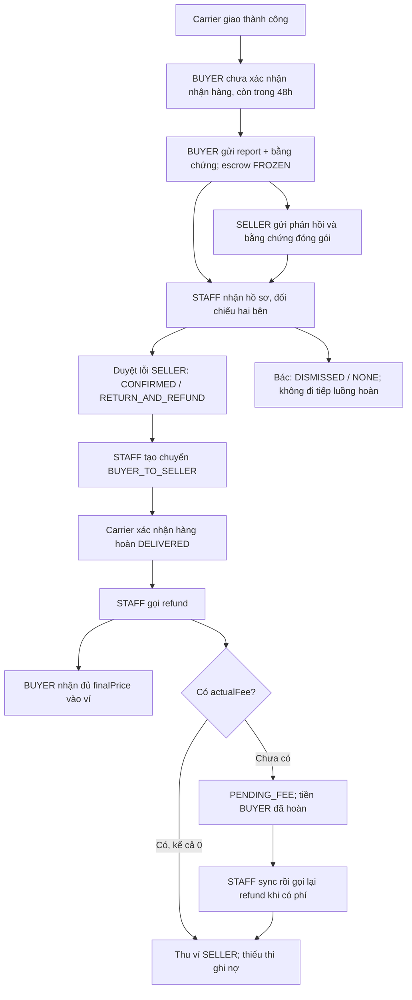

# FE: Khiếu nại đơn hàng, bằng chứng, hoàn hàng, hoàn tiền và công nợ seller

Tài liệu triển khai toàn bộ luồng trong hai ảnh mô tả nghiệp vụ: BUYER mở khiếu nại, SELLER phản hồi bằng ảnh/video, STAFF đối chiếu và duyệt hoàn hàng, tạo chuyến hoàn, hoàn tiền hàng vào ví BUYER và thu phí hoàn từ SELLER có lỗi. Thiếu số dư SELLER thì ghi công nợ.

Các API, field và điều kiện dưới đây được đối chiếu với controller, DTO và service BE trong repository. Đề xuất bố cục/route FE là hướng dẫn giao diện; không phải API BE mới. Tất cả UUID và số tiền trong JSON chỉ minh họa; thay bằng dữ liệu thật trả về từ BE.

## 1. Quy tắc nghiệp vụ phải giữ đúng

1. BUYER chỉ mở khiếu nại mới khi đơn đã được carrier xác nhận giao thành công, chưa xác nhận nhận hàng và BE tiếp nhận trước `shippingDeliveredAt + 48 giờ`. Đúng thời điểm hết hạn cũng bị từ chối.
2. Xác nhận nhận hàng là `PUT /api/v1/orders/{id}/delivered`: thao tác có thể giải ngân ngay cho SELLER. Không dùng API này để mô phỏng carrier giao hàng khi test khiếu nại.
3. Khiếu nại hợp lệ làm escrow `FROZEN`. Qua hạn 48 giờ, STAFF vẫn được xử lý report đã mở hợp lệ; BUYER/SELLER vẫn có thể bổ sung phản hồi khi report còn `OPEN` hoặc `IN_REVIEW`.
4. STAFF duyệt `CONFIRMED + RETURN_AND_REFUND` chưa đồng nghĩa đã tạo chuyến hoặc đã hoàn tiền. Phải có chuyến `BUYER_TO_SELLER` được chọn cho report và carrier xác nhận `DELIVERED` trước refund.
5. BUYER nhận đủ `finalPrice` vào ví SecondLife; không trừ phí hoàn hàng vào tiền hàng. Phí vận chuyển chiều giao ban đầu không được cộng vào khoản hoàn sản phẩm này. Không mô tả đây là hoàn trực tiếp về ngân hàng.
6. Với lỗi `SELLER`, BE chốt phí hoàn khi refund thành công: `feeAmount = actualFee`, `collectedAmount = min(số dư khả dụng seller, feeAmount)`, `debtAmount = feeAmount - collectedAmount`. Ví không bị trừ âm.
7. Không có `actualFee` thì vẫn hoàn tiền BUYER và ghi khoản phí `PENDING_FEE`. Sau sync có phí, STAFF gọi lại API refund để chốt khoản phí đang chờ; không hoàn BUYER lần hai. Phí `0` là miễn phí hợp lệ, khác với thiếu phí.
8. Khoản phí đã chốt `PAID/OUTSTANDING` không tự đổi theo callback phí đến sau. Công nợ chưa được tự động thu khi seller nạp tiền/nhận doanh thu; chưa có API thanh toán nợ thủ công.
9. Report sau refund vẫn `CONFIRMED`; dùng `refundedAt/refundAmount/refundedBy` để hiển thị hoàn tiền thành công. Đơn chuyển `status=CANCELLED`, `escrowStatus=REFUNDED`. Không đợi enum report `REFUNDED`.
10. Khi hoàn tiền thành công với lỗi SELLER, BE ghi nhận lỗi và tính lại uy tín một lần. FE tải lại điểm từ API, không tự trừ cố định 5/10 điểm.



## 2. Các màn hình FE cần có

| Màn hình | Nội dung và thao tác |
| --- | --- |
| BUYER / Đơn mua | Nút Khiếu nại, hạn còn lại; nút Xác nhận đã nhận hàng có cảnh báo về việc đóng quyền khiếu nại |
| BUYER / Tạo khiếu nại | Lý do, mô tả, tải ảnh/video riêng tư, preview, tiến độ upload, gửi report |
| BUYER / Khiếu nại của tôi | Danh sách ORDER report, chi tiết report, bằng chứng ban đầu, phản hồi của chính mình, lịch sử hoàn hàng/biên nhận hoàn tiền |
| SELLER / Đơn bị khiếu nại | Đi vào từ notification kèm reportId; phản hồi, ảnh/video đóng gói của chính seller; xem phần phản hồi của mình |
| STAFF / Hàng đợi tranh chấp | Lọc OPEN/IN_REVIEW/CONFIRMED/DISMISSED; nhận xử lý, mở chi tiết |
| STAFF / Chi tiết tranh chấp | Hồ sơ, bằng chứng hai bên, kết luận, vận đơn hoàn/timeline, refund, khoản phí và nợ |
| SELLER / Phí hoàn hàng | Danh sách phí, bộ lọc còn nợ, tổng công nợ; hiển thị số đã thu và số còn nợ |

Trong màn hình STAFF, bố trí bằng chứng BUYER và SELLER thành hai khu vực cạnh nhau trên desktop, dạng tab trên mobile. Mỗi bằng chứng hiển thị tác giả, vai trò, ngày gửi, ảnh/video và trạng thái tải. Phản hồi chỉ có nội dung chữ vẫn là dữ liệu hợp lệ; không tự bắt buộc video khi BE chưa yêu cầu.

### 2.1. Quyền truy cập và giới hạn riêng tư

| Dữ liệu/thao tác | Quyền thực tế |
| --- | --- |
| Tạo report ORDER | Đúng BUYER của đơn; BE kiểm tra quyền sở hữu và điều kiện giao/escrow |
| Upload ảnh/video bằng chứng | Đăng nhập + `MEDIA_UPLOAD_SELF`; upload thuộc tài khoản đang đăng nhập |
| Xem report chi tiết | Người tạo report hoặc STAFF/ADMIN có quyền review; SELLER không mặc nhiên được xem report gốc của buyer |
| Gửi phản hồi | Reporter hoặc SELLER của report; report ORDER còn OPEN/IN_REVIEW |
| Danh sách phản hồi | BUYER/SELLER chỉ xem phản hồi của chính mình; reviewer được xem cả hai bên |
| Queue, chi tiết/bằng chứng hai bên, nhận xử lý | `ROLE_STAFF` + `STAFF_FRAUD_REVIEW`, hoặc `ROLE_ADMIN` + `ADMIN_RBAC_MANAGE` |
| Duyệt RETURN_AND_REFUND | STAFF có cả `STAFF_FRAUD_REVIEW` và `STAFF_DISPUTE_REVIEW`, hoặc ADMIN có `ADMIN_RBAC_MANAGE` |
| Tạo chuyến hoàn/refund | `ROLE_STAFF` + `STAFF_DISPUTE_REVIEW`, hoặc `ROLE_ADMIN` + `ADMIN_RBAC_MANAGE` |
| Đọc chi tiết phí hoàn | SELLER sở hữu khoản phí, hoặc STAFF có `STAFF_DISPUTE_REVIEW`, hoặc ADMIN có `ADMIN_RBAC_MANAGE` |
| Danh sách phí/tổng nợ cá nhân seller | `ROLE_SELLER` + `PROFILE_READ_SELF` |

Chỉ `report.reviewerId === currentUser.id` được kết luận report, kể cả ADMIN. Reviewer không được là buyer tạo report hoặc seller liên quan. STAFF khác đã có quyền vận hành vẫn có thể tạo chuyến/refund; không tự giới hạn các thao tác này chỉ cho reviewer.

Đọc events/tracking, sync/cancel/reconcile vận đơn hiện có quy tắc STAFF/ADMIN và ownership riêng trong BE; không khẳng định mọi endpoint đều kiểm tra cùng authority. Màn hình vận hành STAFF nên giới hạn các nút theo quyền xử lý tranh chấp nêu trên.

## 3. Contract chung và cách lấy ID

### 3.1. Cách đọc response

- Gửi Bearer token với mọi API riêng tư của BE. JSON request thêm `Content-Type: application/json`; multipart để browser sinh Content-Type/boundary.
- Các API report, phản hồi, upload bằng chứng, video, shipment và phí hoàn trả `ApiResponse`: đọc `body.data`.
- Trang report/phản hồi/phí: `body.data.items`, cùng `page/size/totalElements/totalPages/isLast`.
- `GET /orders/buyer` và `/orders/seller` trả Spring Page trực tiếp: đọc `body.content`, không phải `body.data.items`.
- `GET /wallets/me` trả DTO trực tiếp; lịch sử ví trả PageResponse trực tiếp ở `body.items`.
- Nếu dùng axios, `response.data` là HTTP body. Ví dụ report là `response.data.data`; gọi `.data` hai lần có chủ đích, không áp cho endpoint trả DTO trực tiếp.
- Field null có thể bị lược bỏ. Dùng `value == null` để xử lý cả null và undefined. Đừng dùng `!actualFee` để kiểm tra thiếu phí vì số `0` hợp lệ.
- Mốc nghiệp vụ `createdAt/shippingDeliveredAt/refundedAt` là Instant có múi giờ; dùng chúng để hiển thị. `timestamp` của envelope không dùng làm deadline khiếu nại.

Ví dụ trang report rút gọn:

```json
{
  "success": true,
  "message": "Operation successful",
  "data": {
    "items": [
      {
        "id": "11111111-1111-4111-8111-111111111111",
        "orderId": "22222222-2222-4222-8222-222222222222",
        "targetType": "ORDER",
        "status": "OPEN",
        "resolutionAction": "NONE",
        "createdAt": "2026-10-23T03:00:00Z"
      }
    ],
    "page": 0,
    "size": 20,
    "totalElements": 1,
    "totalPages": 1,
    "isLast": true
  }
}
```

### 3.2. ID dùng ở từng bước

| ID | Nguồn |
| --- | --- |
| orderId | `OrderResponseDTO.id` trong đơn mua/bán; hoặc `ReportResponse.orderId` đối với STAFF |
| reportId | `POST /reports` trả `data.id`; hoặc queue STAFF/notification có referenceType REPORT |
| evidenceId/evidenceUrl | Response upload ảnh hoặc `/api/video/complete`; không tự dựng URL CDN |
| returnShipmentId | Sau booking lấy `data.shipmentId`, rồi tải report kiểm tra `data.returnShipmentId` |
| uploadId/publicId | Response `/api/video/upload-signature`; cùng chủ sở hữu phải gọi complete |

SELLER không dùng `GET /reports/me` để tìm khiếu nại của buyer: endpoint này chỉ trả report do người đang đăng nhập tạo. Notification về đơn có khiếu nại có `referenceType=REPORT`, `referenceId=reportId`, `actionUrl=/seller/orders/{orderId}`. FE giữ referenceId khi điều hướng, ví dụ bằng state hoặc query của route FE do dự án chọn.

Hiện chưa có API liệt kê riêng mọi report mà seller là người bị khiếu nại, cũng chưa có API seller đọc summary/status của report gốc. Với luồng truy cập trực tiếp/reload mất notification context, cần giữ ánh xạ reportId đã nhận hoặc phối hợp bổ sung BE; không lấy orderId làm reportId và không gọi queue STAFF bằng token seller.

## 4. BUYER: điều kiện mở khiếu nại và form

### 4.1. Dữ liệu đơn và điều kiện sơ bộ

```http
GET /api/v1/orders/buyer?page=0&size=20&sort=createdAt,desc
```

`OrderResponseDTO` có `id/buyerId/sellerId/finalPrice/status/escrowStatus/shippingDeliveredAt`. Dùng dữ liệu đơn mới nhất từ API đã có; hiện không có `GET /api/v1/orders/{id}` trả đầy đủ DTO này.

Ví dụ điều kiện UX, không thay thế kiểm tra BE:

```js
function canOpenOrderReport(order, currentUserId, nowMs = Date.now()) {
  if (!order || order.buyerId !== currentUserId) return false;
  const deliveredMs = Date.parse(order.shippingDeliveredAt ?? "");
  return order.status === "DELIVERED"
    && ["HELD", "FROZEN"].includes(order.escrowStatus)
    && Number.isFinite(deliveredMs)
    && deliveredMs <= nowMs
    && nowMs < deliveredMs + 48 * 60 * 60 * 1000;
}
```

BE không trả field `buyerConfirmedAt` trong DTO này; không tự bịa field. Sau buyer xác nhận, trạng thái/escrow không còn đủ điều kiện mở report. Đồng hồ máy người dùng có thể lệch: countdown chỉ hỗ trợ UX; BE quyết định còn hạn hay không khi nhận request. Upload sát hạn có thể khiến lúc gửi report đã hết hạn.

Không khóa mọi khiếu nại chỉ vì escrow FROZEN: BE cho mở report hợp lệ khi escrow HELD hoặc FROZEN, nhưng sẽ chặn report cùng target/reason đang chờ xử lý. Nên tải danh sách report của buyer để hướng họ vào hồ sơ đang có thay vì tạo lặp.

### 4.2. Field form

| Field | Quy tắc |
| --- | --- |
| Lý do | `reasonCode`; ưu tiên MISLEADING_DESCRIPTION/COUNTERFEIT/OTHER theo ca thực tế |
| Nội dung | `description`, bắt buộc có nội dung, tối đa 2000 ký tự |
| Bằng chứng | Danh sách evidenceUrl đã upload/complete thành công; có thể trống theo contract BE |
| requestId | UUID sinh một lần cho một lần gửi nghiệp vụ, giữ nguyên khi retry |
| orderId | Đơn đang khiếu nại; không gửi đồng thời postId/relatedPostId |

Enum ReasonCode hiện có: `MISLEADING_DESCRIPTION`, `COUNTERFEIT`, `FRAUD`, `ITEM_NOT_RECEIVED`, `OTHER`, `LATE_HANDOVER`, `SELLER_CANCELLATION`, `RETURN_NOT_AS_DESCRIBED`, `DUPLICATE_LISTING`. Không đưa toàn bộ enum vào dropdown chỉ vì tồn tại: DUPLICATE_LISTING dành cho listing, không hợp lệ với order; các lý do chuyên biệt có kiểm tra nghiệp vụ khi STAFF chốt. ITEM_NOT_RECEIVED cũng không bỏ qua điều kiện carrier đã ghi nhận giao thành công của luồng này.

Giới hạn số evidence ban đầu lấy từ `app.reputation.max-evidence-images` (hiện `.env` là 6); không coi giới hạn 10 của phản hồi là giới hạn tạo report. FE nên dùng cấu hình chung được thống nhất với môi trường BE vì chưa có endpoint trả các hạn mức này.

### 4.3. Gửi và xem report

```http
POST /api/v1/reports
```

```json
{
  "requestId": "aaaaaaaa-aaaa-4aaa-8aaa-aaaaaaaaaaaa",
  "orderId": "22222222-2222-4222-8222-222222222222",
  "reasonCode": "MISLEADING_DESCRIPTION",
  "description": "Sản phẩm nhận được khác mô tả, đề nghị xem xét hoàn hàng và hoàn tiền.",
  "evidenceUrls": [
    "/api/v1/reports/evidence/77777777-7777-4777-8777-777777777777"
  ]
}
```

HTTP 201 trả ReportResponse tại `data`: lưu reportId, chuyển sang chi tiết khiếu nại, tải lại đơn và danh sách report. Toast: “Đã gửi khiếu nại. Tiền hàng đang được giữ để xem xét.” Không hiển thị “Đã hoàn tiền”.

```http
GET /api/v1/reports/me?targetType=ORDER&page=0&size=20
GET /api/v1/reports/{reportId}
```

Report của tôi và queue STAFF cố định mới nhất trước: `createdAt DESC, id DESC`. Không gửi `sort=["string"]` hoặc tự coi sort là filter được hỗ trợ.

## 5. Ảnh và video bằng chứng: chọn, upload, preview, xem lại

### 5.1. State upload trong FE

Mỗi file giữ: `localId`, `file`, `previewUrl`, `kind`, `state` (LOCAL/UPLOADING/VERIFYING/READY/ERROR), `progress`, `evidenceId`, `evidenceUrl`, `error`. Đây là state FE, không gửi enum này cho BE.

- Chọn file qua input thật trên màn hình; preview file local bằng object URL và thu hồi khi bỏ file/unmount.
- Trong lúc UPLOADING/VERIFYING, khóa nút gửi hồ sơ để tránh chỉ gửi một phần bằng chứng người dùng đã chọn. READY chỉ khi đã có evidenceUrl từ BE.
- Upload ảnh và video của buyer dùng token BUYER; seller dùng token SELLER. Không lấy video buyer để gắn vào phản hồi seller.
- Gửi `evidenceUrls` duy nhất, không trùng. Upload chưa gắn report chưa được reviewer đọc; phải gửi report/phản hồi thành công mới đủ điều kiện review.
- Phản hồi đã gửi chỉ bổ sung mới, không sửa/xóa. Không đưa nút xóa file đã nộp để tạo cảm giác có thể thay đổi hồ sơ đã gửi.

### 5.2. Upload ảnh riêng tư

```http
POST /api/v1/reports/evidence
Content-Type: multipart/form-data
```

Field multipart là **file**, mỗi request một ảnh. JPEG/PNG/WebP; giới hạn bytes theo `app.media.max-file-size-bytes`, hiện `.env` là 10485760 bytes (10 MiB). Đây là API ảnh bằng chứng, không dùng `/posts/init` hoặc lấy ảnh public của listing thay cho upload riêng tư.

Ví dụ hàm gọi từ handler chọn file của React/Vue:

```js
async function uploadPrivateEvidenceImage(apiOrigin, token, file, signal) {
  const allowed = ["image/jpeg", "image/png", "image/webp"];
  if (!allowed.includes(file.type)) throw new Error("Chọn ảnh JPEG, PNG hoặc WebP");
  if (file.size <= 0 || file.size > 10 * 1024 * 1024) {
    throw new Error("Ảnh phải có dữ liệu và không vượt 10 MiB trong cấu hình hiện tại");
  }
  const form = new FormData();
  form.append("file", file);
  const res = await fetch(`${apiOrigin}/api/v1/reports/evidence`, {
    method: "POST",
    headers: { Authorization: `Bearer ${token}` },
    body: form,
    signal
  });
  const body = await res.json();
  if (!res.ok || !body.success) throw new Error(body.message ?? `HTTP ${res.status}`);
  return body.data;
}
```

`apiOrigin` là origin BE đã cấu hình, ví dụ `http://localhost:8080`, không chứa thêm `/api/v1`. Mốc 10 MiB trong ví dụ phải đồng bộ nếu cấu hình môi trường thay đổi. Không áp nhầm giới hạn pixel của tính năng so sánh ảnh `/posts/init` vào API bằng chứng này; giữ ảnh gốc phục vụ đối chiếu, không tự cắt/chỉnh nội dung bằng chứng.

Response HTTP 201:

```json
{
  "success": true,
  "message": "Operation successful",
  "data": {
    "evidenceId": "77777777-7777-4777-8777-777777777777",
    "evidenceUrl": "/api/v1/reports/evidence/77777777-7777-4777-8777-777777777777",
    "contentType": "image/jpeg",
    "size": 185230
  }
}
```

Chỉ đưa `data.evidenceUrl` vào report/phản hồi. Lỗi mạng khi upload ảnh không có requestId chống lặp ở API này: nếu upload lại, giữ duy nhất reference được chọn cho hồ sơ, không tự gửi mọi reference phát sinh do retry.

### 5.3. Video khui hàng/đóng gói

Luồng đã có: xin signature BE → upload chunk trực tiếp Cloudinary → complete tại BE → dùng evidenceUrl. Hướng dẫn chi tiết và hàm dùng lại: [FE_CHUNKED_VIDEO_EVIDENCE_GUIDE.md](FE_CHUNKED_VIDEO_EVIDENCE_GUIDE.md), [direct-video-upload.js](examples/direct-video-upload.js).

```http
POST /api/video/upload-signature
```

```json
{
  "requestId": "dddddddd-dddd-4ddd-8ddd-dddddddddddd"
}
```

Response có `uploadId/publicId/signature/parameters/uploadUrl/expiresAt/maxBytes/chunkSizeBytes`. Dùng nguyên dữ liệu BE trả, upload chunk tuần tự, không gửi JWT SecondLife tới Cloudinary. Mỗi file mới dùng session mới. Hạn mức tài khoản provider có thể thấp hơn `maxBytes`; chia chunk không bỏ giới hạn tổng dung lượng video.

Sau provider trả asset hoàn tất, cùng tài khoản gọi:

```http
POST /api/video/complete
```

```json
{
  "uploadId": "99999999-9999-4999-8999-999999999999",
  "publicId": "report-evidence/videos/99999999-9999-4999-8999-999999999999"
}
```

HTTP 200 trả `data.evidenceId/evidenceUrl` cùng metadata video. UploadId/publicId bắt buộc; videoUrl/bytes/format/duration có thể bỏ, nếu gửi phải đúng asset. Complete thành công vẫn chưa gắn vào report: tiếp tục gửi evidenceUrl trong tạo report/phản hồi. Không dùng videoUrl Cloudinary trong evidenceUrls.

### 5.4. Xem bằng chứng hỗn hợp IMAGE/VIDEO

Không giả định mọi evidenceUrls đều là ảnh. Lấy evidenceId từ reference riêng tư và gọi:

```http
GET /api/v1/reports/evidence/{evidenceId}/metadata
```

Ví dụ `data` cho video:

```json
{
  "evidenceId": "99999999-9999-4999-8999-999999999999",
  "contentType": "video/mp4",
  "size": 8558868,
  "mediaType": "VIDEO",
  "contentUrl": "/api/video/99999999-9999-4999-8999-999999999999/playback"
}
```

| mediaType | Cách hiển thị |
| --- | --- |
| IMAGE | Fetch contentUrl với Bearer → response.blob() → object URL cho img/lightbox; thu hồi URL khi đóng/unmount |
| VIDEO | GET contentUrl với Bearer để nhận JSON `data.url/expiresAt`; dùng URL tạm cho video controls, không tải cả video về BE/blob |

URL ảnh riêng tư không tự mang Bearer khi gắn trực tiếp vào img src. ContentUrl của video là API JSON, không đặt thẳng vào video src. Ví dụ lấy playback URL:

```json
{
  "success": true,
  "data": {
    "url": "https://api.cloudinary.com/v1_1/example/video/download?EXAMPLE_SIGNED_PARAMETERS",
    "expiresAt": "2026-10-23T04:05:00Z"
  }
}
```

URL trên chỉ minh họa hình dạng giá trị; luôn dùng URL thật BE trả. Khi hết hạn và người dùng còn quyền xem, xin lại playback. Không thêm Bearer vào request tới provider, không lưu link tạm làm bằng chứng dài hạn. Player lỗi có thể do hết hạn/mất quyền/mạng; không lặp xin playback vô hạn.

Chỉ gửi token tới origin BE đã cấu hình và các path bằng chứng/playback đúng định dạng. Không fetch kèm token tới một URL ngoài hệ thống do dữ liệu tự nhập cung cấp. Reviewer không được xem upload chưa gắn hồ sơ; bên còn lại không được xem bằng chứng riêng tư của nhau chỉ vì cùng đơn.

Ví dụ helper xem bằng chứng để gắn vào gallery/lightbox React hoặc Vue (apiOrigin là cấu hình tin cậy của FE):

```js
async function loadPrivateEvidenceView(apiOrigin, token, evidenceUrl, signal) {
  const uuid = "[0-9a-f]{8}-[0-9a-f]{4}-[0-9a-f]{4}-[0-9a-f]{4}-[0-9a-f]{12}";
  const evidencePath = new RegExp(`^/api/v1/reports/evidence/${uuid}$`, "i");
  const playbackPath = new RegExp(`^/api/video/${uuid}/playback$`, "i");
  if (!evidencePath.test(evidenceUrl)) throw new Error("Reference bằng chứng không hợp lệ");
  const options = { headers: { Authorization: `Bearer ${token}` }, signal, cache: "no-store" };
  async function readJson(path) {
    const res = await fetch(`${apiOrigin}${path}`, options);
    const body = await res.json();
    if (!res.ok || !body.success) throw new Error(body.message ?? `HTTP ${res.status}`);
    return body.data;
  }
  const metadata = await readJson(`${evidenceUrl}/metadata`);
  if (metadata.mediaType === "IMAGE") {
    if (!evidencePath.test(metadata.contentUrl)) throw new Error("Đường dẫn ảnh không hợp lệ");
    const res = await fetch(`${apiOrigin}${metadata.contentUrl}`, options);
    if (!res.ok) throw new Error(`Không tải được ảnh: HTTP ${res.status}`);
    const src = URL.createObjectURL(await res.blob());
    return { kind: "IMAGE", src, dispose: () => URL.revokeObjectURL(src) };
  }
  if (metadata.mediaType === "VIDEO") {
    if (!playbackPath.test(metadata.contentUrl)) throw new Error("Đường dẫn playback không hợp lệ");
    const playback = await readJson(metadata.contentUrl);
    if (new URL(playback.url).protocol !== "https:") throw new Error("URL xem video không hợp lệ");
    return { kind: "VIDEO", src: playback.url, expiresAt: playback.expiresAt, dispose: () => {} };
  }
  throw new Error("Loại bằng chứng chưa được hỗ trợ");
}
```

Gọi helper khi mở bằng chứng; kind IMAGE dùng img, kind VIDEO dùng video có controls/preload metadata. Khi đổi file/đóng/unmount, gọi dispose của view cũ và hủy request đang chờ bằng AbortController. Với component dùng effect/watch, bỏ kết quả của request đã lỗi thời để tránh ảnh cũ ghi đè ảnh mới. Không tải video để tạo thumbnail bằng cách fetch toàn bộ video về browser.

## 6. SELLER/BUYER: phản hồi và bổ sung bằng chứng

### 6.1. Gửi phản hồi

```http
POST /api/v1/reports/{reportId}/responses
```

Ví dụ SELLER, token/upload đều thuộc seller:

```json
{
  "requestId": "bbbbbbbb-bbbb-4bbb-8bbb-bbbbbbbbbbbb",
  "description": "Video tình trạng sản phẩm và quá trình đóng gói trước khi giao cho hãng vận chuyển.",
  "evidenceUrls": [
    "/api/v1/reports/evidence/88888888-8888-4888-8888-888888888888",
    "/api/v1/reports/evidence/99999999-9999-4999-8999-999999999999"
  ]
}
```

Description bắt buộc, tối đa 2000 ký tự. Tối đa 10 evidence/phản hồi; URL không trùng, thuộc chính tác giả và chưa bị ràng buộc bởi lần gửi khác. `authorRole` do BE xác định, FE không gửi. BUYER bổ sung dùng cùng API nhưng bằng chứng/token của buyer.

HTTP 201 trả `data`:

```json
{
  "id": "eeeeeeee-eeee-4eee-8eee-eeeeeeeeeeee",
  "reportId": "11111111-1111-4111-8111-111111111111",
  "authorId": "33333333-3333-4333-8333-333333333333",
  "authorRole": "SELLER",
  "requestId": "bbbbbbbb-bbbb-4bbb-8bbb-bbbbbbbbbbbb",
  "description": "Video tình trạng sản phẩm và quá trình đóng gói trước khi giao cho hãng vận chuyển.",
  "evidenceUrls": [
    "/api/v1/reports/evidence/88888888-8888-4888-8888-888888888888",
    "/api/v1/reports/evidence/99999999-9999-4999-8999-999999999999"
  ],
  "createdAt": "2026-10-23T03:15:00Z"
}
```

Giữ nguyên requestId/body khi timeout. Request mới sau report đã CONFIRMED/DISMISSED bị 409; retry cùng nội dung đã lưu vẫn có thể trả kết quả cũ. Không cung cấp nút sửa/xóa phản hồi đã gửi.

### 6.2. Danh sách và điều kiện form seller

```http
GET /api/v1/reports/{reportId}/responses?page=0&size=20
```

Response `data.items`, thứ tự **createdAt ASC, id ASC**, tối đa 100/trang. STAFF phải tải đủ các trang cần đối chiếu, không coi trang đầu là toàn bộ bằng chứng. BUYER/SELLER chỉ nhận bài của chính họ; không được hiển thị “bên kia chưa gửi gì” dựa trên danh sách này.

Seller không đọc được report gốc/status qua GET report. Vì vậy không xây form seller phụ thuộc bắt buộc GET report thành công. Khi có reportId từ notification nhưng chưa biết trạng thái chính xác, FE có thể cho gửi phản hồi để BE kiểm tra; nếu 409 báo hồ sơ đã chốt thì đóng form gửi mới. Không giả định nội dung notification là API trạng thái đầy đủ. Nếu sản phẩm yêu cầu seller xem kết luận/status theo thời gian thực sau reload, cần bổ sung API summary có quyền seller ở BE.

## 7. STAFF: tải và đối chiếu hồ sơ

### 7.1. Queue và chi tiết

```http
GET /api/v1/staff/reports?targetType=ORDER&status=OPEN&page=0&size=20
GET /api/v1/reports/{reportId}
GET /api/v1/reports/{reportId}/responses?page=0&size=20
```

Queue lọc `status` và `targetType`; bỏ status để xem tất cả. Không có filter BE cho reviewerId/refundedAt/resolutionAction/orderId hay tổng toàn cục “chờ refund”. Lọc giai đoạn trên một trang chỉ mang ý nghĩa trong trang đó.

Chi tiết report rút gọn tại `data` trước quyết định:

```json
{
  "id": "11111111-1111-4111-8111-111111111111",
  "orderId": "22222222-2222-4222-8222-222222222222",
  "reporterId": "44444444-4444-4444-8444-444444444444",
  "sellerId": "33333333-3333-4333-8333-333333333333",
  "targetType": "ORDER",
  "reasonCode": "MISLEADING_DESCRIPTION",
  "description": "Sản phẩm nhận được khác mô tả.",
  "evidenceUrls": ["/api/v1/reports/evidence/77777777-7777-4777-8777-777777777777"],
  "status": "IN_REVIEW",
  "reviewerId": "55555555-5555-4555-8555-555555555555",
  "resolutionAction": "NONE",
  "responsibleParty": null,
  "returnShipmentId": null,
  "refundedAt": null
}
```

Khu vực BUYER gồm bằng chứng ban đầu ở `report.evidenceUrls` và responses có authorRole BUYER. Khu vực SELLER gồm responses có authorRole SELLER. Hiển thị trạng thái rỗng/lỗi/tải riêng từng nguồn, không gộp lỗi API thành “không có bằng chứng”. BE hiện không ép staff phải bấm xem từng file; FE có thể nhắc đối chiếu trước quyết định nhưng không nói BE đã xác minh nội dung video.

### 7.2. Nhận xử lý

```http
POST /api/v1/staff/reports/{reportId}/start-review
```

Không có body. HTTP 200 trả ReportResponse: `status=IN_REVIEW`, reviewerId là UUID tài khoản nhận. Tải lại queue và chi tiết. Nếu người khác đã nhận, hiện reviewer và chế độ chỉ đọc cho phần kết luận; không có chức năng giành/chuyển người phụ trách trong API hiện tại.

### 7.3. Duyệt hoàn hàng và hoàn tiền

```http
POST /api/v1/staff/reports/{reportId}/resolve
```

```json
{
  "decision": "CONFIRMED",
  "responsibleParty": "SELLER",
  "reason": "Đã đối chiếu bằng chứng hai bên, xác nhận sản phẩm không đúng mô tả. Chấp thuận hoàn hàng và hoàn tiền.",
  "resolutionAction": "RETURN_AND_REFUND"
}
```

Reason bắt buộc, không chỉ khoảng trắng, tối đa 2000 ký tự. Confirm modal nêu rõ: “Chấp thuận hoàn hàng; hoàn tiền sau khi hàng về seller. Seller có lỗi chịu phí hoàn theo phí thực tế.” Sau 200, report có `status=CONFIRMED`, action RETURN_AND_REFUND, `returnApprovedAt`. Chuyển giao diện sang “Chờ tạo chuyến hoàn”, chưa hiện biên nhận hoàn tiền.

Quyết định đã chốt không đổi bằng cách gọi lại resolve. Không chốt CONFIRMED/NONE làm bước tạm rồi định đổi sang hoàn hàng sau. Các party BUYER/CARRIER được BE hỗ trợ cho quyết định phù hợp, nhưng không áp chính sách thu phí lỗi seller; tài liệu này không định nghĩa một chính sách thu phí mới cho hai party đó.

### 7.4. Bác khiếu nại

Cùng endpoint resolve:

```json
{
  "decision": "DISMISSED",
  "responsibleParty": "NONE",
  "reason": "Bằng chứng hiện có chưa xác nhận nội dung khiếu nại.",
  "resolutionAction": "NONE"
}
```

HTTP 200 trả DISMISSED. Dừng luồng hoàn hàng của report này. Không hiển thị đã giải ngân: BE chỉ có thể gỡ freeze khi không còn hold khác và chưa tự trả tiền seller ngay trong thao tác bác.

## 8. STAFF: tạo và vận hành chuyến hoàn

### 8.1. Tạo chuyến

```http
POST /api/v1/orders/{orderId}/shipments
```

```json
{
  "requestId": "cccccccc-cccc-4ccc-8ccc-cccccccccccc",
  "leg": "BUYER_TO_SELLER",
  "reason": "Tạo chuyến hoàn theo quyết định xử lý khiếu nại đã được duyệt.",
  "reportId": "11111111-1111-4111-8111-111111111111"
}
```

BE dùng snapshot địa chỉ buyer/seller và kiện hàng đã thanh toán. Không gửi giá ship, public địa chỉ tự nhập hoặc loại xe tùy ý vào màn hình này. HTTP 200 trả ShipmentResponse nhưng phải đọc `status/lastError`: success=true chưa đảm bảo carrier đã nhận booking.

Ví dụ data booking:

```json
{
  "shipmentId": "66666666-6666-4666-8666-666666666666",
  "orderId": "22222222-2222-4222-8222-222222222222",
  "leg": "BUYER_TO_SELLER",
  "orderCode": "1234567890123456789",
  "status": "READY_TO_PICK",
  "providerStatus": "ASSIGNING_DRIVER",
  "quotedFee": 30000,
  "actualFee": 30000,
  "deliveredAt": null,
  "lastError": null,
  "provider": "LALAMOVE"
}
```

Giữ orderCode dưới dạng string, không ép sang Number. Lưu requestId cùng body cho đến khi biết kết quả; khi booking timeout không sinh UUID mới để bắn lại chuyến.

### 8.2. Chọn đúng chuyến đã liên kết

```http
GET /api/v1/orders/{orderId}/shipments
```

`data` là array gồm cả chiều giao và chiều hoàn. Tải lại report sau booking để lấy returnShipmentId. Chọn đúng:

```js
const selectedReturn = shipments.find(s =>
  s.shipmentId === report.returnShipmentId &&
  s.orderId === report.orderId &&
  s.leg === "BUYER_TO_SELLER"
);
```

Không chọn shipment cuối mảng hoặc bất kỳ chuyến DELIVERED nào. Nếu link report tồn tại nhưng không có phần tử phù hợp, khóa thao tác tiền/tạo thêm và tải lại; không thay bằng outbound đã giao thành công.

### 8.3. Đồng bộ, timeline, tracking, hủy và đối soát

| Thao tác | API | Body |
| --- | --- | --- |
| Đồng bộ dữ liệu carrier | `POST /api/v1/shipments/{shipmentId}/sync` | Không có |
| Xem lịch sử | `GET /api/v1/shipments/{shipmentId}/events` | Không có |
| Xem tài xế/vị trí khi có | `GET /api/v1/shipments/{shipmentId}/tracking` | Không có |
| Hủy chuyến còn được phép | `POST /api/v1/shipments/{shipmentId}/cancel` | Không có |
| Đối soát booking chưa rõ | `POST /api/v1/shipments/{shipmentId}/reconcile-creation` | JSON bên dưới |

```json
{
  "orderCode": "1234567890123456789"
}
```

Reconcile chỉ nhận mã đơn đã tồn tại bên hãng để BE kiểm tra, không tạo carrier booking mới. Không có API ép DELIVERED; sync không phải nút giả lập giao xong. Theo dõi khi cần, tối đa một request tracking mỗi 10 giây; vị trí có thể không có trước nhận chuyến hoặc sau hoàn tất.

| Shipment.status | Nhãn FE | Xử lý |
| --- | --- | --- |
| CREATING | Đang tạo chuyến | Khóa tạo thêm; tải lại/đối soát nếu kéo dài |
| CREATION_UNCERTAIN | Chưa rõ kết quả tạo | Đối soát chuyến đã tồn tại; không tạo key mới |
| READY_TO_PICK | Đang tìm tài xế | Theo dõi; hủy nếu có mã và providerStatus ASSIGNING_DRIVER |
| ASSIGNED | Tài xế đang đến lấy hàng | Theo dõi; hủy nếu providerStatus ON_GOING và carrier còn cho phép |
| PICKED | Đã lấy hàng hoàn | Theo dõi, chưa refund |
| DELIVERED | Hàng đã về seller | STAFF có thể thao tác refund khi đủ các điều kiện khác |
| CANCELLED | Chuyến đã hủy/bị từ chối tạo | Đọc lastError; tạo chuyến thay thế chỉ khi đã biết chắc hủy và không có chuyến khác hoạt động |
| FAILED | Chuyến thất bại | Xử lý ngoại lệ; không tự coi là CANCELLED để tạo lại |

BE chỉ cho thay returnShipmentId khi chuyến trước CANCELLED. Không có API ép FAILED sang CANCELLED hoặc bỏ link; cần hỗ trợ vận hành khi carrier không còn cho hủy.

## 9. STAFF: hoàn tiền và chốt phí seller

### 9.1. Gửi refund

Khi report đã duyệt, chưa refundedAt và đúng selectedReturn đã DELIVERED:

```http
POST /api/v1/shipments/{returnShipmentId}/refund
```

```json
{
  "reason": "Carrier đã xác nhận giao hàng hoàn về seller. Hoàn toàn bộ tiền hàng vào ví buyer theo quyết định đã duyệt."
}
```

Reason bắt buộc, tối đa 2000 ký tự. Không gửi amount/feeAmount/debtAmount hoặc số tiền FE tính. Có thể bỏ responsibleParty để BE lấy từ quyết định; nếu gửi phải khớp party đã chốt.

HTTP 200 vẫn trả ShipmentResponse. Bắt buộc tải lại report để nhận audit; không chờ field refundedAt xuất hiện trong ShipmentResponse.

Ví dụ `data` report sau hoàn, rút gọn:

```json
{
  "id": "11111111-1111-4111-8111-111111111111",
  "status": "CONFIRMED",
  "responsibleParty": "SELLER",
  "resolutionAction": "RETURN_AND_REFUND",
  "returnShipmentId": "66666666-6666-4666-8666-666666666666",
  "returnApprovedAt": "2026-10-23T04:00:00Z",
  "refundedAt": "2026-10-23T06:00:00Z",
  "refundedBy": "55555555-5555-4555-8555-555555555555",
  "refundAmount": 500000
}
```

Nếu refund bị lỗi giữa transaction lần đầu, tiền buyer, thu phí seller, ghi nợ, sổ cái và audit cùng rollback. Đừng tự cộng/trừ số dư trên UI bằng optimistic update.

### 9.2. Xem khoản phí riêng tư

Chỉ SELLER chủ khoản phí hoặc STAFF/ADMIN đúng quyền gọi:

```http
GET /api/v1/shipments/{returnShipmentId}/return-shipping-fee
```

HTTP 200 trả ApiResponse; ví dụ `data` khi phí 30.000đ, ví seller chỉ có 10.000đ:

```json
{
  "shipmentId": "66666666-6666-4666-8666-666666666666",
  "orderId": "22222222-2222-4222-8222-222222222222",
  "reportId": "11111111-1111-4111-8111-111111111111",
  "sellerId": "33333333-3333-4333-8333-333333333333",
  "status": "OUTSTANDING",
  "feeAmount": 30000,
  "collectedAmount": 10000,
  "debtAmount": 20000,
  "createdAt": "2026-10-23T06:00:00Z",
  "assessedAt": "2026-10-23T06:00:00Z",
  "assessedBy": "55555555-5555-4555-8555-555555555555"
}
```

| status phí | Nội dung UI | Nút |
| --- | --- | --- |
| PENDING_FEE | Tiền buyer đã hoàn; đang chờ phí thực tế từ hãng. Không hiển thị feeAmount thiếu thành miễn phí | STAFF được sync; khi có actualFee thì “Chốt phí hoàn hàng” |
| PAID | Tổng phí, đã thu đủ, nợ 0; phí thực tế 0 cũng là PAID hợp lệ | Chỉ đọc |
| OUTSTANDING | Tổng phí, đã thu, còn nợ; hiển thị cảnh báo công nợ seller | Chỉ đọc; chưa có nút thanh toán nợ |
| HTTP 404 | Chưa có assessment: có thể chưa refund, party không phải SELLER hoặc dữ liệu lịch sử không áp hồi tố | Không gán thành PAID/PENDING_FEE; tải lại và đối chiếu report |
| HTTP 403 | Không được phép xem tài chính seller | Không suy thành nợ 0, không retry bằng token buyer |

BUYER không gọi API phí, kể cả khi đó là đơn của mình. Hiển thị biên nhận refundAmount cho buyer; không đưa nợ/số thực thu seller vào DTO/report chung hoặc UI buyer.

### 9.3. Chốt PENDING_FEE sau refund

1. Đọc report có refundedAt và API phí trả đúng PENDING_FEE.
2. STAFF sync selectedReturn; đọc actualFee mới. Nếu `actualFee == null`, tiếp tục chờ, không dùng quotedFee thay thế.
3. Khi có actualFee, kể cả `0`, hiện nút **Chốt phí hoàn hàng**. Nút này gọi lại chính POST refund ở phần 9.1, body reason hợp lệ.
4. Tải lại phí/report/shipments. Buyer không được cộng thêm; audit refundedAt/refundAmount gốc giữ nguyên. Phí thành PAID hoặc OUTSTANDING.

Đây không phải nút hoàn tiền lần hai; không gọi endpoint collect tự đặt vì BE chưa có endpoint đó. Sync/callback chỉ cập nhật carrier, chưa tự thu phí pending. Khi đã PAID/OUTSTANDING, ẩn nút chốt và giữ số snapshot BE trả dù actualFee của shipment đến sau khác đi.

### 9.4. SELLER: danh sách phí và tổng nợ

```http
GET /api/v1/seller/return-shipping-fees?page=0&size=20
GET /api/v1/seller/return-shipping-fees?page=0&size=20&outstandingOnly=true
GET /api/v1/seller/return-shipping-fees/debt
```

Danh sách ở data.items, sắp mới nhất trước. outstandingOnly=true chỉ lấy OUTSTANDING, không gồm PENDING_FEE. Tổng nợ ở data:

```json
{
  "sellerId": "33333333-3333-4333-8333-333333333333",
  "outstandingDebt": 20000
}
```

Tổng nợ là tất cả assessment của seller, không chỉ trang đang hiển thị. Không tự cộng một trang để thay thế endpoint tổng. Không có query sellerId để seller tra người khác. STAFF đọc phí từng chuyến qua API riêng tư; chưa có endpoint STAFF danh sách tổng nợ mọi seller trong thay đổi này.

## 10. Nguồn sự thật cho tiền, điểm uy tín và trạng thái

| Thông tin cần hiển thị | Nguồn BE |
| --- | --- |
| Tiền sản phẩm trước refund đối với buyer/seller | finalPrice trong OrderResponseDTO từ danh sách đơn của chính tài khoản |
| Tiền đã hoàn thực tế | ReportResponse.refundAmount khi refundedAt có giá trị |
| Đã hoàn chưa/người xử lý | refundedAt/refundedBy, không suy từ shipment DELIVERED |
| Phí hoàn/số đã thu/nợ | ReturnShippingFeeResponse; không lấy quotedFee làm assessment |
| Tổng nợ seller | `/seller/return-shipping-fees/debt` |
| Số dư ví cá nhân | `GET /api/v1/wallets/me`, DTO trực tiếp |
| Lịch sử ví cá nhân | `GET /api/v1/wallets/me/transactions?page=0&size=20`, items trực tiếp |
| Điểm uy tín seller | `GET /api/v1/sellers/{sellerId}/reputation`; seller xem `/api/v1/seller/reputation/me` và `/me/history` |

Giao dịch hoàn buyer: type REFUND, referenceId=orderId. Giao dịch seller thực trả: type RETURN_SHIPPING_FEE, amount âm, referenceId=returnShipmentId. Phần nợ không phải một giao dịch tiền mặt đã thu và không phải balance ví âm.

STAFF không gọi `/orders/buyer`, `/orders/seller` hoặc `/wallets/me` rồi coi đó là dữ liệu của buyer/seller đang xem: các API này dùng chính tài khoản đăng nhập. ReportResponse không có finalPrice/escrowStatus/shippingDeliveredAt. `/orders/{orderId}/confirmation` có một số thông tin đơn nhưng không có các field tiền/escrow/hạn đó.

Nếu STAFF có quyền tài chính phù hợp, `/orders/{orderId}/commission` có commissionBase để hiển thị tham khảo tiền hàng snapshot; STAFF thường cần STAFF_PAYOUT_REVIEW, ADMIN cần ADMIN_COMMISSION_MANAGE. Không bắt buộc mọi STAFF phải gọi API này. Khi chưa đọc được tiền trước refund, dùng nhãn “Hoàn toàn bộ tiền hàng theo đơn; BE xác định số tiền”, không đoán từ giá listing hoặc phí ship. Sau refund dùng refundAmount chính thức.

Điểm uy tín được tính lại theo giao dịch/lỗi đã ghi nhận; có trường hợp không có điểm khi chưa có giao dịch đánh giá. Không hiển thị null thành 0 và không khẳng định mỗi khiếu nại trừ cùng một số điểm. `/orders/{id}/settlement` không phải biên nhận hoàn tiền trong luồng này.

## 11. Ma trận hiển thị nút

Các cờ canReview/canOperateReturn được tính từ role + authority ở phần 2.1, không chỉ role STAFF. `approved` nghĩa là report ORDER, status CONFIRMED, action RETURN_AND_REFUND và có returnApprovedAt. `refunded` nghĩa là refundedAt có giá trị. `mine` nghĩa là reviewerId bằng currentUser.id; selfCase là currentUser.id bằng reporterId hoặc sellerId.

| Nút | Điều kiện sơ bộ FE |
| --- | --- |
| BUYER / Khiếu nại mới | canOpenOrderReport ở phần 4.1; không gửi lặp cùng lý do đang chờ |
| BUYER / Bổ sung bằng chứng | Đúng reporter, report OPEN/IN_REVIEW; các file đã READY |
| SELLER / Gửi phản hồi | Đúng seller, có reportId, file READY; xử lý thiếu API trạng thái như phần 6.2, BE quyết định hồ sơ còn mở |
| STAFF / Nhận xử lý | canReview, OPEN, không selfCase |
| STAFF / Duyệt hoàn | canReview + canOperateReturn, IN_REVIEW, mine, không selfCase, report ORDER |
| STAFF / Bác | canReview, IN_REVIEW, mine, không selfCase |
| STAFF / Tạo chuyến | canOperateReturn, approved, chưa refunded, đã tải shipments, chưa có linked return hoặc linked return CANCELLED; không có chuyến hoàn khác còn hoạt động/không rõ kết quả |
| STAFF / Đối soát | canOperateReturn, chuyến LALAMOVE CREATING/CREATION_UNCERTAIN; chưa refunded |
| STAFF / Hủy chuyến | canOperateReturn, đúng selectedReturn, chưa refunded, có orderCode, LALAMOVE và providerStatus ASSIGNING_DRIVER/ON_GOING |
| STAFF / Sync | Có selectedReturn/orderCode và quyền vận hành; còn chờ refund hoặc fee đang PENDING_FEE |
| STAFF / Hoàn tiền | canOperateReturn, approved, chưa refunded, đúng selectedReturn DELIVERED |
| STAFF / Chốt phí hoàn hàng | canOperateReturn, đã refunded, fee PENDING_FEE, đúng selectedReturn DELIVERED có actualFee sau sync |
| Xem biên nhận | Reporter/reviewer có quyền và refunded; seller chưa có quyền đọc report gốc nên không dựng phụ thuộc vào GET report |
| SELLER / Thanh toán công nợ | Không triển khai nút: BE chưa có API thanh toán nợ |

Tất cả nút mutation có loading/disabled chống double-click. Nếu đã biết trạng thái đơn mới là COMPLETED/CANCELLED hoặc escrow không đúng điều kiện, khóa thao tác tương ứng. Không tự giả lập escrow FROZEN khi STAFF không có nguồn đọc: BE kiểm tra lại và vẫn có thể trả 409. Không khóa hành động STAFF chỉ vì thời gian đã qua 48h.

## 12. Luồng tải dữ liệu, refresh và retry

### 12.1. Khi vào trang

- BUYER: tải đơn của mình, report của mình; mở chi tiết thì GET report và responses của mình. Khi có reportId/orderId, tải shipments để hiển thị tiến trình hoàn.
- SELLER: lấy reportId từ notification/context; GET responses bằng token seller; tải đơn bán của mình. Sau refund, có thể xem phí/tổng nợ qua API riêng. Không cố tải report gốc hoặc bằng chứng buyer để so sánh.
- STAFF: GET report trước để xác nhận ORDER và lấy orderId; sau đó GET responses và shipments. Có selectedReturn thì tải events. Nếu report đã refundedAt, lỗi SELLER và tài khoản có quyền phí, tải thêm assessment để phân biệt PAID/OUTSTANDING/PENDING_FEE. Chỉ mở ảnh/video khi cần, tránh tải tất cả video cùng lúc.
- Nếu API phụ lỗi, giữ trạng thái ERROR riêng; không thay shipments lỗi thành [] để bật nút tạo chuyến, hoặc fee lỗi thành số 0.

### 12.2. Sau mutation

| Mutation | Refresh |
| --- | --- |
| Tạo report | Đơn buyer, report detail, report của tôi |
| Gửi response | Responses; STAFF lần tải kế tiếp thấy bài mới; không bắt seller GET report |
| Start-review / resolve | Report detail + queue hiện tại |
| Tạo/hủy/reconcile/sync shipment | Report + shipments + events của selected return |
| Refund/chốt pending fee | Report, shipments, phí theo quyền, queue; buyer/seller refresh ví riêng, seller thêm tổng nợ/lịch sử/uy tín |

Không có bảo đảm realtime cho mọi thay đổi. Có thể poll dữ liệu BE đã lưu (report/shipments/responses) khoảng 15–30 giây khi tab đang mở và hồ sơ còn xử lý; dừng khi unmount/tab ẩn/đã hoàn tất. Tracking ít nhất cách 10 giây. Không dùng POST sync làm polling định kỳ vì gọi carrier.

### 12.3. Retry theo ý định nghiệp vụ

- Tạo report, gửi response, xin signature, tạo shipment: giữ cùng requestId và body cho retry cùng một ý định; đổi nội dung thành ý định mới thì key mới. Không tạo UUID trong mỗi lần bấm Retry.
- Report/response timeout: đọc lại danh sách tương ứng, hoặc retry nguyên body/key để nhận kết quả đã lưu. Không reupload/gắn lại bằng chứng chỉ vì chưa thấy response mạng.
- Resolve timeout: GET report; đã chốt cùng quyết định thì hiển thị kết quả, không đổi party/reason/action trong retry.
- Booking timeout/CREATION_UNCERTAIN: giữ ý định cũ và đối soát; không tạo thêm chuyến. Chuyến thay thế dùng key mới sau khi chuyến cũ đã CANCELLED và đã khắc phục nguyên nhân.
- Refund timeout: tải report. Chưa có audit sau refresh thì có thể retry có kiểm soát; đã refundedAt thì hiển thị tiền đã hoàn. Chỉ tiếp tục thao tác riêng nếu có assessment PENDING_FEE như phần 9.3.
- Không lưu JWT hoặc signed playback URL dài hạn trong request journal; có thể giữ key/body/context không nhạy cảm theo cơ chế state của dự án. Nếu mất context booking sau reload, đọc report/shipments trước, không tạo một chuyến mới mặc định.

## 13. Lỗi thường gặp và thông báo FE

| HTTP/tình huống | FE xử lý |
| --- | --- |
| 400 | Giữ form, hiển thị message/field errors; kiểm tra UUID/reason/evidenceUrl/MIME/size |
| 401 | Xử lý phiên hết hạn; sau đăng nhập kiểm tra kết quả mutation đã lưu trước khi gửi lại |
| 403 report của seller | Là giới hạn riêng tư hiện có, không tự chuyển thành “không có khiếu nại”; dùng responses và context hợp lệ |
| 403 evidence/complete | Kiểm tra chủ upload; đăng nhập đúng tác giả và upload riêng, không dùng lại buyer cho seller |
| 403 phí hoàn | Không có quyền xem tài chính seller; buyer không gọi endpoint này |
| 404 assessment | Chưa có bản ghi; không suy ra miễn phí hoặc không nợ |
| 409 khi tạo report | Có thể hết hạn, đã nhận/giải ngân, chưa giao hoặc report cùng lý do đang chờ; dùng message và refresh, không quy mọi 409 về 48h |
| 409 khi response/bind evidence | Report đã chốt, body/key bị đổi hoặc bằng chứng đã được gắn; không tự bỏ bằng chứng để gửi hồ sơ thiếu |
| 409 refund | Chưa giao hoàn, sai linked shipment, escrow không phù hợp hoặc party khác quyết định; refresh hồ sơ |
| 429 | Dừng gọi dồn; cho chờ và retry có giới hạn, không tạo thêm session/chuyến |
| 502/503/504, mất mạng | Giữ state/key/body; xác minh kết quả rồi retry theo từng API |
| Booking 200 nhưng CANCELLED/CREATION_UNCERTAIN | Hiển thị lastError và hướng đối soát; không toast “đã có tài xế” |

Toast đề xuất: “Đã gửi khiếu nại”, “Đã bổ sung bằng chứng”, “Đã duyệt yêu cầu hoàn hàng”, “Đang tìm tài xế hoàn hàng”, “Hàng đã về seller, chờ hoàn tiền”, “Đã hoàn tiền hàng vào ví buyer”, “Phí hoàn đang chờ hãng xác nhận”, “Đã thu một phần phí hoàn; phần còn lại được ghi công nợ”.

Không ghi token, link xem video tạm, ảnh riêng tư hoặc payload carrier đầy đủ vào log/analytics công khai. Hiển thị tên người dùng từ nguồn được phép đọc; nếu chỉ có UUID thì dùng UUID/mã rút gọn, không gọi API quản trị người dùng vượt quyền chỉ để lấy tên.

## 14. Checklist nghiệm thu FE

- [ ] BUYER còn hạn và chưa xác nhận được gửi report; đúng/vượt 48h bị chặn, không dùng timestamp envelope làm hạn.
- [ ] BUYER bấm xác nhận nhận hàng không còn được tạo khiếu nại mới; report đã mở hợp lệ vẫn xử lý sau 48h.
- [ ] Upload ảnh multipart đúng field file; video đi trực tiếp provider và phải complete trước khi gửi evidenceUrl.
- [ ] File đang upload/verify chưa cho submit; remove local preview thu hồi object URL; bằng chứng đã gửi không có nút sửa/xóa giả.
- [ ] SELLER có reportId từ notification, chỉ dùng token/evidence của mình; không phụ thuộc GET report gốc để gửi phản hồi.
- [ ] STAFF xem đủ report.evidenceUrls và các trang responses hai bên; IMAGE/VIDEO dùng đúng metadata/blob/playback.
- [ ] Reviewer khác hoặc selfCase không được chốt; STAFF thiếu quyền hoàn không thấy nút tài chính.
- [ ] Duyệt xong chỉ hiện chờ tạo chuyến; không báo đã hoàn tiền hoặc đã thu phí.
- [ ] Booking giữ requestId khi retry; HTTP 200 có lỗi trạng thái vẫn hiển thị đúng; không tạo thêm chuyến khi uncertain/FAILED.
- [ ] Đúng linked BUYER_TO_SELLER DELIVERED mới bật refund; outbound DELIVERED không bật nhầm.
- [ ] Refund xong đọc report audit, hiển thị CONFIRMED + đã hoàn tiền; không tìm enum report REFUNDED.
- [ ] Ví seller đủ/một phần/0 đều giữ full finalPrice của buyer; phí/nợ lấy từ API, không optimistic tính sổ cái.
- [ ] PENDING_FEE không chặn biên nhận buyer; actualFee=0 vẫn chốt PAID; sync riêng không giả định đã thu phí.
- [ ] PAID/OUTSTANDING và retry không tính lại/nâng nợ theo actualFee mới đến; không có nút thanh toán nợ khi chưa có API.
- [ ] Buyer/seller khác không đọc nợ seller; tổng nợ dùng endpoint tổng, không cộng trang hiện tại.
- [ ] Các lỗi quyền, xung đột, giới hạn tần suất và mất mạng giữ đúng dữ liệu/ý định; không gọi vô hạn.

## 15. Tài liệu và nguồn code đối chiếu

- [Chi tiết màn hình STAFF và vận hành ngoại lệ](FE_STAFF_RETURN_REFUND_GUIDE.md).
- [Upload video chunk và xem bằng chứng](FE_CHUNKED_VIDEO_EVIDENCE_GUIDE.md).
- [Test Swagger luồng tranh chấp/hoàn hàng/hoàn tiền](SWAGGER_STAFF_RETURN_REFUND_TEST.md).
- [Test Swagger phí ship seller và công nợ](SWAGGER_SELLER_RETURN_SHIPPING_FEE_TEST.md).
- [Quy tắc BE tranh chấp và audit](BE_ORDER_DISPUTE_RETURN_REFUND_GUIDE.md).
- Controller: UserReportController, ReportSubmissionController, ReportEvidenceController, VideoUploadController, StaffReportController, ShipmentController, ReturnShippingFeeController, OrderController.
- DTO: ReportRequests, CreateReportSubmissionRequest, ReportResponse, ReportSubmissionResponse, ReportEvidenceMetadataResponse, OrderResponseDTO, ShipmentResponse, ReturnShippingFeeResponse, SellerReturnShippingDebtResponse, NotificationResponseDTO.
- Service: OrderDisputeServiceImpl, UserReportServiceImpl, ReportSubmissionServiceImpl, ReportEvidenceServiceImpl, VideoUploadServiceImpl, ShipmentServiceImpl, ReturnShippingFeeServiceImpl, ListingReportNotificationsImpl.

Tài liệu này mô tả contract và checklist triển khai; không thay thế kết quả kiểm thử FE trên môi trường thật. Chưa có API seller đọc summary report, STAFF tổng hợp toàn bộ chi tiết tài chính/trạng thái/allowedActions trong một request, STAFF liệt kê nợ mọi seller hoặc thanh toán công nợ; đánh dấu các yêu cầu UI phụ thuộc các API đó để phối hợp bổ sung BE, không mock thành dữ liệu production.
