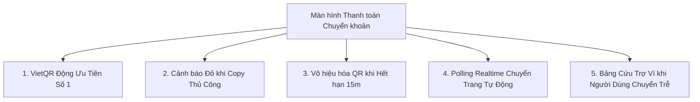

# HƯỚNG DẪN TÍCH HỢP SEPAY VIETQR ĐỘNG & BẢO VỆ DÒNG TIỀN PHÍA FRONTEND
## (FE SEPAY DYNAMIC VIETQR INTEGRATION & PAYMENT SAFETY UX GUIDE)

- **Dự án**: Sàn Thương Mại Điện Tử Đồ Cũ SecondLife (SEP490)
- **Áp dụng cho**: Frontend Web (React / Next.js) & Mobile App (Flutter / React Native)
- **Ngày lập**: 16/10/2026
- **Vấn đề cốt lõi**: Người dùng có thói quen chọn lại "Lịch sử chuyển tiền" hoặc danh bạ thụ hưởng cũ trên App Ngân hàng, dẫn đến việc chuyển nhầm nội dung (Mã `SCL` cũ của đơn hàng trước), khiến đơn hàng mới không được kích hoạt và bị quá hạn (Expired).

---

## I. BẢN CHẤT VẤN ĐỀ & RỦI RO NGHIỆP VỤ

### 1. Hành vi người dùng thực tế
- Người dùng Việt Nam khi thanh toán thường có thói quen:
  1. Mở App Ngân hàng (Vietcombank, MBBank, Techcombank, VPBank...).
  2. Không quét mã QR mà vào mục **Chuyển tiền** $\to$ Chọn tài khoản SecondLife đã lưu trong **"Danh bạ thụ hưởng"** hoặc **"Chuyển tiền cho người nhận gần đây"**.
  3. App ngân hàng tự động điền nội dung chuyển khoản cũ (ví dụ: `SCL123456` của đơn hàng hôm qua).
  4. Người dùng bấm chuyển khoản.

### 2. Hệ quả Backend xử lý (Bảo toàn tiền nhưng lệch luồng đơn hàng)
- Backend có cơ chế an toàn: **Tiền không bao giờ bị mất**.
- Tuy nhiên:
  - Mã cũ `SCL123456` thuộc về đơn hàng cũ đã đóng/hủy.
  - Backend **không thể** tự động gán số tiền đó cho đơn hàng mới (vì mã không khớp).
  - Backend sẽ kích hoạt cơ chế cứu trợ: **Chuyển toàn bộ số tiền đó vào Ví cá nhân (SecondLife Wallet) của người mua**.
  - Đơn hàng mới vẫn ở trạng thái `PENDING_PAYMENT` và sau **15 phút** sẽ bị hệ thống tự động hủy (`PAYMENT_EXPIRED`), hàng hóa của Seller bị trả lại kho.
- **Trải nghiệm tiêu cực cho người dùng**: Người mua thắc mắc *"Tôi đã trừ tiền ngân hàng rồi, tại sao đơn hàng lại bị hủy và tiền lại nằm trong ví?"*.

---

## II. BỘ QUY TẮC THIẾT KẾ UI/UX PHÍA FRONTEND ĐỂ TRIỆT TIÊU RỦI RO

Frontend cần áp dụng triệt để **5 chiến lược UI/UX** sau đây trên cả Web và Mobile:



---

### 1. Chiến lược 1: Ưu Tiên Tuyệt Đối Quét Mã VietQR Động (Dynamic VietQR First)
- **Lợi ích**: Khi quét mã VietQR sinh từ URL của SePay:
  `https://qr.sepay.vn/img?acc={STK}&bank={BANK}&amount={TIEN}&des={SCL_MOI}`
  App ngân hàng sẽ **tự động điền 100%**:
  - Đúng Số tài khoản.
  - Đúng Tên chủ tài khoản: `CONG TY TNHH SECONDLIFE`.
  - Đúng Số tiền cần thanh toán.
  - **Đúng Mã `SCL` duy nhất của đơn hàng hiện tại**. Người dùng không thể nhập sai.
- **Quy chuẩn hiển thị UI**:
  - Mã QR phải nằm ở vị trí **trung tâm, to rõ (kích thước tối thiểu 220x220px)**.
  - Trên Mobile App: Có nút **"Tải ảnh QR về máy"** (để người dùng mở App ngân hàng $\to$ Chọn ảnh từ thư viện để quét).
  - Có dòng chữ nổi bật ngay dưới QR:  
    👉 *"Mở App Ngân hàng và Quét mã QR để tự động điền đúng số tiền & nội dung."*

---

### 2. Chiến lược 2: Cảnh Báo Mạnh Khi Bấm Sao Chép Thủ Công (Anti-Stale Warning)
Nếu người dùng không quét QR mà bấm sao chép thông tin chuyển khoản:
- **Nút "Sao chép Nội dung Chuyển khoản"** phải được làm nổi bật nhất (Màu xanh / Đỏ viền).
- Khi người dùng bấm nút Sao chép (Copy):
  - Hiển thị Toast / SnackBar cảnh báo có icon chuông vàng:  
    `⚠️ Đã chép mã: SCLxxxxxx. Tuyệt đối KHÔNG dùng lại nội dung chuyển khoản cũ để tránh đơn hàng bị hủy!`
- Dưới ô hiển thị Nội dung chuyển khoản, luôn gắn một dòng thông báo màu cam:
  > **Lưu ý**: Mỗi đơn hàng có một mã thanh toán riêng biệt. Vui lòng dán chính xác mã này vào lời nhắn chuyển tiền của ngân hàng.

---

### 3. Chiến lược 3: Quản Lý Vòng Đời & Vô Hiệu Hóa Khi Hết Hạn 15 Phút
- Màn hình thanh toán nhận trường `expiresAt` từ API Backend:
  `POST /api/v1/orders/{orderId}/bank-transfer` hoặc `GET /api/v1/orders/{orderId}/payment`.
- **Đồng hồ đếm ngược (Countdown Timer)**:
  - Đếm lùi từ 15:00 về 00:00.
  - Khi thời gian còn dưới 3 phút: Đổi màu chữ Timer sang **Màu Đỏ nhấp nháy** để hối thúc người dùng.
- **Khi hết 15 phút (Timer về 00:00)**:
  - **Lập tức làm mờ (Blur) ảnh mã QR** và phủ lớp watermark: `MÃ THANH TOÁN ĐÃ HẾT HẠN`.
  - Disable toàn bộ các nút Copy.
  - Hiển thị hộp thoại Modal:  
    *"Đơn hàng đã hết thời hạn thanh toán (15 phút). Vui lòng không chuyển tiền vào mã này nữa. Bạn có thể bấm 'Đặt hàng lại' để tạo mã mới."*

---

### 4. Chiến lược 4: Polling Tự Động & Chuyển Trang Tức Thì (Zero-Refresh)
- Khi người dùng đang ở màn hình chuyển khoản:
  - Frontend thiết lập cơ chế Polling gọi `GET /api/v1/orders/{orderId}/payment` mỗi **3 giây/lần**.
  - Đồng thời lắng nghe Webhook / Firebase Push Notification (FCM).
- **Khi nhận được `status == "PAID"`**:
  - Lập tức dừng Timer.
  - Bật hoạt ảnh thành công (Lottie Animation pháo hoa / tích xanh).
  - Phát âm thanh "tinh tinh" nhẹ hoặc rung thiết bị (Haptic feedback).
  - Tự động chuyển hướng sau 1.5 giây sang màn hình **Chi Tiết Đơn Hàng Thành Công (`OrderSuccessScreen`)**.

---

### 5. Chiến lược 5: Hướng Dẫn Cứu Trợ Khi Tiền Lỡ Rơi Vào Ví (Wallet Fallback Banner)
Nếu người dùng chuyển tiền trễ (sau 15 phút) hoặc chuyển nhầm mã cũ:
- Backend tự động chuyển tiền vào ví người mua (`walletCreditedAmount > 0`).
- Khi FE gọi `GET /api/v1/orders/{orderId}/payment`, API sẽ trả về:
  ```json
  {
    "status": "EXPIRED",
    "orderStatus": "CANCELLED",
    "walletCreditedAmount": 1027000
  }
  ```
- **Xử lý UI phía Frontend**:
  - Nếu `walletCreditedAmount > 0` và đơn hàng bị `CANCELLED` / `EXPIRED`:
  - Hiển thị Banner màu xanh thông báo thông minh:
    ```
    🎉 Chúng tôi đã nhận được 1.027.000đ từ bạn!
    Tuy nhiên do giao dịch được thực hiện sau khi đơn hàng hết hạn, 
    toàn bộ số tiền đã được hoàn trả an toàn vào Ví SecondLife của bạn.
    [ Nút: Mua lại ngay bằng số dư Ví ]   [ Nút: Xem số dư Ví ]
    ```
  - Khi bấm *"Mua lại ngay bằng số dư Ví"*, FE tự động điều hướng sang trang Checkout với phương thức thanh toán mặc định là `WALLET` $\to$ Người dùng bấm thanh toán là xong ngay, không còn bức xúc!

---

## III. MÃ NGUỒN MẪU HOÀN CHỈNH CHO FRONTEND

### 1. Dành cho Frontend Web (React + Tailwind CSS + Lucide Icons)

```jsx
import React, { useState, useEffect } from 'react';
import { Copy, Check, Clock, AlertTriangle, ShieldCheck } from 'lucide-react';

export default function BankTransferPaymentScreen({ paymentData, onExpired, onSuccess }) {
  const [copiedField, setCopiedField] = useState(null);
  const [timeLeft, setTimeLeft] = useState(0);
  const [isExpired, setIsExpired] = useState(false);

  // 1. Tính toán Countdown Timer từ expiresAt của Backend
  useEffect(() => {
    const calculateTime = () => {
      const diff = Math.floor((new Date(paymentData.expiresAt).getTime() - new Date().getTime()) / 1000);
      if (diff <= 0) {
        setTimeLeft(0);
        setIsExpired(true);
        if (onExpired) onExpired();
      } else {
        setTimeLeft(diff);
      }
    };

    calculateTime();
    const timer = setInterval(calculateTime, 1000);
    return () => clearInterval(timer);
  }, [paymentData.expiresAt]);

  // 2. Polling trạng thái thanh toán mỗi 3 giây
  useEffect(() => {
    if (isExpired) return;
    const pollInterval = setInterval(async () => {
      try {
        const res = await fetch(`/api/v1/orders/${paymentData.orderId}/payment`, {
          headers: { Authorization: `Bearer ${localStorage.getItem('token')}` }
        });
        const json = await res.json();
        if (json.status === 'PAID') {
          clearInterval(pollInterval);
          onSuccess();
        }
      } catch (err) {
        console.error('Polling error', err);
      }
    }, 3000);

    return () => clearInterval(pollInterval);
  }, [paymentData.orderId, isExpired]);

  // 3. Hàm copy kèm cảnh báo
  const handleCopy = (text, fieldName) => {
    navigator.clipboard.writeText(text);
    setCopiedField(fieldName);
    setTimeout(() => setCopiedField(null), 2500);
  };

  const minutes = Math.floor(timeLeft / 60).toString().padLeft(2, '0');
  const seconds = (timeLeft % 60).toString().padLeft(2, '0');

  return (
    <div className="max-w-xl mx-auto p-6 bg-white rounded-2xl shadow-xl border border-gray-100">
      {/* Tiêu đề & Đồng hồ đếm ngược */}
      <div className="text-center mb-6">
        <h2 className="text-2xl font-bold text-gray-800">Thanh toán chuyển khoản VietQR</h2>
        <p className="text-sm text-gray-500 mt-1">Quét mã QR bằng App Ngân hàng bất kỳ (24/7 tức thì)</p>

        <div className={`inline-flex items-center gap-2 px-4 py-2 mt-3 rounded-full text-sm font-semibold ${
          isExpired ? 'bg-gray-100 text-gray-500' : timeLeft < 180 ? 'bg-red-50 text-red-600 animate-pulse' : 'bg-amber-50 text-amber-700'
        }`}>
          <Clock className="w-4 h-4" />
          <span>{isExpired ? 'Giao dịch đã hết hạn' : `Hết hạn sau: ${minutes}:${seconds}`}</span>
        </div>
      </div>

      {/* Ảnh VietQR động */}
      <div className="relative flex justify-center mb-6">
        <div className={`p-4 bg-white border-2 rounded-2xl shadow-sm ${isExpired ? 'border-gray-200 filter blur-sm' : 'border-blue-500'}`}>
          
        </div>

        {isExpired && (
          <div className="absolute inset-0 flex flex-col items-center justify-center bg-white/80 rounded-2xl">
            <AlertTriangle className="w-12 h-12 text-red-500 mb-2" />
            <p className="font-bold text-gray-800">MÃ ĐÃ HẾT HẠN</p>
            <p className="text-xs text-gray-500">Vui lòng không chuyển tiền vào mã này</p>
          </div>
        )}
      </div>

      {/* Khung cảnh báo chống dùng lại mã cũ */}
      <div className="p-4 mb-6 bg-blue-50/70 border border-blue-200 rounded-xl flex gap-3 text-sm text-blue-900">
        <ShieldCheck className="w-6 h-6 text-blue-600 flex-shrink-0" />
        <div>
          <p className="font-semibold">Mẹo thanh toán nhanh & chính xác 100%:</p>
          <p className="text-xs text-blue-700 mt-0.5">
            Mở App ngân hàng $\rightarrow$ Chọn <strong>Quét mã QR</strong>. Hệ thống sẽ tự động điền đúng số tiền và mã đơn hàng của bạn.
          </p>
        </div>
      </div>

      {/* Danh sách thông tin chuyển khoản có nút Copy */}
      <div className="space-y-3 bg-gray-50 p-4 rounded-xl border border-gray-100 text-sm">
        {/* Số tài khoản */}
        <div className="flex justify-between items-center">
          <span className="text-gray-500">Ngân hàng:</span>
          <span className="font-bold text-gray-800">{paymentData.bankName}</span>
        </div>

        <div className="flex justify-between items-center">
          <span className="text-gray-500">Chủ tài khoản:</span>
          <span className="font-semibold text-gray-800">{paymentData.bankAccountName}</span>
        </div>

        <div className="flex justify-between items-center pt-2 border-t border-gray-200">
          <span className="text-gray-500">Số tài khoản:</span>
          <div className="flex items-center gap-2">
            <span className="font-mono font-bold text-base text-gray-900">{paymentData.bankAccountNumber}</span>
            <button
              disabled={isExpired}
              onClick={() => handleCopy(paymentData.bankAccountNumber, 'acc')}
              className="p-1.5 text-blue-600 hover:bg-blue-100 rounded-lg transition"
            >
              {copiedField === 'acc' ? <Check className="w-4 h-4 text-green-600" /> : <Copy className="w-4 h-4" />}
            </button>
          </div>
        </div>

        {/* Số tiền */}
        <div className="flex justify-between items-center pt-2 border-t border-gray-200">
          <span className="text-gray-500">Số tiền:</span>
          <div className="flex items-center gap-2">
            <span className="font-mono font-bold text-base text-red-600">
              {Number(paymentData.amount).toLocaleString('vi-VN')} đ
            </span>
            <button
              disabled={isExpired}
              onClick={() => handleCopy(paymentData.amount.toString(), 'amount')}
              className="p-1.5 text-blue-600 hover:bg-blue-100 rounded-lg transition"
            >
              {copiedField === 'amount' ? <Check className="w-4 h-4 text-green-600" /> : <Copy className="w-4 h-4" />}
            </button>
          </div>
        </div>

        {/* NỘI DUNG CHUYỂN KHOẢN (RẤT QUAN TRỌNG) */}
        <div className="flex justify-between items-center pt-2 border-t-2 border-dashed border-red-200 bg-red-50/50 p-2.5 rounded-lg">
          <div>
            <span className="text-xs font-bold text-red-600 block">NỘI DUNG CHUYỂN TIỀN (BẮT BUỘC):</span>
            <span className="font-mono font-extrabold text-lg text-red-700 tracking-wider">
              {paymentData.transferContent}
            </span>
          </div>
          <button
            disabled={isExpired}
            onClick={() => handleCopy(paymentData.transferContent, 'content')}
            className="flex items-center gap-1 px-3 py-1.5 bg-red-600 text-white font-medium rounded-lg hover:bg-red-700 transition shadow-sm text-xs"
          >
            {copiedField === 'content' ? (
              <>
                <Check className="w-3.5 h-3.5" /> Đã sao chép
              </>
            ) : (
              <>
                <Copy className="w-3.5 h-3.5" /> Sao chép mã
              </>
            )}
          </button>
        </div>
      </div>

      {/* Cảnh báo tuyệt đối không dùng mã cũ */}
      <p className="text-[11px] text-red-500 text-center mt-3 font-medium">
        * Chú ý: Không chuyển theo nội dung cũ trong danh bạ ngân hàng để tránh đơn hàng bị hủy!
      </p>
    </div>
  );
}
```

---

### 2. Dành cho Mobile Flutter (Dart)

```dart
import 'dart:async';
import 'package:flutter/material.dart';
import 'package:flutter/services.dart';

class OrderBankPaymentScreen extends StatefulWidget {
  final Map<String, dynamic> paymentData;
  final VoidCallback onSuccess;

  const OrderBankPaymentScreen({
    Key? key,
    required this.paymentData,
    required this.onSuccess,
  }) : super(key: key);

  @override
  State<OrderBankPaymentScreen> createState() => _OrderBankPaymentScreenState();
}

class _OrderBankPaymentScreenState extends State<OrderBankPaymentScreen> {
  Timer? _countdownTimer;
  Timer? _pollingTimer;
  Duration _remaining = Duration.zero;
  bool _isExpired = false;

  @override
  void initState() {
    super.initState();
    _startCountdown();
    _startPolling();
  }

  void _startCountdown() {
    final expiresAt = DateTime.parse(widget.paymentData['expiresAt']);
    _countdownTimer = Timer.periodic(const Duration(seconds: 1), (timer) {
      final now = DateTime.now();
      final diff = expiresAt.difference(now);
      if (diff.isNegative) {
        timer.cancel();
        setState(() {
          _remaining = Duration.zero;
          _isExpired = true;
        });
      } else {
        setState(() => _remaining = diff);
      }
    });
  }

  void _startPolling() {
    _pollingTimer = Timer.periodic(const Duration(seconds: 3), (timer) async {
      if (_isExpired) {
        timer.cancel();
        return;
      }
      // Gọi API kiểm tra thanh toán
      // final res = await apiService.getPaymentStatus(widget.paymentData['orderId']);
      // if (res.status == 'PAID') {
      //   timer.cancel();
      //   widget.onSuccess();
      // }
    });
  }

  void _copyToClipboard(String text, String label) {
    Clipboard.setData(ClipboardData(text: text));
    ScaffoldMessenger.of(context).showSnackBar(
      SnackBar(
        content: Text('Đã sao chép $label. Vui lòng KHÔNG dùng lại nội dung cũ!'),
        backgroundColor: Colors.indigo,
        behavior: SnackBarBehavior.floating,
        duration: const Duration(seconds: 2),
      ),
    );
  }

  @override
  void dispose() {
    _countdownTimer?.cancel();
    _pollingTimer?.cancel();
    super.dispose();
  }

  @override
  Widget build(BuildContext context) {
    final minutes = _remaining.inMinutes.remainder(60).toString().padLeft(2, '0');
    final seconds = _remaining.inSeconds.remainder(60).toString().padLeft(2, '0');

    return Scaffold(
      appBar: AppBar(title: const Text('Thanh toán Chuyển khoản QR')),
      body: SingleChildScrollView(
        padding: const EdgeInsets.all(16.0),
        child: Column(
          children: [
            // Timer Card
            Container(
              padding: const EdgeInsets.symmetric(horizontal: 16, vertical: 10),
              decoration: BoxDecoration(
                color: _isExpired ? Colors.grey.shade100 : Colors.red.shade50,
                borderRadius: BorderRadius.circular(10),
                border: Border.all(color: _isExpired ? Colors.grey : Colors.red.shade200),
              ),
              child: Row(
                mainAxisAlignment: MainAxisAlignment.center,
                children: [
                  Icon(Icons.timer_outlined, color: _isExpired ? Colors.grey : Colors.red, size: 20),
                  const SizedBox(width: 8),
                  Text(
                    _isExpired ? 'Giao dịch đã hết hạn' : 'Hết hạn sau: $minutes:$seconds',
                    style: TextStyle(
                      fontWeight: FontWeight.bold,
                      color: _isExpired ? Colors.grey : Colors.red.shade700,
                    ),
                  ),
                ],
              ),
            ),
            const SizedBox(height: 16),

            // Ảnh VietQR
            Stack(
              alignment: Alignment.center,
              children: [
                Container(
                  padding: const EdgeInsets.all(12),
                  decoration: BoxDecoration(
                    color: Colors.white,
                    borderRadius: BorderRadius.circular(16),
                    border: Border.all(color: Colors.blue.shade300, width: 2),
                    boxShadow: [
                      BoxShadow(color: Colors.black.withOpacity(0.05), blurRadius: 10, offset: const Offset(0, 4)),
                    ],
                  ),
                  child: Image.network(
                    widget.paymentData['qrCodeUrl'],
                    width: 220,
                    height: 220,
                    fit: BoxFit.contain,
                  ),
                ),
                if (_isExpired)
                  Container(
                    width: 244,
                    height: 244,
                    decoration: BoxDecoration(
                      color: Colors.white.withOpacity(0.85),
                      borderRadius: BorderRadius.circular(16),
                    ),
                    child: const Center(
                      child: Text(
                        'MÃ ĐÃ HẾT HẠN\nVui lòng không chuyển tiền',
                        textAlign: TextAlign.center,
                        style: TextStyle(color: Colors.red, fontWeight: FontWeight.bold),
                      ),
                    ),
                  ),
              ],
            ),
            const SizedBox(height: 12),
            const Text(
              'Mở App Ngân hàng bất kỳ để Quét mã QR tự động điền nội dung',
              textAlign: TextAlign.center,
              style: TextStyle(fontSize: 12, color: Colors.blueGrey, fontWeight: FontWeight.w500),
            ),
            const SizedBox(height: 20),

            // Card chi tiết chuyển khoản thủ công
            Card(
              elevation: 0,
              color: Colors.grey.shade50,
              shape: RoundedRectangleBorder(
                borderRadius: BorderRadius.circular(12),
                side: BorderSide(color: Colors.grey.shade200),
              ),
              child: Padding(
                padding: const EdgeInsets.all(14.0),
                child: Column(
                  children: [
                    _buildRow('Ngân hàng', widget.paymentData['bankName']),
                    const Divider(height: 18),
                    _buildRow('Chủ tài khoản', widget.paymentData['bankAccountName']),
                    const Divider(height: 18),
                    _buildCopyRow('Số tài khoản', widget.paymentData['bankAccountNumber'], 'Số tài khoản'),
                    const Divider(height: 18),
                    _buildCopyRow('Số tiền', '${widget.paymentData['amount']} đ', 'Số tiền'),
                    const Divider(height: 18),

                    // Ô Nội dung chuyển khoản đặc biệt nổi bật
                    Container(
                      padding: const EdgeInsets.all(10),
                      decoration: BoxDecoration(
                        color: Colors.red.shade50,
                        borderRadius: BorderRadius.circular(8),
                        border: Border.all(color: Colors.red.shade200),
                      ),
                      child: Row(
                        children: [
                          Expanded(
                            child: Column(
                              crossAxisAlignment: CrossAxisAlignment.start,
                              children: [
                                const Text(
                                  'NỘI DUNG CHUYỂN TIỀN (BẮT BUỘC):',
                                  style: TextStyle(color: Colors.red, fontSize: 11, fontWeight: FontWeight.bold),
                                ),
                                const SizedBox(height: 2),
                                Text(
                                  widget.paymentData['transferContent'],
                                  style: const TextStyle(
                                    fontWeight: FontWeight.w900,
                                    fontSize: 18,
                                    color: Colors.red,
                                    letterSpacing: 1.2,
                                  ),
                                ),
                              ],
                            ),
                          ),
                          ElevatedButton.icon(
                            onPressed: _isExpired
                                ? null
                                : () => _copyToClipboard(widget.paymentData['transferContent'], 'Nội dung chuyển khoản'),
                            icon: const Icon(Icons.copy, size: 14),
                            label: const Text('Sao chép'),
                            style: ElevatedButton.styleFrom(
                              backgroundColor: Colors.red,
                              foregroundColor: Colors.white,
                              padding: const EdgeInsets.symmetric(horizontal: 10, vertical: 8),
                              textStyle: const TextStyle(fontSize: 12, fontWeight: FontWeight.bold),
                            ),
                          ),
                        ],
                      ),
                    ),
                  ],
                ),
              ),
            ),
            const SizedBox(height: 8),
            const Text(
              '* Chú ý: Không dùng lại nội dung cũ trong danh bạ ngân hàng để tránh đơn bị hủy!',
              textAlign: TextAlign.center,
              style: TextStyle(fontSize: 11, color: Colors.redAccent),
            ),
          ],
        ),
      ),
    );
  }

  Widget _buildRow(String label, String value) {
    return Row(
      mainAxisAlignment: MainAxisAlignment.spaceBetween,
      children: [
        Text(label, style: const TextStyle(color: Colors.black54, fontSize: 13)),
        Text(value, style: const TextStyle(fontWeight: FontWeight.bold, fontSize: 13)),
      ],
    );
  }

  Widget _buildCopyRow(String label, String value, String copyLabel) {
    return Row(
      mainAxisAlignment: MainAxisAlignment.spaceBetween,
      children: [
        Text(label, style: const TextStyle(color: Colors.black54, fontSize: 13)),
        Row(
          children: [
            Text(value, style: const TextStyle(fontWeight: FontWeight.bold, fontSize: 14)),
            IconButton(
              icon: const Icon(Icons.copy, size: 16, color: Colors.blue),
              constraints: const BoxConstraints(),
              padding: const EdgeInsets.only(left: 8),
              onPressed: _isExpired ? null : () => _copyToClipboard(value, copyLabel),
            ),
          ],
        ),
      ],
    );
  }
}
```

---

## IV. CHECKLIST NGHIỆM THU CHO ĐỘI NGŨ FRONTEND

- [ ] **Mã QR VietQR Động**:
  - [ ] Hiển thị hình ảnh mã QR được lấy trực tiếp từ `data.qrCodeUrl`.
  - [ ] Thử quét bằng App Ngân hàng thực tế: Xác nhận App ngân hàng tự điền đúng STK, Số tiền và Mã `SCL` duy nhất.
- [ ] **Đồng hồ đếm ngược 15 phút**:
  - [ ] Đếm lùi chính xác theo `data.expiresAt`.
  - [ ] Khi hết 15 phút: Mã QR tự động mờ đi và các nút Copy bị vô hiệu hóa, không để người dùng thao tác tiếp.
- [ ] **Sao chép nội dung chuyển khoản**:
  - [ ] Bấm sao chép nội dung chuyển khoản có hiển thị Toast/SnackBar cảnh báo người dùng không dùng lại mã cũ.
- [ ] **Tự động chuyển trang khi hoàn tất (Realtime)**:
  - [ ] Polling mỗi 3 giây; khi trạng thái đơn đổi thành `PAID`, giao diện tự động chuyển sang trang thành công mà không cần người dùng ấn F5.
- [ ] **Banner Cứu trợ Ví khi chuyển trễ / nhầm mã**:
  - [ ] Khi đơn hàng bị hủy nhưng `walletCreditedAmount > 0`, hiển thị Banner hướng dẫn người mua sử dụng tiền trong ví để bấm *"Mua lại ngay"*.
