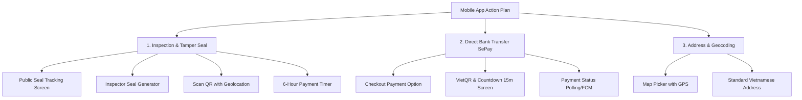

# KẾ HOẠCH HÀNH ĐỘNG NÂNG CẤP MOBILE APP (MOBILE APP ACTION PLAN)
## ĐỒNG BỘ CÁC TÍNH NĂNG MỚI: KIỂM ĐỊNH NÂNG CAO, CHUYỂN KHOẢN SEPAY VÀ GEOCODING

- **Dự án**: Sàn Thương Mại Điện Tử Đồ Cũ SecondLife (SEP490)
- **Đối tượng áp dụng**: Mobile Flutter Team (Buyer App, Seller App, Inspector App)
- **Nhánh Backend mục tiêu**: `dev` (Commit: `8ca8392`)
- **Ngày lập**: 16/10/2026
- **Trạng thái**: Sẵn sàng triển khai (Ready for Implementation)

---

## I. MỤC TIÊU VÀ PHẠM VI DỰ ÁN

Tài liệu này vạch ra lộ trình chi tiết từng bước, cấu trúc dữ liệu, giao diện người dùng và mã nguồn mẫu để đội ngũ Mobile App cập nhật ứng dụng di động theo các thay đổi mới nhất từ Backend:
1. **Module Kiểm định & Tem QR Niêm phong Số (Inspection & Tamper Seal)**:
   - Màn hình Tra cứu Tem QR công khai: Hiển thị ảnh sản phẩm đại diện (`productImageUrl`) và bản đồ lịch sử quét kèm tọa độ GPS (`latitude`, `longitude`).
   - Xử lý Rate Limiting: Bắt mã lỗi `429 Too Many Requests` và hiển thị cảnh báo thân thiện.
   - Lấy tọa độ Geolocation thiết bị khi quét mã QR chặng vận chuyển.
   - Ứng dụng Kỹ thuật viên (Inspector App): Sinh mã tem QR có Checksum SHA-256 (`SL-SEAL-{YYYYMMDD}-{6HEX}-{2HEX_CHECKSUM}`).
   - Cơ chế Đếm ngược 6 giờ thanh toán sau khi đơn kiểm định đạt (`PASSED`) và thông báo bồi thường tiền cọc cho Người bán.
   - Kéo dài thời hạn xem video kiểm định Cloudinary lên 14 ngày.
2. **Module Thanh toán Chuyển khoản Ngân hàng Trực tiếp (Direct Bank Transfer qua SePay)**:
   - Phương thức thanh toán mới `BANK_TRANSFER` trên màn hình Checkout.
   - Màn hình hướng dẫn quét mã VietQR/SePay, sao chép số tài khoản, đếm ngược 15 phút.
   - Tự động phát hiện thanh toán thành công qua WebSocket / FCM Notification.
3. **Module Chuẩn hóa Địa chỉ & Geocoding 3 Thành Phố**:
   - Chọn vị trí trên bản đồ, tự động tra cứu địa chỉ chuẩn hóa (Hà Nội, Đà Nẵng, TP.HCM).

---

## II. DANH MỤC CÁC HẠNG MỤC NÂNG CẤP CHI TIẾT



---

### PHẦN 1: MODULE KIỂM ĐỊNH & TEM NIÊM PHONG SỐ

#### 1.1. Màn hình Tra cứu Tem QR Công Khai (`PublicSealVerificationScreen`)
- **API**: `GET /api/v1/inspection/seal/{tamperSealId}` (Public, không cần Auth Token).
- **Điểm mới cần bổ sung trên UI**:
  - **Ảnh đại diện sản phẩm**: Render trường `data.productImageUrl` ở đầu màn hình (dùng `CachedNetworkImage` kèm placeholder khi tải).
  - **Lược đồ hành trình có bản đồ thu nhỏ**: Danh sách `scanLogs` có thêm `latitude` và `longitude`. Nếu có tọa độ, hiển thị icon ghim vị trí hoặc nhấn vào để mở bản đồ (Google Maps / Apple Maps).
  - **Xử lý Rate Limiting (Mã lỗi 429)**: Khi người dùng quét hoặc F5 liên tục quá 30 lần/phút, hiển thị SnackBar: *"Bạn đang thao tác quá nhanh. Vui lòng thử lại sau 1 phút."*

#### 1.2. Màn hình Quét Tem Chặng Vận Chuyển (`ScanSealTrackingScreen`)
- **API**: `POST /api/v1/inspection/seal/scan`
- **Tích hợp phần cứng**:
  - Sử dụng package `geolocator` hoặc `location` để xin quyền vị trí (`LocationPermission`).
  - Khi camera quét được chuỗi `tamperSealId`, tự động lấy tọa độ hiện tại `Position` (nếu người dùng cấp quyền) và truyền vào body:
    ```json
    {
      "tamperSealId": "SL-SEAL-20261016-D4E5F6-3A",
      "stage": "SELLER_TO_CENTER", 
      "notes": "Đã tiếp nhận hàng từ người bán",
      "latitude": 10.776889,
      "longitude": 106.700806
    }
    ```
  - Nếu người dùng từ chối quyền định vị, vẫn cho phép gửi request mà không có `latitude`/`longitude`.

#### 1.3. Ứng dụng Kỹ Thuật Viên (Inspector App) - Sinh Tem & Nộp Kết Quả
- **API Sinh Tem**: `POST /api/v1/inspector/orders/{orderId}/generate-seal`
  - Thêm nút **"Tạo tem QR niêm phong"** tại màn hình chi tiết đơn kiểm định của KTV.
  - Khi bấm, gọi API nhận về mã tem dạng: `SL-SEAL-20261016-A1B2C3-9F`.
  - Hiển thị Popup mã QR (dùng widget `QrImageView` từ package `qr_flutter`) kèm nút **"In tem"** hoặc **"Sao chép mã"**.
- **API Nộp Biên Bản**: `POST /api/v1/inspector/orders/{orderId}/submit-report`
  - Tự động điền mã tem vừa tạo vào trường `tamperSealId` trong form nộp kết quả.
  - Nếu sản phẩm `PASSED`, Backend sẽ tự động kiểm tra Checksum của mã tem này.

#### 1.4. Đếm Ngược 6 Giờ Thanh Toán & Cảnh Báo Mất Cọc (Buyer App & Seller App)
- **Màn hình Chi tiết Đơn hàng (Buyer)**:
  - Khi đơn kiểm định chuyển sang `PASSED` và chờ người mua trả nốt tiền hàng (`PENDING_FINAL_PAYMENT`), hiển thị đồng hồ đếm ngược 6 tiếng.
  - Hiển thị thông báo cảnh báo: *"Vui lòng thanh toán số tiền còn lại trước [Thời gian]. Quá thời hạn này, đơn hàng sẽ tự động hủy và tiền cọc kiểm định của bạn sẽ được chuyển cho Người bán để đền bù."*
- **Màn hình Chi tiết Đơn hàng (Seller)**:
  - Nếu hết hạn 6 tiếng, hiển thị trạng thái: *"Đơn hàng đã hủy do Người mua quá hạn thanh toán. Tiền cọc [Số tiền] đã được bồi hoàn vào ví của bạn."*

---

### PHẦN 2: MODULE THANH TOÁN CHUYỂN KHOẢN TRỰC TIẾP (SEPAY BANK TRANSFER)

#### 2.1. Màn hình Chọn Phương Thức Thanh Toán (Checkout Screen)
- Bổ sung tùy chọn `OrderPaymentMethod.BANK_TRANSFER`:
  - Icon: Ngân hàng / Chuyển khoản QR 24/7.
  - Tiêu đề: *"Chuyển khoản ngân hàng (Quét mã VietQR qua SePay)"*.
  - Phụ đề: *"Xác nhận thanh toán tức thì trong 15 phút, không mất phí giao dịch"*.

#### 2.2. Màn hình Chi Tiết Thanh Toán Chuyển Khoản (`OrderBankTransferScreen`)
- **API Khởi tạo**: `POST /api/v1/orders/{orderId}/bank-transfer`
- **Response DTO**:
  ```json
  {
    "code": 200,
    "message": "Khởi tạo thanh toán chuyển khoản thành công",
    "data": {
      "orderId": "651a9985-714e-4f30-863a-2df28362629b",
      "bankAccountName": "CONG TY TNHH SECONDLIFE",
      "bankAccountNumber": "0388888888",
      "bankName": "MBBank",
      "amount": 2500000,
      "transferContent": "SL651A9985",
      "qrCodeUrl": "https://qr.sepay.vn/img?acc=0388888888&bank=MBBank&amount=2500000&des=SL651A9985",
      "expiresAt": "2026-10-16T08:22:00Z"
    }
  }
  ```
- **Các thành phần giao diện bắt buộc**:
  1. **Hình ảnh VietQR**: Render từ `qrCodeUrl` cho phép người dùng mở ứng dụng ngân hàng quét trực tiếp hoặc chụp màn hình.
  2. **Nút "Lưu ảnh QR vào thư viện"**: Tải ảnh QR về máy (`image_gallery_saver`).
  3. **Thông tin chuyển khoản có nút Copy 1-chạm**:
     - Số tài khoản + Nút sao chép.
     - Tên chủ tài khoản: `CONG TY TNHH SECONDLIFE`.
     - Số tiền + Nút sao chép.
     - **Nội dung chuyển khoản (Bắt buộc chính xác)** + Nút sao chép nổi bật.
  4. **Đồng hồ đếm ngược 15 phút**:
     - Đếm lùi về 0:00. Khi hết giờ, hiển thị thông báo đơn hàng hết hạn và chuyển về màn hình danh sách đơn.
  5. **Lắng nghe kết quả thanh toán**:
     - Lắng nghe qua Firebase Cloud Messaging (FCM Topic / Token).
     - Kết hợp Polling mỗi 5 giây gọi `GET /api/v1/orders/{orderId}` để kiểm tra trạng thái đơn (`ESCROWED` hoặc `PAID`).
     - Khi thành công: Bật Popup Lottie hoạt ảnh chúc mừng $\rightarrow$ Chuyển sang màn hình `OrderSuccessScreen`.

---

### PHẦN 3: MODULE CHUẨN HÓA ĐỊA CHỈ & GEOCODING BẢN ĐỒ

#### 3.1. Màn hình Chọn Địa Chỉ Trên Bản đồ (`AddressMapPickerScreen`)
- Tích hợp `google_maps_flutter` hoặc `flutter_map`.
- Cho phép người dùng ghim vị trí hoặc bấm *"Lấy vị trí hiện tại của tôi"*.
- Gửi tọa độ `latitude`, `longitude` lên API Reverse Geocoding của Backend để nhận về địa chỉ chuẩn hóa tiếng Việt (đã chuẩn hóa các phường mới sáp nhập tại Hà Nội, Đà Nẵng, TP.HCM).

---

## III. KẾ HOẠCH TRIỂN KHAI THEO GIAI ĐOẠN (SPRINT PHASES)

```
Tuần 1: Models & DTOs  ──>  Thanh toán Chuyển khoản SePay  ──>  Đếm ngược 15m
Tuần 2: Tem QR Checksum ──>  Inspector App Sinh Tem     ──>  GPS Scan Logs
Tuần 3: Đếm ngược 6h    ──>  Bản đồ Geocoding          ──>  Test E2E & Release
```

### Phase 1: Models, DTOs & Màn hình Thanh toán SePay (3 ngày)
- [ ] Cập nhật enum `OrderPaymentMethod.BANK_TRANSFER` và `EscrowStatus.AWAITING_BANK_TRANSFER`.
- [ ] Tạo model `OrderBankPaymentResponse.dart` và service gọi API `POST /orders/{id}/bank-transfer`.
- [ ] Thiết kế màn hình `OrderBankTransferScreen` với VietQR, nút sao chép và Timer đếm ngược 15 phút.
- [ ] Viết logic Polling và đón push notification khi thanh toán thành công.

### Phase 2: Nâng cấp Tem Niêm Phong & Tra Cứu (3 ngày)
- [ ] Cập nhật `InspectionSealVerificationResponse.dart` thêm `productImageUrl`, `latitude`, `longitude`.
- [ ] Cập nhật màn hình `PublicSealVerificationScreen` hiển thị ảnh sản phẩm và trạm quét bản đồ.
- [ ] Thêm xử lý lỗi HTTP `429` (Rate Limiting) trên Interceptor của Dio/Http.
- [ ] Thêm tính năng xin quyền Geolocation và truyền tọa độ vào `POST /inspection/seal/scan`.

### Phase 3: Nâng cấp Inspector App & Luồng Escrow 6 Giờ (2 ngày)
- [ ] Thêm nút và Popup "Sinh mã tem QR niêm phong" trong ứng dụng Inspector.
- [ ] Cập nhật form nộp kết quả kiểm định (`submit-report`).
- [ ] Màn hình chi tiết đơn hàng: Bổ sung Timer 6 giờ thanh toán nốt sau khi kiểm định `PASSED`.
- [ ] Màn hình chi tiết đơn hàng: Hiển thị thông báo bồi thường tiền cọc cho Người bán khi đơn bị hủy.
- [ ] Nâng thời hạn xem video Cloudinary thành 14 ngày.

### Phase 4: Kiểm thử Tích hợp & Nghiệm thu Toàn diện (2 ngày)
- [ ] Kiểm thử E2E trên cả Android Emulator và iOS Simulator.
- [ ] Kiểm thử ngắt kết nối mạng, từ chối quyền vị trí GPS, hết hạn đếm ngược 15 phút / 6 giờ.
- [ ] Build file APK / TestFlight gửi QA nghiệm thu.

---

## IV. MÃ NGUỒN THAM KHẢO CHO MOBILE FLUTTER (DART)

### 1. Model `OrderBankPaymentResponse.dart`
```dart
class OrderBankPaymentResponse {
  final String orderId;
  final String bankAccountName;
  final String bankAccountNumber;
  final String bankName;
  final double amount;
  final String transferContent;
  final String qrCodeUrl;
  final DateTime expiresAt;

  OrderBankPaymentResponse({
    required this.orderId,
    required this.bankAccountName,
    required this.bankAccountNumber,
    required this.bankName,
    required this.amount,
    required this.transferContent,
    required this.qrCodeUrl,
    required this.expiresAt,
  });

  factory OrderBankPaymentResponse.fromJson(Map<String, dynamic> json) {
    return OrderBankPaymentResponse(
      orderId: json['orderId'] ?? '',
      bankAccountName: json['bankAccountName'] ?? '',
      bankAccountNumber: json['bankAccountNumber'] ?? '',
      bankName: json['bankName'] ?? '',
      amount: (json['amount'] as num?)?.toDouble() ?? 0.0,
      transferContent: json['transferContent'] ?? '',
      qrCodeUrl: json['qrCodeUrl'] ?? '',
      expiresAt: DateTime.parse(json['expiresAt'] ?? DateTime.now().toIso8601String()),
    );
  }
}
```

### 2. Hàm Quét Tem QR kèm Tọa độ GPS (`InspectionScanService.dart`)
```dart
import 'package:geolocator/geolocator.dart';
import 'package:http/http.dart' as http;
import 'dart:convert';

class InspectionScanService {
  final String baseUrl;
  InspectionScanService(this.baseUrl);

  Future<bool> scanTamperSeal({
    required String tamperSealId,
    required String stage,
    String? notes,
  }) async {
    double? latitude;
    double? longitude;

    // Lấy tọa độ GPS nếu được người dùng cho phép
    try {
      LocationPermission permission = await Geolocator.checkPermission();
      if (permission == LocationPermission.denied) {
        permission = await Geolocator.requestPermission();
      }
      if (permission == LocationPermission.always || permission == LocationPermission.whileInUse) {
        Position position = await Geolocator.getCurrentPosition(
          desiredAccuracy: LocationAccuracy.medium,
          timeLimit: const Duration(seconds: 4),
        );
        latitude = position.latitude;
        longitude = position.longitude;
      }
    } catch (e) {
      // Bỏ qua lỗi định vị, vẫn tiếp tục gửi request
    }

    final response = await http.post(
      Uri.parse('$baseUrl/api/v1/inspection/seal/scan'),
      headers: {'Content-Type': 'application/json'},
      body: jsonEncode({
        'tamperSealId': tamperSealId,
        'stage': stage,
        'notes': notes ?? '',
        if (latitude != null) 'latitude': latitude,
        if (longitude != null) 'longitude': longitude,
      }),
    );

    return response.statusCode == 200;
  }
}
```

### 3. Widget Đếm Ngược 15 Phút Thanh Toán (`CountdownTimerWidget.dart`)
```dart
import 'dart:async';
import 'package:flutter/material.dart';

class CountdownTimerWidget extends StatefulWidget {
  final DateTime expiresAt;
  final VoidCallback onExpired;

  const CountdownTimerWidget({
    Key? key,
    required this.expiresAt,
    required this.onExpired,
  }) : super(key: key);

  @override
  State<CountdownTimerWidget> createState() => _CountdownTimerWidgetState();
}

class _CountdownTimerWidgetState extends State<CountdownTimerWidget> {
  late Timer _timer;
  Duration _remaining = Duration.zero;

  @override
  void initState() {
    super.initState();
    _calculateRemaining();
    _timer = Timer.periodic(const Duration(seconds: 1), (_) => _calculateRemaining());
  }

  void _calculateRemaining() {
    final now = DateTime.now();
    final difference = widget.expiresAt.difference(now);
    if (difference.isNegative) {
      _timer.cancel();
      widget.onExpired();
      setState(() => _remaining = Duration.zero);
    } else {
      setState(() => _remaining = difference);
    }
  }

  @override
  void dispose() {
    _timer.cancel();
    super.dispose();
  }

  @override
  Widget build(BuildContext context) {
    final minutes = _remaining.inMinutes.remainder(60).toString().padLeft(2, '0');
    final seconds = _remaining.inSeconds.remainder(60).toString().padLeft(2, '0');
    return Container(
      padding: const EdgeInsets.symmetric(horizontal: 16, vertical: 8),
      decoration: BoxDecoration(
        color: Colors.red.shade50,
        borderRadius: BorderRadius.circular(8),
        border: Border.all(color: Colors.red.shade200),
      ),
      child: Row(
        mainAxisSize: MainAxisSize.min,
        children: [
          const Icon(Icons.timer_outlined, color: Colors.red, size: 20),
          const SizedBox(width: 8),
          Text(
            'Hết hạn sau: $minutes:$seconds',
            style: const TextStyle(color: Colors.red, fontWeight: FontWeight.bold, fontSize: 16),
          ),
        ],
      ),
    );
  }
}
```

---

## V. TIÊU CHÍ NGHIỆM THU (ACCEPTANCE CRITERIA)

| Mã | Tiêu Chí Kiểm Tra | Kết Quả Mong Đợi |
| :--- | :--- | :--- |
| **AC-01** | Quét QR Tra cứu Tem (`/seal/:id`) | Hiển thị hình ảnh sản phẩm chính xác, danh sách trạm quét hiển thị tọa độ GPS. |
| **AC-02** | Spam gọi API Tra cứu Tem | Sau 30 lần trong 1 phút, nhận status 429 và hiển thị SnackBar cảnh báo thân thiện. |
| **AC-03** | Quét tem chặng vận chuyển | Hệ thống xin quyền vị trí và gửi kèm `latitude`, `longitude` lên backend. |
| **AC-04** | KTV Sinh mã tem niêm phong | KTV bấm nút sinh mã nhận được chuỗi định dạng `SL-SEAL-{YYYYMMDD}-{6HEX}-{2HEX}` và hiển thị mã QR để in. |
| **AC-05** | Thanh toán SePay Bank Transfer | Màn hình hiển thị đầy đủ ảnh VietQR, nút sao chép STK/Nội dung, đồng hồ 15 phút đếm lùi chính xác. |
| **AC-06** | Hoàn tất chuyển khoản SePay | App tự động chuyển sang trang thành công ngay khi SePay webhook kích hoạt mà không cần người dùng thao tác lại. |
| **AC-07** | Đếm ngược 6 giờ thanh toán sau khi Đạt | Buyer thấy đồng hồ 6 giờ; nếu quá hạn, đơn bị hủy và Seller nhận thông báo bồi thường tiền cọc vào ví. |
